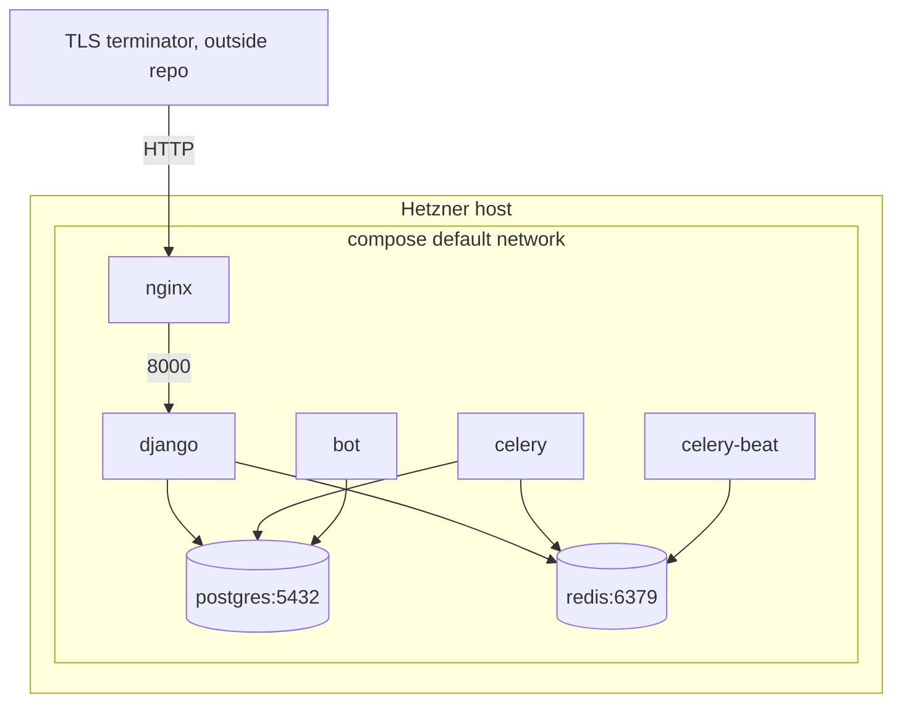

# Spec: Infrastructure

Status: Current-state (reverse-engineered from code, 2026-11-11) · Owner: @armanhm · Wiki: [Deployment and Operations](../wiki/Deployment-and-Operations.md), [Testing and CI](../wiki/Testing-and-CI.md)

## 1. Purpose & scope

The runtime topology, container contract, environment contract, CI and deploy contract, and data-protection (backup) targets for Lingaru.

| In scope | Out of scope |
|---|---|
| `docker-compose.yml`, `docker-compose.dev.yml`, `backend/Dockerfile`, `nginx/Dockerfile`, `nginx/nginx.conf` | Host OS provisioning, firewall and SSH configuration (not in repo) |
| `.github/workflows/*.yml`, `.github/dependabot.yml` | TLS termination in front of nginx (not in repo) |
| `scripts/backup_db.sh`, `scripts/restore_db.sh` | Application behaviour of individual apps (see the per-domain specs) |
| `backend/config/settings/*.py` environment reads, `/api/health/` | Third-party provider SLAs (Gemini, Groq, Telegram, Sentry) |

## 2. Requirements

| ID | Requirement (current behaviour) |
|---|---|
| FR-1 | The production stack is defined by `docker-compose.yml` alone and starts with `docker compose up -d --build` from the repo root. |
| FR-2 | nginx is the only service that publishes a host port: container `80` to host `${LINGARU_HTTP_PORT:-80}`. |
| FR-3 | All backend services (`django`, `celery`, `celery-beat`, `bot`) build from `backend/Dockerfile`, read `.env`, and run with `DJANGO_SETTINGS_MODULE=config.settings.prod`. |
| FR-4 | Backend services start only after `postgres` and `redis` report healthy. |
| FR-5 | `django` applies migrations and runs `collectstatic` before starting gunicorn on `0.0.0.0:8000` with 3 workers. |
| FR-6 | nginx serves the Vite build at `/`, with SPA fallback to `index.html`; proxies `/api/` and `/admin/` to `django:8000`; serves `/static/` and `/media/` from shared volumes read-only. |
| FR-7 | nginx rejects request bodies larger than 10 MB. |
| FR-8 | `GET /api/health/` returns `200 {"status":"ok","db":"ok"}` when `SELECT 1` succeeds, and `503 {"status":"error",...}` otherwise. |
| FR-9 | CI (`ci.yml`) runs on every push and PR to `main` and `dev`; lint, Django checks, migration drift check, pytest, and frontend build must pass. |
| FR-10 | A successful CI run on `main` triggers `deploy.yml`, which updates the server checkout to `origin/main`, rebuilds, migrates, smoke-tests `/api/health/` and, on failure, resets to the previously deployed SHA and rebuilds. |
| FR-11 | Deploys are serialised (`concurrency: deploy-prod`, no cancellation). |
| FR-12 | `scripts/backup_db.sh` produces a gzipped plain-SQL dump of the `lingaru` database and prunes dumps older than `RETENTION_DAYS` (default 14). It is scheduled by user cron, outside the repo. |
| FR-13 | `scripts/restore_db.sh <file>` restores such a dump into the running `postgres` container after interactive confirmation. |
| FR-14 | Sentry is initialised in the backend only when `SENTRY_DSN` is non-empty, with `send_default_pii=False`. |
| FR-15 | Dependabot opens update PRs for pip, npm, GitHub Actions and the backend Dockerfile base image. |

## 3. Data model (persistent state)

| Volume | Mounted in | Path | Contents | Backed up |
|---|---|---|---|---|
| `postgres_data` | postgres | `/var/lib/postgresql/data` | All relational data | Yes, via `pg_dump` (same host) |
| `redis_data` | redis | `/data` | Celery broker and results, Django cache | No (rebuildable) |
| `media_files` | django (rw), nginx (ro) | `/app/media` | `MEDIA_ROOT`: generated audio and stored files | No |
| `static_files` | django (rw), nginx (ro) | `/app/staticfiles` | `collectstatic` output | No (rebuildable) |

Image-baked data: `data/` is copied to `/data` (seed JSON and CSV). The frontend build is baked into the nginx image at `/usr/share/nginx/html`.

## 4. API contract

### 4.1 Topology

### 4.2 Services

| Service | Base | Entrypoint / command | Internal port | Published | Depends on | Restart |
|---|---|---|---|---|---|---|
| postgres | `postgres:16-alpine` | default | 5432 | no | | none |
| redis | `redis:7-alpine` | default | 6379 | no | | none |
| django | `python:3.12-slim` | `migrate && collectstatic --noinput && gunicorn config.wsgi:application --bind 0.0.0.0:8000 --workers 3` | 8000 | no | postgres, redis (healthy) | none |
| celery | same image | `celery -A config worker -l info` | | no | postgres, redis (healthy) | none |
| celery-beat | same image | `celery -A config beat -l info` | | no | postgres, redis (healthy) | none |
| bot | same image | `python manage.py run_bot` (Telegram long polling) | | no | postgres, redis (healthy) | `unless-stopped` |
| nginx | `nginx:alpine` (+ `node:20-alpine` build stage) | default | 80 | `${LINGARU_HTTP_PORT:-80}` | django | none |

Dev override (`docker-compose.dev.yml`) publishes postgres `5433:5432`, redis `6379:6379`, django `8000:8000` (runserver), nginx `80:80`, and bind-mounts `./backend:/app`.

### 4.3 HTTP routing (nginx)

| Path prefix | Upstream | Headers set |
|---|---|---|
| `/` | static `/usr/share/nginx/html`, fallback `/index.html` | |
| `/api/` | `http://django:8000` | `Host $host`, `X-Real-IP`, `X-Forwarded-For`, `X-Forwarded-Proto $scheme` |
| `/admin/` | `http://django:8000` | same |
| `/static/` | `/app/staticfiles/` | |
| `/media/` | `/app/media/` | |

### 4.4 Health endpoint

| Method | Path | Auth | 200 | 503 |
|---|---|---|---|---|
| GET | `/api/health/` | none | `{"status":"ok","db":"ok"}` | `{"status":"error", ...}` |

### 4.5 Environment contract

Read from `.env` (python-decouple `config()` in `base.py`; `os.environ` in `prod.py`).

| Variable | Required in prod | Consumer | Notes |
|---|---|---|---|
| `DJANGO_SECRET_KEY` | yes | Django, SimpleJWT signing | Unique, at least 50 random chars |
| `DEBUG` | no | base | Overridden to `False` by `prod.py` |
| `ALLOWED_HOSTS` | yes | base | CSV |
| `CSRF_TRUSTED_ORIGINS` | yes, for admin | prod | CSV of `scheme://host[:port]` |
| `SESSION_COOKIE_SECURE`, `CSRF_COOKIE_SECURE` | yes (`True` under HTTPS) | prod | Default `False` |
| `CORS_ALLOWED_ORIGINS` | no | base | CSV |
| `DB_NAME`, `DB_USER`, `DB_PASSWORD`, `DB_HOST`, `DB_PORT` | yes | base, postgres container | `DB_HOST=postgres` |
| `REDIS_URL` | yes | cache | |
| `CELERY_BROKER_URL`, `CELERY_RESULT_BACKEND` | no | Celery | Default to `REDIS_URL` |
| `GEMINI_API_KEY`, `GEMINI_MODEL`, `GEMINI_EMBEDDING_MODEL` | yes, for AI | services/llm, services/rag | Model defaults in `base.py` |
| `GROQ_API_KEY`, `GROQ_MODEL` | yes, for AI and STT | services/llm, services/stt | |
| `TELEGRAM_BOT_TOKEN` | yes, for bot | apps/bot | Bot raises at startup if empty |
| `LINGARU_MEMORY_ENABLED` | no | assistant | Default `False` |
| `SENTRY_DSN`, `SENTRY_ENVIRONMENT`, `SENTRY_TRACES_SAMPLE_RATE`, `SENTRY_RELEASE` | no | prod | |
| `LINGARU_HTTP_PORT` | no | compose | Default `80` |
| `VITE_API_URL`, `VITE_SENTRY_*` | no | frontend build | Build-time only |

### 4.6 Deploy contract

Inputs (GitHub secrets): `HETZNER_SSH_KEY`, `HETZNER_HOST`, `HETZNER_USER`, `HETZNER_DEPLOY_PATH`, optional `HEALTH_URL`.

| Phase | Command (remote unless noted) | Failure handling |
|---|---|---|
| Record | `git rev-parse HEAD` saved as `PREV` | job fails, no rollback (no PREV) |
| Update | `git fetch origin main && git reset --hard origin/main && docker compose up -d --build` | rollback |
| Migrate | `docker compose exec -T django python manage.py migrate --noinput` | rollback |
| Verify (runner) | `curl` health URL, 5 attempts, 10s apart, expects `"status": "ok"` | rollback |
| Rollback | `git reset --hard $PREV && docker compose up -d --build`, one health probe | job marked failed either way |

Invariants:
- The server checkout tracks `origin/main` exactly; local changes on the server are discarded.
- Rollback restores code and images only; the database schema stays at the newest applied migration.
- Migrations must therefore be backward compatible with the previous release (expand/contract).

### 4.7 CI contract

| Check | Command | Gate |
|---|---|---|
| Python lint | `ruff check .`, `ruff format --check .` | blocking |
| Django system check | `python manage.py check` | blocking |
| Migration drift | `python manage.py makemigrations --check --dry-run` | blocking |
| Tests | `pytest --cov=apps --cov=services` (collects `testpaths = apps`) | blocking |
| JS lint | `npm run lint` | blocking |
| JS build | `npm run build` | blocking |
| Image scan | Trivy on built backend image, CRITICAL/HIGH, fixable only | advisory |
| Lighthouse | `lhci autorun` (PR) | advisory (accessibility < 0.85 errors inside the step, but the step is `\|\| true`) |
| Visual regression | Playwright screenshots (PR) | blocking for the PR check |

## 5. Business rules & invariants

| Rule | Value |
|---|---|
| Max request body (nginx) | 10 MB |
| gunicorn | 3 sync workers, default 30s timeout |
| Postgres healthcheck | `pg_isready -U ${DB_USER}` every 5s, 5 retries |
| Redis healthcheck | `redis-cli ping` every 5s, 5 retries |
| Backup schedule (documented) | Daily 03:00 server time via cron |
| Backup retention | 14 days (`RETENTION_DAYS`) |
| Backup format | `pg_dump --no-owner --clean --if-exists`, gzip, `lingaru-<UTC YYYYMMDD-HHMMSS>.sql.gz` |

### Recovery objectives

| Objective | Current (as implemented) | Target |
|---|---|---|
| RPO, database | Up to 24h, if the cron job is installed; lost entirely if the host is lost | Target: 24h with an off-host copy; 1h once WAL archiving or more frequent dumps exist |
| RPO, media files | Not backed up | Target: 24h, off-host |
| RTO, bad deploy (code) | ~5 min (automatic rollback rebuild) | Target: < 5 min via pre-built tagged images |
| RTO, bad migration | Manual; depends on reversibility; restore from last nightly dump | Target: < 30 min via pre-deploy dump and documented restore |
| RTO, host loss | Undefined (rebuild host, no off-host data) | Target: < 4h from off-host backups onto a fresh server |
| Restore verification | None | Target: quarterly restore drill into a scratch container |
| Backup monitoring | `backup.log` on host only | Target: success ping to an external monitor; alert on miss |

## 6. Background jobs

| Job | Where | Schedule |
|---|---|---|
| `discover.generate_daily_feed` | celery-beat, then celery | every 86400s |
| `discover.fetch_real_news_pipeline` (`max_total=10`) | celery-beat, then celery | 07:00 and 19:00 UTC |
| `documents.process_document` | celery, on upload | on demand |
| `exam_prep.grade_response` | celery, on EE/EO submit | on demand |
| `content.process_video_lesson` | celery, on staff video attach | on demand |
| Postgres backup | host cron, `scripts/backup_db.sh` | daily 03:00 (documented) |

## 7. Dependencies

| Kind | Dependency |
|---|---|
| Runtime images | `python:3.12-slim`, `postgres:16-alpine`, `redis:7-alpine`, `nginx:alpine`, `node:20-alpine` (build) |
| Python | Django 5.1.x, DRF 3.15, SimpleJWT 5.3, django-cors-headers, psycopg2-binary, redis, celery 5.4, gunicorn 22, python-decouple, python-telegram-bot 21, google-genai, groq, gTTS, PyPDF2, youtube-transcript-api, Pillow 10.4.0, feedparser, sentry-sdk (see `backend/requirements.txt`) |
| Frontend | React 18, react-router 6, axios, react-markdown 10, i18next, @sentry/react 10, Vite 5, Tailwind 3 |
| External services | Gemini API, Groq API, Google TTS (gTTS), Telegram Bot API, Sentry, RSS feeds (`apps/discover/sources.py`) |
| CI | GitHub Actions: checkout, setup-python, setup-node, upload-artifact, `aquasecurity/trivy-action`, `MishaKav/pytest-coverage-comment`, `@lhci/cli`, Playwright |
| Hosting | One Hetzner server, Docker Engine and compose plugin, user cron |

## 8. Deviations / open questions

| # | Deviation or question |
|---|---|
| D-1 | Migrations run twice per deploy (container command and an explicit step), and workers start with new code before migrations complete. |
| D-2 | Rollback is code-only; no pre-deploy database dump is taken. |
| D-3 | Only `bot` has a restart policy; other services do not come back after a host reboot. |
| D-4 | Backups cover Postgres only and stay on the same host; there is no restore test. |
| D-5 | The backup and restore scripts hardcode database and role `lingaru` rather than reading `DB_NAME` / `DB_USER`. |
| D-6 | No compose-level log rotation, resource limits, or healthchecks for app containers. |
| D-7 | Images are built on the production host; nothing is published to a registry. |
| D-8 | `VITE_SENTRY_*` is not supplied to the nginx image build, so frontend Sentry is off in production. `SENTRY_RELEASE` is not stamped by the deploy. |
| D-9 | `testpaths = apps` excludes `services/*/tests` from CI. Tests run on SQLite, not Postgres. |
| D-10 | No `LOGGING` setting; production emits only WARNING+ app logs to stderr. |
| D-11 | `config/celery.py` and `config/wsgi.py` default `DJANGO_SETTINGS_MODULE` to `config.settings.dev`; production relies on compose setting it. |
| D-12 | Django 5.1 is past its upstream support window; the pinned range (`<5.2`) blocks upgrades. |
| D-13 | Dependabot's docker ecosystem covers `/backend` only; Node 20 (build stage) is past end of life. |
| D-14 | `frontend/Dockerfile` is unused. |
| D-15 | `backend/celerybeat-schedule` (local Beat state) is not listed in `.gitignore`. |
| Q-1 | Where is TLS terminated, and what forwarded headers does that layer pass to nginx? |
| Q-2 | Is the backup cron installed on the server, and where are copies kept? |
