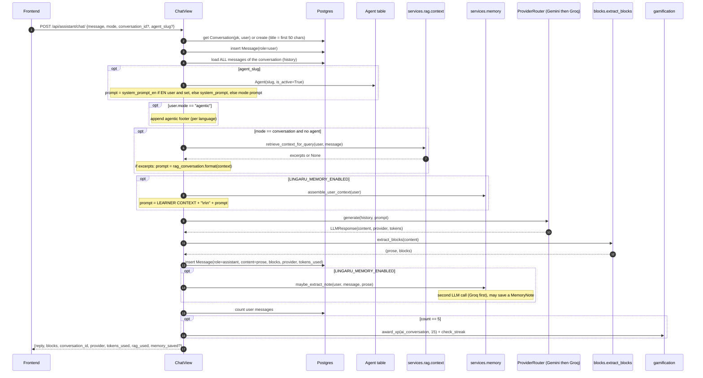

# AI Assistant

> The conversational tutor at `/assistant` (and on each agent's run page). Learners chat by text, voice or image. Each turn can be shaped by a mode (conversation, grammar, roleplay), a specialised agent, the learner's own documents (RAG), and a learner-memory block. Replies can carry structured cards and inline widgets.

**Code:** `backend/apps/assistant/` · **Spec:** [specs/assistant.md](../specs/assistant.md)

## Overview

Three entry points write into the same `Conversation` / `Message` tables:

| Endpoint | View | Input | Pipeline |
|---|---|---|---|
| `POST /api/assistant/chat/` | `ChatView` | text | agent → agentic footer → RAG → memory → LLM → blocks → memory extraction → XP |
| `POST /api/assistant/voice-chat/` | `VoiceChatView` | audio | STT → LLM (mode prompt + agentic footer) → blocks → TTS → XP |
| `POST /api/assistant/image-query/` | `ImageQueryView` | image + optional question | Gemini vision (no history) |

Two read endpoints list and open conversations.

The Telegram bot (`apps/bot/handlers/chat.py`, `agents.py`) has its own copy of a simpler pipeline over the same models.

## Key concepts

| Term | Meaning |
|---|---|
| Conversation | A thread owned by one user. Its title is generated from the first message. `context` is `agent:<slug>` when an agent run created it. |
| Message | One turn, `role` `user` or `assistant`. Assistant messages store `provider`, `tokens_used` and `blocks`. |
| Mode | Request field that selects the base system prompt (`conversation`, `grammar_correction`, `grammar_explanation`, ten `roleplay_*`). See [LLM Providers and Prompts](LLM-Providers-and-Prompts.md). |
| Agent | A DB-stored persona selected by `agent_slug`. Its prompt replaces the mode prompt. See [Agents](Agents.md). |
| User mode `agentic` | `User.mode == "agentic"` appends a footer that teaches the model to emit `action` / `feature_widget` blocks. See [Agentic Blocks](Agentic-Blocks.md). |
| Blocks | Structured payloads parsed out of the reply and rendered as cards. See [Agentic Blocks](Agentic-Blocks.md). |
| Composer @-mentions | A frontend-only feature in `frontend/src/pages/Assistant.jsx`. Typing `@grammar`, `@vocab` and so on prepends a directive to the user's text and overrides the mode for that turn. It does **not** send `agent_slug`. |

## How it works

### Text chat turn (`ChatView.post`)

How the system prompt is assembled. Order matters:

| Step | Condition | Effect on `system_prompt` |
|---|---|---|
| 1 | always | `get_system_prompt(user.target_language, mode)` |
| 2 | `agent_slug` resolves to an active agent | replaced by the agent prompt (EN prompt for EN learners when set) |
| 3 | `user.mode == "agentic"` | agentic footer appended |
| 4 | `mode == "conversation"`, no agent, RAG returned context | **replaced** by `rag_conversation` with the excerpts filled in |
| 5 | memory flag on and context non-empty | learner context **prepended** |

Error handling:
- An unknown or foreign `conversation_id` returns **404**.
- An LLM failure from both providers returns **503** `{"detail": "AI service is temporarily unavailable. Please try again."}`. The user message has already been saved by then.
- RAG and memory failures are logged and skipped. They never fail the turn.

### Voice chat (`VoiceChatView.post`)

1. Transcribe the uploaded audio with Groq Whisper (`services/stt/groq_whisper.py`), language `fr`. An STT failure returns **503**.
2. Resolve or create the conversation (title `Voice: <first 40 chars>`) and save the transcription as the user message.
3. System prompt = `get_system_prompt(lang, mode)` plus the agentic footer for agentic users. **No agent, RAG or memory.**
4. LLM call (503 on failure), `extract_blocks`, then save the assistant message.
5. Synthesise the prose with `get_or_create_audio(prose, language="fr")`. A TTS failure gives `ai_response_audio_url: null`.
6. Same XP rule as text chat (5th user message gives +15 XP).

Response: `{transcription, ai_response_text, blocks, ai_response_audio_url, conversation_id, provider, tokens_used}`.

### Image query (`ImageQueryView.post`)

1. Resolve or create the conversation (title `Image: <question[:40]>` or `Image query`).
2. Read the image bytes and call `router.generate_with_image(...)` with the `image_query` prompt. Gemini only. No conversation history, agent, memory or footer.
3. Save an `ImageQuery` row (file under `image_queries/`) and two messages: `[Image uploaded] <question>` (or `[Image uploaded for analysis]`) and the raw reply.
4. Return `{image_query_id, ai_response, conversation_id, provider, tokens_used}`.

The reply is not passed through `extract_blocks`.

### Conversations

| Endpoint | Behaviour |
|---|---|
| `GET /api/assistant/conversations/` | The user's conversations, paginated (20 per page), each with `message_count`. |
| `GET /api/assistant/conversations/<id>/` | One conversation with **all** of its messages (`id, role, content, blocks, provider, tokens_used, created_at`). 404 if not owned. |

## Data model

| Model | Purpose | Key fields |
|---|---|---|
| `Conversation` (`assistant_conversations`) | A chat thread | `user`, `title` (300), `context` (nullable, `agent:<slug>`), `created_at`. Ordering `-created_at`. |
| `Message` (`assistant_messages`) | One turn | `conversation`, `role` (`user`/`assistant`), `content`, `blocks` (JSON list), `provider` (`gemini`/`groq`, nullable), `tokens_used`, `created_at`. Ordering `created_at`. |
| `ImageQuery` (`assistant_image_queries`) | Audit of an image question | `user`, `conversation` (SET_NULL), `image_file`, `question`, `extracted_text` (unused), `ai_response`, `created_at` |

## Configuration

| Setting | Effect |
|---|---|
| `GEMINI_API_KEY`, `GROQ_API_KEY`, `GEMINI_MODEL`, `GROQ_MODEL` | LLM providers (see [LLM Providers and Prompts](LLM-Providers-and-Prompts.md)) |
| `LINGARU_MEMORY_ENABLED` (default `False`) | Learner-context injection and post-turn note extraction ([Memory](Memory.md)) |
| `RAG_TOP_K` (5), `RAG_MIN_SIMILARITY` (0.3) | Document retrieval ([Documents and RAG](Documents-and-RAG.md)) |
| `User.target_language`, `User.mode` | Prompt language, and whether the agentic footer is appended |

## Working on it

- **Tests** live in `backend/apps/assistant/tests/`:
  - `test_views.py`: chat and conversations.
  - `test_chat_language.py`: FR/EN prompt and agent selection.
  - `test_chat_rag.py`
  - `test_chat_with_memory.py`: pins "memory never breaks chat".
  - `test_voice_chat.py`
  - `test_image_query.py`
  - `test_blocks.py`
- **Mocking:** patch `apps.assistant.views.create_llm_router`. If your `.env` sets `LINGARU_MEMORY_ENABLED=true` and real keys, also patch `apps.assistant.views.maybe_extract_note` (or export `LINGARU_MEMORY_ENABLED=false`). Otherwise the extractor makes real API calls during tests.
- **Add a chat mode:** add the prompt under every language in `services/llm/prompts.py`, then add the choice to `ChatRequestSerializer.MODE_CHOICES`.
- **Change prompt composition:** the order is fixed in `ChatView.post`. Keep `test_memory_context_survives_rag_template_replacement` passing.
- The XP rule fires on exactly the 5th user message of a conversation, once per conversation.

## Known gaps

- When RAG finds context it replaces the whole system prompt, so the agentic footer appended earlier is lost for that turn.
- Voice chat transcribes and synthesises in French for all learners. It ignores `target_language` and does not use agents, RAG or memory.
- Image queries ignore conversation history and do not parse blocks.
- History sent to the LLM is the full conversation, with no windowing or summarisation, so cost grows with conversation length.
- `extract_blocks` strips blocks from `content`, so later turns cannot see the quizzes or widgets the assistant already emitted.
- The user message and a new conversation are saved before the LLM call. A 503 leaves a turn with no reply.
- The conversation list uses `annotate(Count)`, which drops `Meta.ordering`, so the list order is not guaranteed.
- Text, voice, image and the Telegram bot each build prompts separately, and the XP logic is duplicated between text and voice.
- Memory extraction runs synchronously on every turn when enabled, adding a second LLM call.
- `ImageQuery.extracted_text` is never written.
