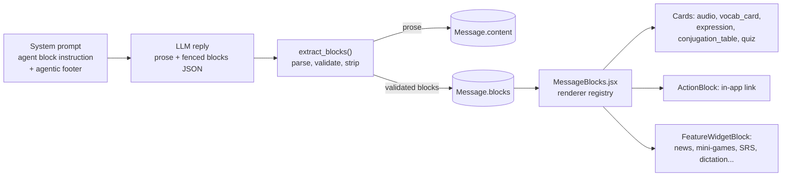

# Agentic Blocks

> The protocol that turns an assistant reply into more than text. The LLM appends a fenced JSON segment to its prose. The backend validates it and strips it out. The frontend renders each entry as a card (vocab, audio, conjugation table, quiz) or as an inline feature widget or navigation button (agentic mode).

**Code:** `backend/apps/assistant/blocks.py`, `backend/apps/assistant/agentic_prompt.py`, `backend/apps/agents/prompts.py`, `frontend/src/components/blocks/` · **Spec:** [specs/assistant.md](../specs/assistant.md) (section "Block protocol")

## Overview



`apps/assistant/blocks.py` is the server-side source of truth for the schema. `frontend/src/components/blocks/MessageBlocks.jsx` mirrors it. The rule on both sides is that unknown types are dropped silently, never errors.

## Key concepts

| Term | Meaning |
|---|---|
| Fence | A trailing ` ```blocks ` code fence holding a JSON array (or `{"blocks": [...]}`, or a single block object). |
| Block | A dict with a `type`. It is kept only if its validator returns a cleaned copy. |
| Content blocks | `audio`, `vocab_card`, `expression`, `conjugation_table`, `quiz`. Agents are taught these (`apps/agents/prompts.py`). |
| Agentic blocks | `action` and `feature_widget`. Taught only to users whose `User.mode == "agentic"` (`apps/assistant/agentic_prompt.py`). |
| Legacy quiz fence | ` ```quiz ` with `{title, questions:[{question, options, correct, explanation}]}`. Some seeded agent prompts still describe it. The backend does **not** parse it: it stays in `content` and the frontend's `components/QuizBlock.jsx` renders it. |

## How it works

### 1. Teaching the model

| Source | Applied when | Teaches |
|---|---|---|
| `BLOCK_FENCE_INSTRUCTION` (`apps/agents/prompts.py`) | Stored at the end of every agent's FR `system_prompt` by migration `agents/0002` and `seed_agents` (marker `<!-- structured-payloads:v1 -->`) | content blocks |
| `append_agentic_footer(prompt, lang)` (`apps/assistant/agentic_prompt.py`) | At request time in `ChatView` and `VoiceChatView` when `user.mode == "agentic"` (idempotent via a marker string) | `action` routes, `feature_widget` slugs, routing rules ("never a widget for greetings") |
| Composer @-mention directives (`frontend/src/pages/Assistant.jsx`, `BLOCKS_FOOTER` and its examples) | The user picks `@grammar`, `@vocab`, `@conjugate` and similar in the main assistant | content blocks, with an inline example inside the user message |

The FR agentic footer is detailed (route table, widget table, routing rules). The EN footer is a short summary.

### 2. Parsing (`extract_blocks(raw_text) -> (prose, blocks)`)

| Strategy | Trigger | Behaviour |
|---|---|---|
| 1. Explicit fence | One or more ` ```blocks ` (or ` ```blocks json `) fences | Parse each fence. If `json.loads` fails, `_salvage_objects` recovers each balanced `{...}` separately. All fences are removed from the prose. If nothing could be recovered, the raw text is returned unchanged. |
| 2. JSON fence fallback | No blocks fence. A ` ```json ` / ` ```jsonc ` / bare ` ``` ` fence whose body starts with `[` or `{` | The first such fence that **validates** as blocks is adopted and removed. Unrelated JSON code samples are left alone. |
| 3. Bare trailing array | Neither fence form | A JSON array at the very end of the reply is adopted only if it validates. |
| none | | `(raw_text, [])` |

After parsing, `_candidates_from_payload` accepts a list, `{"blocks": [...]}` or a single block object. `_validate_candidates` runs each validator and keeps at most **8** blocks.

### 3. Block schema (validated output)

| `type` | Required | Optional | Clamping / rules |
|---|---|---|---|
| `audio` | `text` | `lang` (default `fr`) | text ≤ 400 chars |
| `vocab_card` | `french`, `english` | `pos` (≤ 24), `example_fr` (≤ 240) | |
| `expression` | `fr`, `en` | `note` (≤ 240) | |
| `conjugation_table` | `verb`, `tense`, `rows[{pronoun, form}]` | | verb and tense ≤ 48; pronoun ≤ 24; form ≤ 64; ≤ 12 rows; invalid rows dropped |
| `quiz` | `questions[]` | | ≤ 10 valid questions (see below) |
| `action` | `route`, `label` | `emoji` (≤ 8) | `route` must be one of `ALLOWED_ACTION_ROUTES`; label ≤ 48 |
| `feature_widget` | `widget` | `config` (object, default `{}`), `title` (≤ 80) | `widget` must be in `ALLOWED_FEATURE_WIDGETS` |

Quiz question kinds. Every question has `kind` and `prompt` (≤ 400), plus an optional `explanation` (≤ 400). `answer` is accepted as an alias for `correct`.

| `kind` | Fields | Answer form |
|---|---|---|
| `mcq` | `options` (2-6 strings) | `correct`: index, or the option text (resolved to an index) |
| `multi` | `options` (2-6) | `correct`: list of indices or option texts, deduplicated and sorted |
| `true_false` | | `correct`: boolean |
| `matching` | `pairs` (2-8 `{left, right}`, each ≤ 80) | at least 2 valid pairs |
| `short` | `accept` (list of accepted strings, ≤ 8) | |

`ALLOWED_ACTION_ROUTES`:
`/dashboard`, `/topics`, `/discover`, `/news`, `/practice/dictation`, `/practice/pronunciation`, `/practice/conjugation`, `/practice/srs`, `/mini-games`, `/grammar`, `/exam-prep`, `/assistant`, `/agents`, `/dictionary`, `/progress`, `/settings`, `/documents`.

`ALLOWED_FEATURE_WIDGETS`:
`news`, `minigame`, `dictation`, `flashcard`, `conjugation`, `word_scramble`, `gender_snap`, `missing_letter`, `speed_round`, `match_pairs`, `listening_challenge`, `grammar_topic`.

### 4. Rendering (frontend)

`MessageBlocks.jsx` maps `type` to a component. An unknown type renders nothing.

| `type` | Component | Behaviour |
|---|---|---|
| `audio` | `AudioBlock.jsx` | Play button (`AudioPlayButton`) that calls `POST /api/media/tts/` with the text |
| `vocab_card` | `VocabCardBlock.jsx` | Word card |
| `expression` | `ExpressionBlock.jsx` | Idiom card |
| `conjugation_table` | `ConjugationTableBlock.jsx` | Table |
| `quiz` | `QuizBlockV2.jsx` | Polymorphic quiz with per-kind correctness and a score summary |
| `action` | `ActionBlock.jsx` | react-router `<Link to={route}>` chip |
| `feature_widget` | `FeatureWidgetBlock.jsx` | Dispatches on `widget` (table below) |

| `widget` | Renders | Data source (frontend API) |
|---|---|---|
| `news` | `NewsWidget` (first article, optional `config.topic`) | `GET /api/news/` |
| `dictation` | `inline/DictationInline.jsx` | `api/media` start and check dictation |
| `flashcard` | `inline/FlashcardsInline.jsx` | `api/progress` SRS due cards and review |
| `conjugation` | `inline/ConjugationInline.jsx` | `api/progress` conjugation verbs and check |
| `word_scramble`, `gender_snap`, `missing_letter`, `speed_round`, `match_pairs` | `inline/*Inline.jsx` | `api/content` random vocabulary |
| `listening_challenge` | `inline/ListeningChallengeInline.jsx` | random vocabulary + TTS |
| `grammar_topic` | `inline/GrammarTopicInline.jsx` (needs `config.slug`) | `api/grammar` topic by slug |
| `minigame` | `MiniGameWidget` preview card | deep link to `/mini-games` |

Inline practice widgets share `InlineRoundWidget.jsx`: a header, one round in place, an "Encore" button and a "full session" link. Apart from `news` (`topic`) and `grammar_topic` (`slug`), the inline widgets ignore `config`.

`pages/Assistant.jsx` renders `msg.content` (with legacy ` ```quiz ` segments split out by `splitChatMessage`), then `<MessageBlocks blocks={msg.blocks} />` below the bubble. `pages/AgentRun.jsx` (the dedicated agent page) renders `content` and legacy ` ```quiz ` segments only: it does **not** render `msg.blocks`.

## Data model

Blocks are stored on `assistant.Message.blocks` (JSON list, default `[]`) for assistant messages. The prose without the fences is stored in `Message.content`.

## Configuration

| Setting | Effect |
|---|---|
| `User.mode == "agentic"` | Appends the agentic footer, which enables `action` and `feature_widget` |
| `User.target_language` | Picks the FR or EN footer |
| Agent prompt contents | Whether content blocks are requested (FR prompts include the instruction) |

## Working on it

**Add a block type** (all four steps are needed):
1. Add a validator to `BLOCK_VALIDATORS` in `blocks.py`.
2. Add a renderer to `RENDERERS` in `MessageBlocks.jsx`.
3. Teach it in a prompt (`apps/agents/prompts.py` or `agentic_prompt.py`).
4. Add tests in `apps/assistant/tests/test_blocks.py`.

If you change `BLOCK_FENCE_INSTRUCTION`, bump the marker (`structured-payloads:v1`) and add a data migration. The text is baked into the stored agent prompts.

**Add a widget or route:** extend `ALLOWED_FEATURE_WIDGETS` or `ALLOWED_ACTION_ROUTES`, the `REGISTRY` in `FeatureWidgetBlock.jsx` (or the React Router config), and the route or widget tables in the FR agentic footer.

**Tests:**
- `apps/assistant/tests/test_blocks.py` covers all strategies, salvage, every validator and the whitelists.
- There are no frontend unit tests for the renderers. The `MessageBlocks.jsx` docstring mentions `MessageBlocks.test.jsx`, but that file does not exist.

## Known gaps

- The agent run page (`/agents/<slug>`, `pages/AgentRun.jsx`) does not render `Message.blocks`. Content blocks that agents emit are stripped from the prose and never shown there.
- Two quiz formats coexist. The legacy ` ```quiz ` fence (frontend-parsed) and `quiz` blocks (backend-validated) are sometimes both described in the same agent prompt.
- EN agent prompts (`system_prompt_en`) do not include the block instruction, so EN learners rarely get content blocks from agents.
- The EN agentic footer is much shorter than the FR one: it has no route or widget table.
- `audio.lang` is validated but the frontend `AudioPlayButton` does not forward it, so TTS uses the server default (`fr`).
- Blocks are removed from `Message.content`, so the LLM does not see them in later history.
- Image-query replies are not parsed for blocks.
- When RAG context is used in `ChatView`, the agentic footer is dropped for that turn (see [AI Assistant](AI-Assistant.md)).
