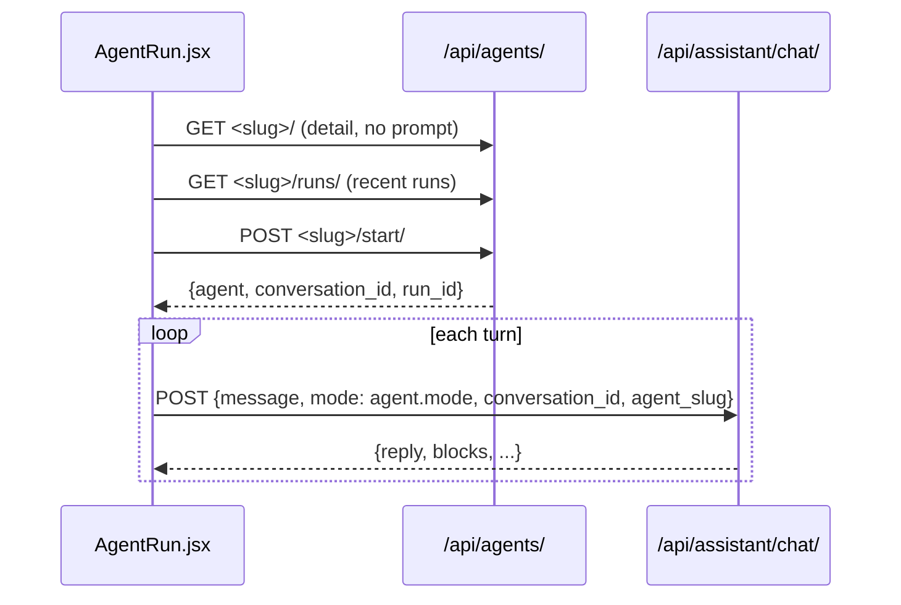

# Agents

> Specialised assistants (Grammar Coach, Writing Editor, Verb Studio, and others) shown as a gallery at `/agents`. Each agent is an admin-editable DB row holding a persona prompt plus display metadata. Starting an agent opens a dedicated conversation at `/agents/<slug>` that runs through the normal assistant chat endpoint.

**Code:** `backend/apps/agents/` · **Spec:** [specs/agents.md](../specs/agents.md)

## Overview



The agents app owns the **catalogue** (the `Agent` table) and the **run index** (`AgentRun`). Running the chat itself happens in [AI Assistant](AI-Assistant.md) `ChatView`, which looks up the agent by `agent_slug` and uses its prompt in place of the mode prompt.

## Key concepts

| Term | Meaning |
|---|---|
| Agent | A persona: `system_prompt` (FR, the primary) plus an optional `system_prompt_en`, display fields (name, emoji, Tailwind gradient `tint`, tagline, description, `best_for`, `capabilities`, `suggested_questions`), and `_en` variants of the display fields. |
| Run | An `AgentRun` row that links a user, an agent and a new `Conversation` (`context="agent:<slug>"`). |
| EN overrides | For users with `target_language == "en"`, the list and detail serializers swap each display field for its non-empty `_en` sibling. |
| Composer @-mentions | Not agents. The main `/assistant` page has client-side shortcuts (`@grammar`, `@vocab`, ...) that only prepend a directive to the message. See [AI Assistant](AI-Assistant.md). |

## How it works

### Endpoints (`apps/agents/views.py`)

| Method + path | View | Behaviour |
|---|---|---|
| `GET /api/agents/` | `AgentListView` | Active agents ordered by `order, name`. Lean shape: slug, name, emoji, tint, tagline, best_for, mode, output_shape, order. |
| `GET /api/agents/<slug>/` | `AgentDetailView` | Full display shape. 404 if the agent is missing or inactive. |
| `POST /api/agents/<slug>/start/` | `AgentStartRunView` | Creates a `Conversation` (title `"<name>, nouvelle session"`, `context="agent:<slug>"`) and an `AgentRun`. Returns 201 `{agent, conversation_id, run_id}`. |
| `GET /api/agents/<slug>/runs/` | `AgentRunsView` | The user's last 20 runs for this agent, with an annotated message count (one query, no N+1). |

System prompts are never serialized to clients.

### Prompt selection at chat time (`apps/assistant/views.py`)

1. `Agent.objects.filter(slug=agent_slug, is_active=True).first()`.
2. If the user's `target_language == "en"` and `system_prompt_en` is non-empty, use it. Otherwise use `system_prompt`. If both are empty, use the mode prompt.
3. The agentic footer is appended if `user.mode == "agentic"`.
4. RAG is **skipped** when an agent is active. Memory context is still prepended when enabled.

The frontend sends `agent.mode` as the chat `mode`, but when an agent is active the server picks the prompt from the agent. The mode only matters as a fallback when the agent's prompts are empty.

### Seeded catalogue

`seed_agents` (FR) seeds 9 agents:

| Slug | Mode | Output shape | Focus |
|---|---|---|---|
| `grammar-coach` | grammar_explanation | structured | one grammar point, formula, examples, traps, optional drill |
| `writing-editor` | grammar_correction | structured | correct a French text and explain each error |
| `verb-studio` | conversation | structured | conjugate a verb across the 8 main tenses |
| `vocab-explorer` | conversation | free_text | meaning, gender, IPA, examples of a word |
| `translation-lab` | conversation | free_text | FR ↔ EN translation with nuance |
| `idiom-hunter` | conversation | free_text | idioms: meaning, register, examples |
| `culture-guide` | conversation | free_text | French culture notes |
| `pronunciation-buddy` | conversation | free_text | IPA and pronunciation tips |
| `exam-coach` | conversation | structured | TCF/TEF strategy, drills, essay grading, revision plans |

The full prompts and metadata are in `apps/agents/management/commands/seed_agents.py`. `output_shape` is display metadata for the frontend and does not change the backend chat logic.

## Data model

| Model | Table | Purpose | Key fields |
|---|---|---|---|
| `Agent` | `agents_agent` | Catalogue entry | `slug` (unique), `name`/`name_en`, `emoji`, `tint`, `tagline(_en)`, `description(_en)`, `best_for(_en)`, `capabilities(_en)`, `suggested_questions(_en)` (JSON lists), `system_prompt`, `system_prompt_en`, `mode` (conversation / grammar_correction / grammar_explanation), `output_shape` (free_text / structured), `order`, `is_active`, timestamps |
| `AgentRun` | `agents_run` | User's session with an agent | `user`, `agent`, `conversation` (FK to `assistant.Conversation`), `started_at`. Index `(user, agent, -started_at)`. |

## Configuration

There are no settings of its own. Agents are managed in Django admin at `/admin/agents/agent/`, where `order` and `is_active` are editable from the list view and the slug is prepopulated from the name.

## Working on it

| Task | How |
|---|---|
| Seed or refresh FR agents | `python manage.py seed_agents` (idempotent `update_or_create` by slug; `--clear` deletes all agents first). Appends the structured-blocks instruction to `system_prompt`. |
| Fill EN fields | `python manage.py seed_agents_en`. Only fills empty `_en` fields and `system_prompt_en`; `--force` overwrites them. |
| Add an agent without code | Admin. To keep it reproducible, also add it to `seed_agents.py` (and `seed_agents_en.py`). |
| Change the blocks instruction | Edit `apps/agents/prompts.py`, bump the marker, and add a data migration like `0002_append_blocks_instruction.py`. |

Tests: `apps/agents/tests/`:
- `test_models.py`
- `test_serializers.py`: EN override behaviour.
- `test_runs_view_perf.py`: query count.

Agent prompt selection in chat is covered by `apps/assistant/tests/test_chat_language.py`.

## Known gaps

- `system_prompt_en` does not get the structured-blocks instruction, so EN learners rarely receive cards from agents.
- `pages/AgentRun.jsx` does not render `Message.blocks` (see [Agentic Blocks](Agentic-Blocks.md)).
- Some FR prompts (grammar-coach, exam-coach) describe both the legacy ` ```quiz ` fence and `quiz` blocks.
- `Conversation.context` (`agent:<slug>`) is written but never read. The agent is chosen per request from `agent_slug`, not from the conversation.
- The run conversation title is always French ("nouvelle session").
- There are no view tests for list, detail and start (only perf and serializer tests).
- `StartAgentRunSerializer` is unused.
- The `seed_agents` docstring and help text say "8 starter agents". The seed has 9.
- The blocks instruction is stored inside DB prompts rather than composed at request time, so changing its wording needs a data migration.
