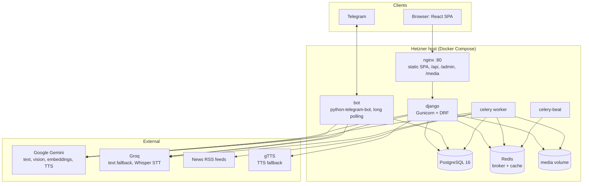

# Architecture

> Lingaru is a language-learning app (French and English as target languages) built as a Django monolith with a React SPA, a Telegram bot and Celery workers, all sharing one PostgreSQL database. This page is the map: what runs where, how the code is organised, and how a request flows. Every box links to a deeper page.

**Related:** [Getting Started](Getting-Started.md) · [Conventions](Conventions.md) · [Deployment and Operations](Deployment-and-Operations.md) · [Specs index](../README.md#specs)

## Runtime topology



`django`, `bot`, `celery` and `celery-beat` are built from the **same image and code**; only the command differs. A migration shipped for the API is immediately visible to the bot and the workers. Details: [Deployment and Operations](Deployment-and-Operations.md), [Infrastructure spec](../specs/infrastructure.md).

## Backend layout

```
backend/
├── config/            settings (base, dev, local, test, prod), urls.py, celery.py, wsgi/asgi
├── apps/              one Django app per bounded domain (table below)
└── services/          cross-app infrastructure: llm, memory, rag, stt, tts
```

### Apps

| App | API prefix | Responsibility | Wiki |
|-----|-----------|----------------|------|
| `users` | `/api/users/` | Custom `User`, registration (admin approval), JWT login, profile and learner settings | [Users and Auth](Users-and-Auth.md) |
| `content` | `/api/content/` | Topics, lessons, vocabulary, grammar rules, reading texts, questions, video lessons | [Content and Lessons](Content-and-Lessons.md) |
| `practice` | `/api/practice/` | Lesson quiz sessions and answer checking | [Practice and Quizzes](Practice-and-Quizzes.md) |
| `progress` | `/api/progress/` | SM-2 flashcards, mistake journal, conjugation drills, lesson/topic progress | [Progress, SRS and Conjugation](Progress-SRS-and-Conjugation.md) |
| `gamification` | `/api/gamification/` | XP, levels, streaks, badges, leaderboard, trend report, mini-game scores | [Gamification](Gamification.md) |
| `assistant` | `/api/assistant/` | AI chat (text, voice, image), conversations, agentic blocks | [AI Assistant](AI-Assistant.md), [Agentic Blocks](Agentic-Blocks.md) |
| `agents` | `/api/agents/` | Admin-editable specialised assistants | [Agents](Agents.md) |
| `memory` | `/api/memory/` | Learner notes the assistant remembers | [Memory](Memory.md) |
| `documents` | `/api/documents/` | PDF/TXT upload, chunking, embeddings for RAG | [Documents and RAG](Documents-and-RAG.md) |
| `media` | `/api/media/` | TTS, pronunciation check, dictation | [Audio: TTS and STT](Audio-TTS-STT.md) |
| `discover` | `/api/discover/`, `/api/news/` | Explore feed cards (word, grammar, trivia) and the News reader | [Discover and News](Discover-and-News.md) |
| `dictionary` | `/api/dictionary/` | Cache-first word lookup and verb conjugator | [Dictionary and Conjugator](Dictionary-and-Conjugator.md) |
| `exam_prep` | `/api/exam-prep/` | TCF/TEF section drills, mocks, async EE/EO grading | [Exam Prep](Exam-Prep.md) |
| `grammar` | `/api/grammar/` | Grammar Booster: categories, topics, drills, mastery | [Grammar Booster](Grammar-Booster.md) |
| `notes` | `/api/notes/` | "Our Notes": curated study notes reviewed as cards | [Notes and My Notes](Notes-and-My-Notes.md) |
| `my_notes` | `/api/my-notes/` | "My Notes": the learner's own rich-text notebook with AI actions | [Notes and My Notes](Notes-and-My-Notes.md) |
| `bot` | (none) | Telegram handlers; uses the ORM directly | [Telegram Bot](Telegram-Bot.md) |

Plus `GET /api/health/` (DB liveness probe) defined in `config/urls.py`.

### `services/`

| Package | What it does | Wiki |
|---------|--------------|------|
| `services/llm` | `BaseProvider`, Gemini and Groq providers, `ProviderRouter` (primary then fallback), per-language system prompts | [LLM Providers and Prompts](LLM-Providers-and-Prompts.md) |
| `services/memory` | Builds the LEARNER CONTEXT block; extracts "remember this" notes from chat | [Memory](Memory.md) |
| `services/rag` | Chunking, Gemini embeddings, cosine retrieval over the user's documents | [Documents and RAG](Documents-and-RAG.md) |
| `services/stt` | Groq Whisper transcription | [Audio: TTS and STT](Audio-TTS-STT.md) |
| `services/tts` | Text-to-speech with a DB/file cache | [Audio: TTS and STT](Audio-TTS-STT.md) |

**Dependency direction.** Apps depend on services. The intent is that services do not depend on apps, but today `services/memory`, `services/rag` and `services/tts` import app models (memory, progress, documents, media). Treat that as known coupling, not a pattern to copy.

## Frontend layout

React 18 + Vite 5 + Tailwind 3 + React Router 6 + Axios + i18next. One file per route in `src/pages/`; shared widgets in `src/components/` (including `blocks/` for agentic chat cards and `ui/` primitives); API modules in `src/api/`; contexts for auth, theme and toasts. Details: [Frontend Architecture](Frontend-Architecture.md), [Frontend Design System](Frontend-Design-System.md), [Internationalization](Internationalization.md), [Mini Games](Mini-Games.md).

## Cross-cutting concepts

| Concept | Summary | Read more |
|---------|---------|-----------|
| **Target language** | Every content model has a `language` field (`fr`/`en`). Endpoints filter by `request.user.target_language`; prompts are chosen per language. A few endpoints do not scope yet. | [Content and Lessons](Content-and-Lessons.md), [specs/content.md](../specs/content.md) |
| **UI language** | Separate from the target language: only app chrome is translated (EN/FR). | [Internationalization](Internationalization.md) |
| **XP and streaks** | All features report activity via `apps/gamification/services.py` (`award_xp`, `check_streak`). | [Gamification](Gamification.md) |
| **Spaced repetition** | SM-2 lives in `apps/progress/services.py`. Grammar Booster has its own copy of the algorithm for topic mastery. | [Progress, SRS and Conjugation](Progress-SRS-and-Conjugation.md), [Grammar Booster](Grammar-Booster.md) |
| **Auth** | JWT (SimpleJWT). Web sign-ups start inactive until an admin approves them. The bot identifies people by `User.telegram_id`. | [Users and Auth](Users-and-Auth.md), [Telegram Bot](Telegram-Bot.md) |
| **LLM routing** | Gemini first, Groq on failure for text; vision only on Gemini. Some features use static banks or caches instead of the LLM. | [LLM Providers and Prompts](LLM-Providers-and-Prompts.md) |
| **Content** | Hand-authored banks in `data/` plus seed commands; LLM output is cached where reused (dictionary). | [Content Data Pipeline](Content-Data-Pipeline.md) |
| **Time** | UTC everywhere in storage; the frontend formats locally. | [Conventions](Conventions.md) |

## A typical chat turn

1. `Assistant.jsx` posts `/api/assistant/chat/` with `{message, mode, conversation_id?, agent_slug?}`.
2. `ChatView` loads or creates the `Conversation`, stores the user `Message`, loads the history.
3. It builds the system prompt: the agent's persona or the mode prompt, then the agentic footer, then RAG excerpts (conversation mode), then the LEARNER CONTEXT block (when memory is enabled).
4. `ProviderRouter` calls Gemini, then Groq on error.
5. `blocks.extract_blocks` strips structured JSON blocks from the reply. The text and the blocks are saved on the assistant `Message`; XP is awarded.
6. The frontend renders the prose plus a card per block.

Full sequence diagram, voice and image variants: [AI Assistant](AI-Assistant.md).

## Background work

Celery tasks live in `apps/*/tasks.py`. Beat (`CELERY_BEAT_SCHEDULE` in `config/settings/base.py`) runs:

| Job | When |
|-----|------|
| `discover.generate_daily_feed` | Every 24 h, counted from when beat starts |
| `discover.fetch_real_news_pipeline` | 07:00 and 19:00 UTC |

On-demand tasks include document processing, video-lesson processing and exam EE/EO grading. There is no scheduled streak job: streaks are evaluated when activity is recorded. Most user-triggered LLM calls run inline in the request. See [Configuration and Settings](Configuration-and-Settings.md).

## CI and deploy

GitHub Actions runs lint, tests, build, a Trivy scan and Playwright on push/PR. Lighthouse and visual regression run on frontend PRs. A green run on `main` deploys over SSH to the Hetzner host with a health check and code rollback. See [Testing and CI](Testing-and-CI.md) and [Deployment and Operations](Deployment-and-Operations.md).

## Where to add things

| You want to... | Do this |
|----------------|---------|
| Add an endpoint | View + URL in the right app, logic in its `services.py`, update `docs/specs/<domain>.md` §4 |
| Add a model field | Migration + spec §3 + include `language` if it is content |
| Add an agent | Django admin `/admin/agents/agent/` (seed it in `seed_agents` if it should ship by default) |
| Add an LLM provider | Implement `BaseProvider` in `services/llm/`, wire it in `factory.py` |
| Add a background job | `@shared_task` in `apps/<app>/tasks.py`; periodic ones go in `CELERY_BEAT_SCHEDULE` |
| Add content | JSON/CSV in `data/` + a loader command; see [Content Data Pipeline](Content-Data-Pipeline.md) |
| Add a page | `src/pages/X.jsx`, route in `App.jsx`, strings in both locale files |
| Add a UI locale | See [Internationalization](Internationalization.md) |

## History

The original design and per-phase plans (phases 1 to 22) live in [`docs/superpowers/`](../superpowers/). They describe intent at the time and are not kept up to date; this wiki and `docs/specs/` describe the system as it is.
