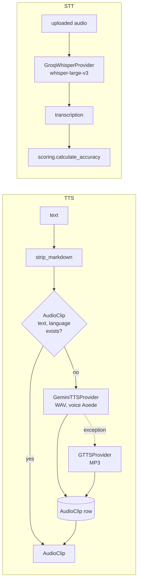

# Audio: TTS and STT

> Everything audio: text-to-speech for any phrase in the app (cards, blocks, dictation, voice-chat replies), speech-to-text for voice chat and pronunciation practice, a word-overlap pronunciation score, and the dictation exercise. TTS output is cached in the DB and on disk, so a phrase is synthesised once.

**Code:** `backend/services/tts/`, `backend/services/stt/`, `backend/apps/media/` · **Spec:** [specs/media-audio.md](../specs/media-audio.md)

## Overview

| Consumer | Uses |
|---|---|
| `POST /api/media/tts/` | TTS. Called by `AudioPlayButton` across the frontend (blocks, cards, inline widgets). |
| `POST /api/media/pronunciation/check/` | STT, scoring, `PronunciationAttempt`, XP |
| `GET /api/media/dictation/start/`, `POST /api/media/dictation/check/` | TTS, scoring, XP |
| `POST /api/assistant/voice-chat/` | STT in, TTS out (see [AI Assistant](AI-Assistant.md)) |
| Telegram bot, exam prep (speaking) | STT / TTS through the same services |

## Key concepts

| Term | Meaning |
|---|---|
| `AudioClip` | Cached TTS output. Unique on `(text_content, language)`, where `text_content` is the markdown-stripped text. |
| Disk cache | Both providers name files with an MD5 of the inputs (Gemini: `gemini-tts:<lang>:<voice>:<text>` to `.wav`; gTTS: `<lang>:<text>` to `.mp3`) under `MEDIA_ROOT/audio/`. They skip synthesis if the file already exists. |
| Accuracy | Word-level in-order match ratio between the expected text and the transcription (0.0 to 1.0, two decimals). |

## How it works

### TTS (`services/tts/service.py::get_or_create_audio(text, language="fr")`)

1. `strip_markdown(text)` removes fenced code, inline code markers, headers, bold and italic, links, list markers, blockquotes and rules, and collapses blank lines.
2. DB cache: `AudioClip.objects.filter(text_content=clean, language=language).first()`. A hit is returned as-is.
3. On a miss, if `GEMINI_API_KEY` is set, try `GeminiTTSProvider`:
   - Model `gemini-2.5-flash-preview-tts`, voice `Aoede`, `response_modalities=["AUDIO"]`.
   - The returned 16-bit PCM is wrapped in a WAV container, with the sample rate parsed from the MIME type (default 24000).
   - Any exception falls back to `GTTSProvider`.
4. With no Gemini key, use `GTTSProvider` (Google Translate TTS, `lang=language`, MP3) directly.
5. Create the `AudioClip(text_content, audio_file=<relative path>, language, provider="gemini_tts"|"gtts")`.

The `language` value only reaches gTTS as `lang`. Gemini TTS takes no language parameter, so the voice reads whatever text it gets.

### STT (`services/stt/groq_whisper.py::GroqWhisperProvider.transcribe(audio_file, language="fr")`)

- Reads the upload into memory and sends it to Groq `audio.transcriptions.create(model="whisper-large-v3", language=..., response_format="text")`.
- The file is always labelled `audio.webm` / `audio/webm`, because browser uploads often arrive named `blob`.
- Returns `STTResult(transcription, provider="groq_whisper", language)`.

### Pronunciation check (`PronunciationCheckView`)

1. Multipart `{audio, expected_text (≤ 1000), vocabulary_id?}`.
2. Transcribe with `language="fr"`. Failure returns 503.
3. `calculate_accuracy(expected, transcription)`:
   - Normalise both texts: lowercase, NFC, strip punctuation except apostrophes, collapse spaces.
   - Greedy in-order word matching.
   - `matches / len(expected_words)`.
4. `generate_feedback(accuracy, ...)`:

   | Accuracy | Feedback |
   |---|---|
   | ≥ 0.95 | "Excellent!" |
   | ≥ 0.8 | "Good job!" |
   | ≥ 0.5 | "Keep practicing!" |
   | below 0.5 | "Let's try again." |

   Below 0.95 the message includes the expected text and what was heard.
5. Save a `PronunciationAttempt` (with the audio file), award **5 XP** (`pronunciation`), run `check_streak`.
6. Return `{id, expected_text, transcription, accuracy_score, feedback, created_at}`.

### Dictation

| Step | Behaviour |
|---|---|
| `GET dictation/start/` | Picks a random `Vocabulary` with a non-empty `example_sentence` and returns `{sentence_id, audio_clip}`, where `audio_clip` is a serialized `AudioClip` with an absolute `audio_url`. Returns 404 if there are no sentences. |
| `POST dictation/check/` `{audio_clip_id, user_text (≤ 2000)}` | Scores `user_text` against the clip text. `correct = accuracy >= 0.9`. Awards **15 XP** (`dictation`) and runs `check_streak`. Returns `{correct, expected, user_text, accuracy, feedback}`. Returns 404 for an unknown clip. |

### `POST /api/media/tts/`

Request `{text (≤ 1000, non-blank after strip), language? (default "fr")}`. Returns 200 with `{id, text_content, language, provider, audio_url, created_at}`.

## Data model

| Model | Table | Purpose | Key fields |
|---|---|---|---|
| `AudioClip` | `media_audio_clips` | Shared TTS cache | `text_content` (Text), `audio_file` (`audio/`), `language` (≤ 10, default `fr`), `provider` (choices list only `gtts`; `gemini_tts` is also written), `created_at`. Unique `(text_content, language)`. |
| `PronunciationAttempt` | `media_pronunciation_attempts` | One pronunciation try | `user`, `vocabulary` (SET_NULL), `expected_text`, `audio_file` (`pronunciation/`), `transcription`, `accuracy_score`, `feedback`, `created_at` |

`AudioClip` is registered in admin.

## Configuration

| Setting | Effect |
|---|---|
| `GEMINI_API_KEY` | Enables Gemini TTS (otherwise gTTS only) |
| `GROQ_API_KEY` | Required for STT (`GroqWhisperProvider` reads it by default) |
| `MEDIA_ROOT` / `MEDIA_URL` | Where audio files are written and how `audio_url` is built |
| Constants | `GEMINI_TTS_MODEL`, `VOICE_NAME` (`services/tts/gemini_provider.py`); `WHISPER_MODEL` (`services/stt/groq_whisper.py`) |

## Working on it

- **Tests:**
  - `services/tts/tests/`: service, gTTS provider.
  - `services/stt/tests/`: Whisper provider, scoring.
  - `apps/media/tests/`: models, serializers, views.
- `services/` tests are outside `pytest.ini`'s `testpaths`, so run `python -m pytest services/tts services/stt` explicitly.
- **Mocking:** patch `services.tts.service.GeminiTTSProvider` / `GTTSProvider` and `apps.media.views.GroqWhisperProvider`.
- **Change voice or model:** the voice is part of the Gemini file hash, but **not** of the `AudioClip` DB key. Existing clips keep the old voice until their rows are deleted.
- **Pre-generate audio** for vocab lists in a Celery task rather than on first play.

## Known gaps

- STT is called with `language="fr"` in pronunciation check and voice chat, and voice-chat TTS uses `fr`, whatever the learner's `target_language`.
- Dictation picks from all `Vocabulary`, not only the learner's target language. `order_by("?")` is a full random sort.
- `AudioPlayButton` and `api/media.js::generateTTS` send only `text`, so `audio` blocks' `lang` and EN content are synthesised with `language="fr"`.
- XP awards for pronunciation (5) and dictation (15) are not idempotent: every call awards again.
- `TTSView` has no error handling. An unsupported `language` (gTTS `ValueError`) or a provider failure returns 500. Concurrent first requests for the same text can hit the unique constraint.
- A unique index on a free `TextField` is fragile for long texts (for example long voice-chat replies). A hash key column would be safer.
- Gemini TTS output is uncompressed WAV (about 48 KB/s). Voice chat synthesises the entire reply with no length cap.
- `AudioClip.PROVIDER_CHOICES` does not list `gemini_tts`.
- Uploads are always labelled `audio/webm` for Whisper, which may not match recordings from browsers that produce `audio/mp4` (Safari).
- The Gemini TTS model is a preview model.
- Provider calls have no explicit timeouts, and TTS and STT run synchronously in the request.
