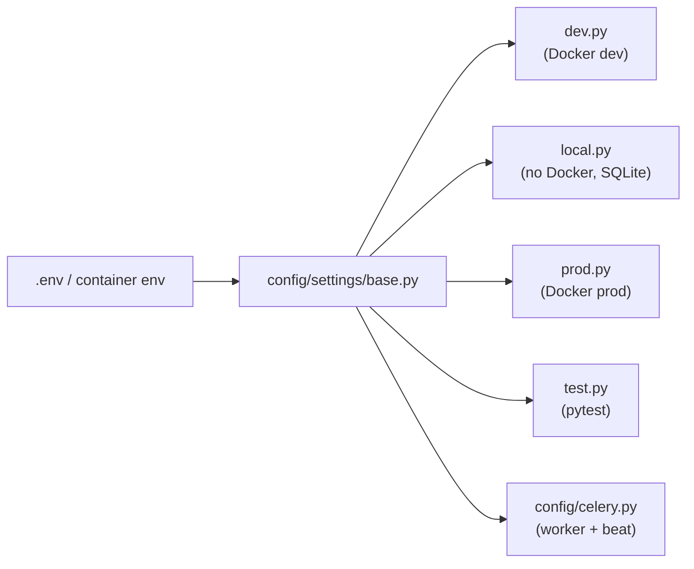

# Configuration and Settings

> How the Django project is configured: the settings modules, every environment variable the backend reads, DRF/JWT defaults, and the Celery worker and beat setup. Read this before deploying, adding an env var, or scheduling a background job.

**Code:** `backend/config/` · **Spec:** none (cross-cutting; see each domain spec)

## Overview

`base.py` holds everything shared and reads env vars via `python-decouple` (`config(...)`), which reads both the process environment and a `.env` file. Each profile does `from .base import *` and overrides a few values. `DJANGO_SETTINGS_MODULE` picks the profile.

## Key concepts

| Term | Meaning |
|------|---------|
| Settings profile | One of `dev`, `local`, `prod`, `test` under `config/settings/`. |
| decouple `config()` | Reads env var, falls back to `.env`, then to the given default. Used in `base.py`. |
| `os.environ.get` | Used in `prod.py` only: reads the process environment, not `.env`. In Docker, `env_file: .env` injects the file into the environment so both work. |
| Beat schedule | `CELERY_BEAT_SCHEDULE` dict in `base.py`, read by the `celery-beat` service. |

## How it works

### Settings profiles

| Module | Used by | DB | Cache | Celery | Notable overrides |
|--------|---------|----|-------|--------|-------------------|
| `base.py` | (imported by all) | PostgreSQL from `DB_*` | Redis (`REDIS_URL`) | Redis broker/backend | Everything shared |
| `dev.py` | `docker-compose.dev.yml` | PostgreSQL | Redis | Real worker | `DEBUG=True`, `CORS_ALLOW_ALL_ORIGINS=True` |
| `local.py` | Running without Docker (`export DJANGO_SETTINGS_MODULE=config.settings.local`) | SQLite `backend/db.sqlite3` | LocMem | `CELERY_TASK_ALWAYS_EAGER=True`, `CELERY_TASK_EAGER_PROPAGATES=True` (tasks run inline) | `DEBUG=True`, all CORS origins, JWT access 7 d / refresh 30 d |
| `prod.py` | `docker-compose.yml` (django, celery, celery-beat, bot) | PostgreSQL | Redis | Real worker | `DEBUG=False`, CSRF trusted origins, cookie flags, proxy headers, optional Sentry |
| `test.py` | `pytest.ini`, CI | SQLite in-memory | LocMem | (base: Redis; tests mock `.delay`) | `DEBUG=True`, MD5 password hasher |

`manage.py`, `config/wsgi.py`, `config/asgi.py` and `config/celery.py` all default `DJANGO_SETTINGS_MODULE` to `config.settings.dev` when unset. Docker Compose always sets it explicitly.

### Installed apps and middleware

`base.py` installs Django contrib apps, `rest_framework`, `corsheaders`, and 17 local apps: `users`, `content`, `practice`, `bot`, `assistant`, `gamification`, `media`, `discover`, `progress`, `documents`, `dictionary`, `exam_prep`, `grammar`, `agents`, `memory`, `my_notes`, `notes`. Middleware is the Django default stack plus `corsheaders.middleware.CorsMiddleware`.

### URL routing

`config/urls.py` mounts `admin/`, `api/health/` and one `api/<prefix>/` include per app:

| Prefix | App | Prefix | App |
|--------|-----|--------|-----|
| `api/users/` | users | `api/documents/` | documents |
| `api/content/` | content | `api/dictionary/` | dictionary |
| `api/practice/` | practice | `api/exam-prep/` | exam_prep |
| `api/assistant/` | assistant | `api/grammar/` | grammar |
| `api/gamification/` | gamification | `api/agents/` | agents |
| `api/media/` | media | `api/memory/` | memory |
| `api/discover/` | discover | `api/my-notes/` | my_notes |
| `api/news/` | discover (`news_urls`) | `api/notes/` | notes |
| `api/progress/` | progress | | |

`GET /api/health/` is a plain Django view (no DRF auth). It runs `SELECT 1` and returns `200 {"status":"ok","db":"ok"}`, or `503` when the database is unreachable. The deploy workflow uses it as its smoke test. Media files are served by Django only when `DEBUG=True` (nginx serves them in prod).

### DRF and JWT defaults (`base.py`)

| Setting | Value |
|---------|-------|
| `DEFAULT_AUTHENTICATION_CLASSES` | `rest_framework_simplejwt.authentication.JWTAuthentication` |
| `DEFAULT_PERMISSION_CLASSES` | `IsAuthenticated` (views opt out with `AllowAny`) |
| `DEFAULT_PAGINATION_CLASS` | `PageNumberPagination`, `PAGE_SIZE=20` (applies to `ListAPIView`s; plain `APIView`s are unpaginated unless they paginate manually) |
| `SIMPLE_JWT.ACCESS_TOKEN_LIFETIME` | 60 minutes (7 days in `local.py`) |
| `SIMPLE_JWT.REFRESH_TOKEN_LIFETIME` | 7 days (30 days in `local.py`) |
| `SIMPLE_JWT.ROTATE_REFRESH_TOKENS` | `True` (refresh returns a new refresh token) |

### Other constants (not env-driven)

| Setting | Value | Used by |
|---------|-------|---------|
| `TIME_ZONE` / `USE_TZ` | `UTC` / `True` | All timestamps stored in UTC |
| `LANGUAGE_CODE` | `en-us` | Django i18n (UI chrome is translated in the frontend) |
| `STATIC_ROOT` / `MEDIA_ROOT` | `backend/staticfiles`, `backend/media` | collectstatic, uploads |
| `DEFAULT_AUTO_FIELD` | `BigAutoField` | All models |
| `RAG_TOP_K`, `RAG_MIN_SIMILARITY` | `5`, `0.3` | `services/rag/context.py` |
| `RAG_CHUNK_SIZE`, `RAG_CHUNK_OVERLAP` | `2000`, `200` | Defined but not read; `services/rag/chunker.py` has its own defaults |

## Environment variables

Every variable the backend reads, verified against `config/settings/*.py` and `docker-compose*.yml`. `.env.example` at the repo root is the template.

| Variable | Read in | Default | Purpose |
|----------|---------|---------|---------|
| `DJANGO_SETTINGS_MODULE` | `manage.py`, `wsgi.py`, `asgi.py`, `celery.py` | `config.settings.dev` | Selects the settings profile. Compose sets `prod` (or `dev` in the dev override). |
| `DJANGO_SECRET_KEY` | `base.py` | dev-only placeholder | Django `SECRET_KEY`. Must be set to a long random value in every deployed environment. |
| `DEBUG` | `base.py` | `False` | Overridden to `True` by `dev`, `local`, `test`; forced `False` by `prod`. |
| `ALLOWED_HOSTS` | `base.py` | `localhost,127.0.0.1` | Comma-separated. |
| `DB_NAME` | `base.py`, compose `postgres` | `lingaru` | PostgreSQL database name. |
| `DB_USER` | `base.py`, compose `postgres` | `lingaru` | PostgreSQL user. |
| `DB_PASSWORD` | `base.py`, compose `postgres` | `lingaru` | PostgreSQL password. |
| `DB_HOST` | `base.py` | `localhost` | `postgres` inside Compose. |
| `DB_PORT` | `base.py` | `5432` | The dev override publishes Postgres on host port 5433. |
| `CORS_ALLOWED_ORIGINS` | `base.py` | `http://localhost:5173,http://localhost:3000` | Comma-separated. Ignored when `CORS_ALLOW_ALL_ORIGINS=True` (dev/local). |
| `REDIS_URL` | `base.py` | `redis://localhost:6379/0` | Cache backend; default for the Celery URLs. |
| `CELERY_BROKER_URL` | `base.py` | `REDIS_URL` | Celery broker. |
| `CELERY_RESULT_BACKEND` | `base.py` | `REDIS_URL` | Celery result store. |
| `TELEGRAM_BOT_TOKEN` | `base.py` -> `apps/bot/bot.py` | empty | Required for the `bot` service; `run_bot` exits with an error if empty. |
| `GEMINI_API_KEY` | `base.py` | empty | Primary LLM provider, embeddings. |
| `GEMINI_MODEL` | `base.py` | `gemini-2.0-flash` | Chat/generation model. |
| `GEMINI_EMBEDDING_MODEL` | `base.py` | `models/text-embedding-004` | RAG embeddings. |
| `GROQ_API_KEY` | `base.py` | empty | Fallback LLM provider. |
| `GROQ_MODEL` | `base.py` | `llama-3.3-70b-versatile` | Groq model. |
| `LINGARU_MEMORY_ENABLED` | `base.py` -> `services/memory/__init__.py` | `False` | Kill switch for chat-memory injection/extraction. The `/api/memory/` REST endpoints work either way. |
| `CSRF_TRUSTED_ORIGINS` | `prod.py` (`os.environ`) | empty | Comma-separated, scheme included, e.g. `https://lingaru.app`. Needed for admin login behind nginx. |
| `SESSION_COOKIE_SECURE` | `prod.py` (`os.environ`) | `False` | Accepts `1/true/yes`. Set to true once served over HTTPS. |
| `CSRF_COOKIE_SECURE` | `prod.py` (`os.environ`) | `False` | Same as above. |
| `SENTRY_DSN` | `prod.py` (`os.environ`) | empty | Sentry is initialised only when set (Django, Celery and logging integrations). |
| `SENTRY_ENVIRONMENT` | `prod.py` (`os.environ`) | `production` | Sentry environment tag. |
| `SENTRY_RELEASE` | `prod.py` (`os.environ`) | unset | Optional release (git SHA). |
| `SENTRY_TRACES_SAMPLE_RATE` | `prod.py` (`os.environ`) | `0.1` | Performance trace sampling. |
| `LINGARU_HTTP_PORT` | `docker-compose.yml` (nginx) | `80` | Host port for nginx. |

## Celery

`config/celery.py` creates the app `lingaru`, loads `CELERY_*` settings from Django settings, and calls `autodiscover_tasks()`. `config/__init__.py` imports it so `celery -A config` works. No time limits, `acks_late` or custom queues are configured; everything runs on the default queue.

### Registered tasks

| Task name | Module | Trigger |
|-----------|--------|---------|
| `content.process_video_lesson` | `apps/content/tasks.py` | Staff attaches a YouTube URL (API or admin). See [Content and Lessons](Content-and-Lessons.md). |
| `documents.process_document` | `apps/documents/tasks.py` | Document upload |
| `exam_prep.grade_response` | `apps/exam_prep/tasks.py` | Exam writing/speaking submission |
| `discover.generate_daily_feed` | `apps/discover/tasks.py` | Beat |
| `discover.fetch_real_news_pipeline` | `apps/discover/tasks.py` | Beat |

### Beat schedule (`CELERY_BEAT_SCHEDULE` in `base.py`)

| Entry | Task | Schedule | Args |
|-------|------|----------|------|
| `generate-daily-discover-feed` | `discover.generate_daily_feed` | Every 86400 s (interval counted from when beat starts, not a fixed clock time) | none |
| `fetch-real-news-morning` | `discover.fetch_real_news_pipeline` | `crontab(hour=7, minute=0)` UTC | `max_total=10` |
| `fetch-real-news-evening` | `discover.fetch_real_news_pipeline` | `crontab(hour=19, minute=0)` UTC | `max_total=10` |

These are the only periodic jobs. There is no streak-rollover or cache warm-up job.

## Deployment shape

Full deploy and operations detail: [Deployment and Operations](Deployment-and-Operations.md).

`backend/Dockerfile` builds one image (`python:3.12-slim`, `pip install -r requirements.txt`, copies `backend/` to `/app` and `data/` to `/data`). Compose runs it as:

| Service | Command |
|---------|---------|
| `django` | `migrate` -> `collectstatic --noinput` -> `gunicorn config.wsgi:application --workers 3` |
| `celery` | `celery -A config worker -l info` |
| `celery-beat` | `celery -A config beat -l info` |
| `bot` | `python manage.py run_bot` |

## Working on it

- **Add an env var:** read it in `base.py` with `config("NAME", default=..., cast=...)` so `.env` works, add it to `.env.example`, and add a row to the table above.
- **Add a periodic job:** define a `@shared_task(name="app.task_name")` in `apps/<app>/tasks.py`, then add an entry to `CELERY_BEAT_SCHEDULE` in `config/settings/base.py`.
- **Run tasks without a worker:** use `config.settings.local` (eager mode).
- **Tests:** `cd backend && pytest` uses `config.settings.test` from `pytest.ini` (`testpaths = apps`). CI runs `manage.py check`, `makemigrations --check --dry-run`, then pytest with coverage. See [Testing and CI](Testing-and-CI.md).
- **Dependencies:** a single `backend/requirements.txt` with version ranges. It includes test tooling (`pytest`, `pytest-django`, `pytest-cov`, `factory-boy`, `pytest-asyncio`).

## Known gaps

- The daily Discover feed runs on a 24 h interval from beat start, not at a fixed hour.
- No Celery task time limits are configured for long LLM-backed tasks.
- `RAG_CHUNK_SIZE` and `RAG_CHUNK_OVERLAP` are defined but unused.
- `prod.py` reads its variables with `os.environ` while `base.py` uses decouple, so prod-only vars are not picked up from a bare `.env` outside Compose.
- `dev.py` and `local.py` overlap and their difference is not documented in the files.
- Tests run on SQLite while production runs PostgreSQL.
- `backend/celerybeat-schedule` (the beat state file) is not in `.gitignore`.
- Test tooling ships in the production image because there is no separate dev requirements file.
