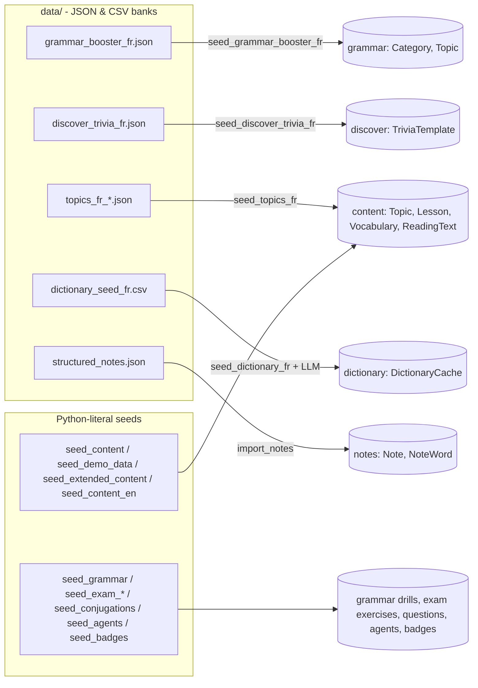

# Content Data Pipeline

> Most of Lingaru's learning content is authored by hand and checked into the repo. Some lives as JSON or CSV "banks" in `data/`, some as Python literals inside seed commands. Management commands load it into the database. This page lists every bank and seed command, the order to seed a fresh database, and how to add content for a new level or a new target language.

**Code:** `data/`, `backend/apps/*/management/commands/`, `scripts/build_dictionary_seed_fr.py` · **Spec:** [specs/content-data.md](../specs/content-data.md)

## Overview



**Direction of travel.** The canonical pattern, settled in the Grammar Booster refactor, is:

```
data/<feature>_<lang>.json  ->  seed_<feature>_<lang>.py  ->  update_or_create on a stable key
```

The JSON is reviewed in git, re-seeding costs nothing, and no LLM runs at seed time. The exception is the dictionary pre-warm, which fills a cache from the LLM by design. The content-and-cache plan (`docs/superpowers/plans/2026-06-27-content-and-cache-plan.md`) is moving the remaining Python-literal and LLM-generated content to this pattern.

## Key concepts

| Term | Meaning |
|---|---|
| Bank | A JSON or CSV file in `data/` that is the source of truth for one content type and language |
| Loader | A `seed_*` or `import_*` management command that reads a bank |
| Stable key | The field the loader upserts on (slug, `name_fr`, `note_number`, lemma). Never rename one casually. |
| `language` discriminator | Every content row carries `language` (`fr` or `en`). Loaders set it explicitly or rely on the model default (`fr`). |
| `_meta` | Header object in JSON banks (`language`, `title`, `description`, optional `cefr_level`). Loaders currently ignore it. |

## How it works

### Banks in `data/`

| File | Size | Shape | Loader | Upsert key | Target |
|---|---|---|---|---|---|
| `topics_fr_a1.json` … `topics_fr_c1c2.json` | 58 topics (12/11/13/12/10) | `{_meta{language, cefr_level, ...}, topics[{name_fr, name_en, icon, order, difficulty_level, description, vocabulary[], phrases[], reading{}, cultural_note}]}` | `seed_topics_fr` | `(name_fr, "fr")` | `content` Topic + Lessons (vocab, text, phrases) + Vocabulary + ReadingText |
| `grammar_booster_fr.json` | 8 categories, 49 topics | `{_meta, categories[{slug, name, icon, order, topics[{title, slug, cefr_level, summary, formula, explanation, examples}]}]}` | `seed_grammar_booster_fr` | category slug, topic slug | `grammar` Category + Topic (no drills) |
| `discover_trivia_fr.json` | 100 entries | `{_meta, entries[{slug, category, level, title, summary, fact_fr, fact_en, is_active?}]}` | `seed_discover_trivia_fr` | `(slug, "fr")` | `discover.TriviaTemplate` |
| `dictionary_seed_fr.csv` | 3000 rows | `rank,lemma,part_of_speech` | `seed_dictionary_fr` (one LLM call per new lemma) | `("lookup", lemma)` | `dictionary.DictionaryCache` |
| `structured_notes.json` | 80 notes, 1275 words | `{notes[{note_number, date, title, words[{word, definition, example}]}]}` | `import_notes` | `("en", note_number)` | `notes.Note` + `NoteWord` |

### Locating `data/`

- Loaders use either `Path(settings.BASE_DIR).parent / "data"` (topics, trivia, dictionary) or `Path(__file__).parents[5] / "data"` (grammar booster, notes).
- Both resolve to the repo root locally and to `/data` in Docker. The `Dockerfile` copies `backend/` to `/app` and `data/` to `/data`.
- Most loaders accept `--path` to point at another file.

### Python-literal seed commands

| Command | App | Seeds | Re-run behaviour |
|---|---|---|---|
| `seed_content` | content | 2 FR starter topics (vocab, grammar rules, reading, questions) | Skips entirely if **any** `Topic` exists |
| `seed_demo_data` | content | FR topics 3-8, plus 12 Discover cards | Skips topics whose `name_fr` exists |
| `seed_extended_content` | content | FR topics 9-20 | Skips topics whose `name_fr` exists |
| `seed_content_en` | content | 5 EN topics, 25 lessons | Skips entirely if **any** EN `Topic` exists |
| `seed_questions_en` | content | One MCQ per EN vocab item | Skips lessons that already have questions |
| `seed_conjugations` | progress | "Conjugaison" topic plus conjugation questions | `get_or_create` per question |
| `seed_grammar` | grammar | Legacy categories, topics **and all drill items** | `update_or_create` by slug; replaces drills |
| `seed_exam_exercises`, `seed_exam_all_levels` | exam_prep | CE/CO/EE/EO exercises A1-C2 | `get_or_create(section, level, title)`; edits are not applied |
| `seed_agents` (`--clear`), `seed_agents_en` (`--force`) | agents | Agent gallery and its EN fields | `update_or_create` by slug / fills empty `_en` fields |
| `seed_badges` | gamification | Badge definitions | `get_or_create` |
| `seed_news`, `seed_news_en` | discover | One news card per topic (RSS, then LLM, then curated mock) | FR always adds; EN skips topics with an active card |
| `seed_flashcards [--username]` | progress | An SRS card for **every** vocabulary item for every user (or one user) | `get_or_create` |

### Seeding a fresh database (recommended order)

Run each command with `python manage.py <cmd>`, or `docker compose exec django python manage.py <cmd>` in Docker.

| # | Command | Why this position |
|---|---|---|
| 1 | `migrate` | Schema (some migrations also clean legacy data) |
| 2 | `createsuperuser` | Admin access |
| 3 | `seed_badges` | Gamification needs badge definitions before XP is awarded |
| 4 | `seed_agents` then `seed_agents_en` | Agent gallery (web and `/agents` in the bot) |
| 5 | *(optional)* `seed_content` | Must run **before** any other topic exists, or it skips |
| 6 | `seed_topics_fr --level all` | Canonical FR topics A1-C2 |
| 7 | *(optional)* `seed_demo_data`, `seed_extended_content` | Extra FR topics 3-20 (legacy) |
| 8 | `seed_conjugations` | Conjugation questions for practice |
| 9 | `seed_content_en` then `seed_questions_en` | EN content. Run before anyone uses Our Notes add-to-srs or quiz, because those create an EN "Our Notes" topic and `seed_content_en` would then skip. |
| 10 | `seed_grammar` then `seed_grammar_booster_fr` | Drills come only from `seed_grammar`; lessons come from the JSON |
| 11 | `seed_exam_exercises` then `seed_exam_all_levels` | Exam content |
| 12 | `import_notes` | Our Notes library |
| 13 | `seed_discover_trivia_fr` | Trivia bank |
| 14 | `generate_feed` | First Discover cards; needs Vocabulary, GrammarRule and the trivia bank |
| 15 | `fetch_news --max 10` (or `seed_news`) | First news cards (network + LLM) |
| 16 | `seed_dictionary_fr` (optionally with `--limit`) | About 3000 LLM calls and about 30 min; can run later or in stages |
| 17 | *(optional, per user)* `seed_flashcards --username <u>` | Puts every vocabulary item in a user's SRS deck |

After that, Celery beat keeps the Discover feed and news fresh. See [Discover and News](Discover-and-News.md).

## Data model

| Bank | Writes to |
|---|---|
| topics | `content.Topic`, `content.Lesson` (`vocab`, `text`, `grammar` for phrases), `content.Vocabulary`, `content.ReadingText` |
| grammar booster | `grammar.GrammarCategory`, `grammar.GrammarTopic` |
| trivia | `discover.TriviaTemplate` |
| dictionary CSV | `dictionary.DictionaryCache(kind="lookup", source="seed")` |
| structured notes | `notes.Note`, `notes.NoteWord` |

For the per-model detail, see [Content and Lessons](Content-and-Lessons.md), [Grammar Booster](Grammar-Booster.md), [Discover and News](Discover-and-News.md), [Dictionary and Conjugator](Dictionary-and-Conjugator.md) and [Notes and My Notes](Notes-and-My-Notes.md).

## Configuration

| Item | Effect |
|---|---|
| `BASE_DIR` (settings) | Determines where `data/` is resolved |
| `GEMINI_*`, `GROQ_*` | Needed only for `seed_dictionary_fr`, `seed_news*` and `fetch_news` |

## Working on it

### Add content at a new CEFR level (FR topics)

1. Create `data/topics_fr_<level>.json` with the same `_meta` and `topics[]` shape as the existing files.
2. Add the level code to `LEVELS` in `seed_topics_fr.py` (currently `a1, a2, b1, b2, c1c2`).
3. Run `seed_topics_fr --level <level> --dry-run`, then without `--dry-run`.
4. Use `--force` to rebuild the lessons of existing topics, or `--reset` to wipe the lessons of every topic in the file first.

### Add trivia, grammar lessons or notes

Edit the bank and re-run its loader:

| Bank | Re-run |
|---|---|
| Trivia | `seed_discover_trivia_fr` (`--force` to update existing slugs) |
| Grammar | `seed_grammar_booster_fr --force` |
| Notes | `import_notes` (always replaces words) |

Keep keys stable. Renaming a slug creates a new row and leaves the old one in place.

### Add a new target language (for example `es`)

1. Add the code to `LANGUAGE_CHOICES` in `backend/apps/users/constants.py`. Check every model whose `language` has `max_length=2`.
2. Add per-language prompts to `SYSTEM_PROMPTS` in `services/llm/prompts.py`.
3. Create the banks: `data/topics_<lang>_<level>.json`, `data/grammar_booster_<lang>.json`, `data/discover_trivia_<lang>.json`.
4. Write the loaders. The current loaders hard-code `language="fr"` and `fr` filenames. Either generalise them with a `--language` flag (preferred: one loader per content type) or copy them as `seed_<feature>_<lang>.py`.
5. Exam content and grammar drills are still Python literals. They need a bank first (plan Phase 4).
6. Check language-agnostic gaps: `DictionaryCache` has no language column, and some bot commands do not filter by language.

### Regenerate the dictionary lemma list

```bash
python scripts/build_dictionary_seed_fr.py   # see script docstring for its venv
git add data/dictionary_seed_fr.csv
```

### Validate a bank before committing

Every JSON loader supports `--dry-run`. It parses the file, validates the required keys (and, for trivia, unique slugs) and prints a preview without writing.

## Known gaps

- About 9000 lines of content are still Python literals: `seed_content`, `seed_demo_data`, `seed_extended_content`, `seed_content_en`, `seed_grammar`, `seed_exam_*` and `seed_conjugations`. `_topic_exists`, `_bulk_vocab` and `_bulk_questions` are copy-pasted between `seed_demo_data` and `seed_extended_content`.
- `seed_exam_exercises` and `seed_exam_all_levels` have identical loader logic, and edits never update existing rows.
- `grammar_booster_fr.json` has no drills, so drills still come from the legacy `seed_grammar`. The two taxonomies overlap on only one slug.
- `seed_content` and `seed_content_en` skip globally if any (EN) topic exists, so the order matters.
- JSON loaders ignore `_meta.language` and hard-code `fr`. There are no EN banks.
- Removing an entry from a bank does not deactivate or delete its row.
- Two conventions locate `data/`. A single `settings.DATA_DIR` would be clearer.
- No CI step runs the loaders' `--dry-run` against the banks.
- `seed_topics_fr --level all` is not yet part of the deploy workflow; new content needs a manual run after deploy.
- Content plan status: Phase 1 (dictionary) is done; Phase 3 (Discover bank) is partial (trivia only); Phases 2, 4 and 5 are not started.
