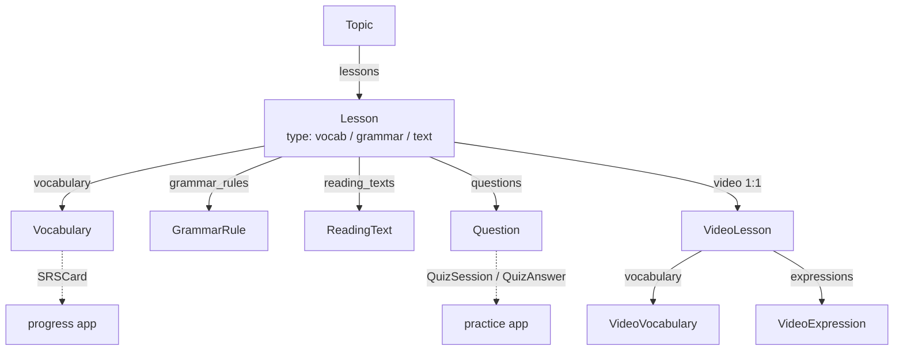
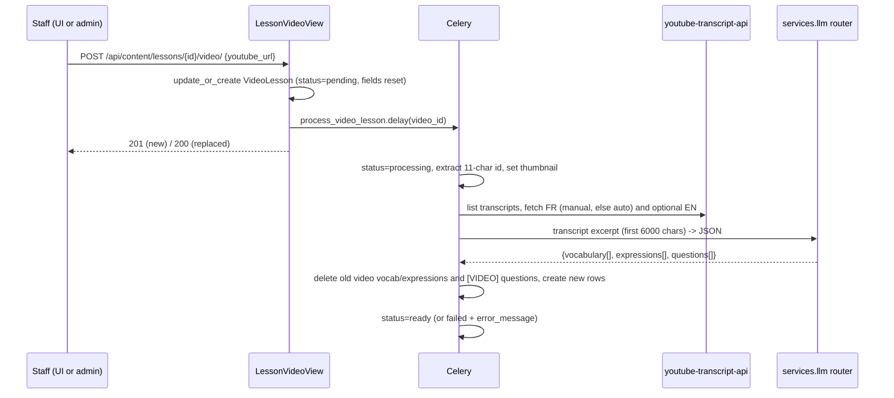

# Content and Lessons

> The curriculum: topics, lessons, vocabulary, grammar rules, reading texts, quiz questions, and YouTube video lessons. Every learner-facing feature (lessons, quizzes, flashcards, mini-games) reads from these tables, filtered by the learner's target language.

**Code:** `backend/apps/content/` · **Spec:** [specs/content.md](../specs/content.md)

## Overview

Content is read-only for learners and authored by seed commands or Django admin. Staff can attach a YouTube video to a lesson; a Celery task then pulls the transcript and asks the LLM to extract vocabulary, expressions and quiz questions.

## Key concepts

| Term | Meaning |
|------|---------|
| `language` | Discriminator on every content row (`fr`/`en`, default `fr`). APIs return only rows matching `request.user.target_language`. |
| Topic | A themed unit ("Salutations", "Les voyages"), ordered by `order`, with a `difficulty_level`. |
| Lesson | One unit of study inside a topic. `type` is `vocab`, `grammar` or `text`. `content` is free-form JSON the UI renders (e.g. `phrases`, `cultural_note`). |
| Question | A quiz item for a lesson: `mcq`, `fill_blank`, `translate`, `match`, `listen`, `cloze`, `conjugation`. |
| `[VIDEO]` prefix | Questions generated from a video transcript have prompts starting with `[VIDEO] ` so they can be replaced on reprocessing. |
| `french` / `english` columns | On `Vocabulary`, `french` is the target-language term and `english` the gloss. For EN content the column names are historical. |

## How it works

### Browsing

| Step | Endpoint | Notes |
|------|----------|-------|
| List topics | `GET /api/content/topics/` | Unpaginated list, language-filtered, ordered by `order`. `lesson_count` comes from a single `COUNT` annotation. |
| Open a topic | `GET /api/content/topics/{id}/` | Topic plus a short lesson list (`id, type, title, order, difficulty`). Cross-language ids return 404. |
| Open a lesson | `GET /api/content/lessons/{id}/` | Full lesson: topic stub, vocabulary, grammar rules, reading texts, questions, and the video (or `null`). One query per relation thanks to `select_related` + `prefetch_related`. Cross-language ids return 404. |
| Random words | `GET /api/content/vocabulary/random/?count=&single_word=&gendered=` | Used by mini-games and pronunciation. `count` is capped at 20. `single_word=true` excludes multi-word entries and very short ones; `gendered=true` keeps only `m`/`f`. Returns one object when `count=1`, otherwise a list. |

### Video lessons

- Attaching a video through the API needs a staff or superuser account. Saving a `VideoLesson` in admin with a new or changed URL also queues the task.
- `GET /api/content/lessons/{id}/video/` returns the current `VideoLesson` (with extracted vocabulary and expressions) so the UI can poll `status`.
- Failure handling: a `ValueError` (bad URL, no French captions) marks the video `failed` without retry. Other errors (transcript fetch refused, LLM/JSON errors) mark it `failed` and retry up to 2 times, 60 s apart.

## Data model

| Model | Purpose | Key fields |
|-------|---------|------------|
| `Topic` | Thematic unit | `name_fr`, `name_en`, `description`, `icon` (emoji), `order`, `difficulty_level`, `language` |
| `Lesson` | Study unit in a topic | `topic` FK, `type`, `title`, `content` (JSON), `order`, `difficulty`, `language` |
| `Vocabulary` | Word/phrase in a lesson | `lesson` FK, `french`, `english`, `pronunciation`, `example_sentence`, `gender` (`m/f/n/a`), `part_of_speech`, `audio_url`, `language` |
| `GrammarRule` | Grammar explanation | `lesson` FK, `title`, `explanation`, `formula`, `examples` (JSON list), `exceptions` (JSON list), `language` |
| `ReadingText` | Reading passage | `lesson` FK, `title`, `content_fr`, `content_en`, `vocabulary_highlights`, `comprehension_questions` (JSON), `language` |
| `Question` | Quiz item | `lesson` FK, `type`, `prompt`, `correct_answer`, `wrong_answers` (JSON list), `explanation`, `difficulty`, `language` |
| `VideoLesson` | YouTube video on a lesson (1:1) | `lesson` 1:1, `youtube_url`, `youtube_id`, `title`, `thumbnail_url`, `duration_seconds`, `transcript_fr`, `transcript_en`, `status`, `error_message`, `language`, timestamps |
| `VideoVocabulary` | Word extracted from a video | `video_lesson` FK, `french`, `english`, `pronunciation`, `example_sentence`, `timestamp_seconds` |
| `VideoExpression` | Idiom extracted from a video | `video_lesson` FK, `expression_fr`, `expression_en`, `context_sentence`, `timestamp_seconds` |

All `language` fields are indexed. Deleting a lesson cascades to everything under it, including learners' SRS cards, quiz sessions and lesson completions that point at it.

## Configuration

- LLM provider keys (`GEMINI_API_KEY`, `GROQ_API_KEY`) are needed for video extraction. See [Configuration and Settings](Configuration-and-Settings.md).
- In `config.settings.local`, Celery runs eagerly, so attaching a video blocks the request until processing (including retries) finishes.

## Working on it

### Seeding content

| Command | What it seeds | Source | Re-run behaviour |
|---------|---------------|--------|------------------|
| `seed_topics_fr [--level a1\|a2\|b1\|b2\|c1c2\|all] [--force] [--reset] [--dry-run] [--path]` | FR topics with a vocab lesson, a reading lesson and an "Expressions clés" lesson each | `data/topics_fr_<level>.json` | `update_or_create` per topic; existing topics are skipped unless `--force`/`--reset`. **Preferred pattern.** |
| `seed_content` | 2 FR starter topics with vocab, grammar, reading and questions | Python literals | Skips if any topic exists |
| `seed_demo_data` | FR topics 3-8 plus 12 Discover cards | Python literals | Skips topics whose `name_fr` exists |
| `seed_extended_content` | FR topics 9-20 | Python literals | Skips topics whose `name_fr` exists |
| `seed_content_en` | 5 EN topics, 25 lessons, about 300 words | Python literals | Skips if any EN topic exists |
| `seed_questions_en` | One MCQ per EN vocab item (distractors from the same lesson) | Derived | Skips lessons that already have questions |
| `seed_conjugations` (progress app) | "Conjugaison" topic with conjugation questions | Python dict | `get_or_create` per question |

A fresh FR database typically needs `seed_topics_fr` (and optionally the demo/extended seeds); EN needs `seed_content_en` then `seed_questions_en`. Inside Docker, `data/` is copied to `/data`, which is where `seed_topics_fr` looks (`BASE_DIR.parent / "data"`).

### Common changes

- **New content field:** add it to the model with a default, `makemigrations`, add it to the serializer `fields`, and to the admin inline.
- **New question type:** add it to `Question.TYPE_CHOICES`, to the allowed list in `apps/content/tasks.py`, and teach the frontend quiz renderer about it.
- **New language-scoped view:** filter with `language=request.user.target_language` in `get_queryset()`.
- **Tests:** `pytest apps/content` (models, serializers, views, language filtering, topic-list query count, video helpers).

### Gotchas

- `Lesson`, `Topic` ordering is by `order`; seeds use steps of 10 so you can insert between.
- `TopicListSerializer.lesson_count` falls back to a per-object `COUNT` if the queryset is not annotated. Keep the annotation in `TopicListView`.
- `Vocabulary` rows written by other apps (e.g. `apps/notes`) also live here.

## Known gaps

- `LessonVideoView` does not filter by `target_language`, unlike the other detail views.
- Video processing does not copy `lesson.language` onto `VideoLesson` or the generated `Question` rows, so they default to `fr`. The transcript fetch and LLM prompt are French-only.
- Video processing deletes and re-creates rows one at a time outside a transaction, so a mid-way failure can leave partial content.
- Permanent transcript errors (captions disabled, video unavailable) are retried like transient ones.
- The `[VIDEO] ` prompt prefix is a string marker shared with the frontend instead of a field.
- `RandomVocabularyView` returns an object for `count=1` and a list otherwise; non-numeric or negative `count` produces a server error.
- About 6,000 lines of seed content live as Python literals across four commands with copy-pasted helpers; only `seed_topics_fr` uses JSON data files.
- `seed_content` skips when any topic exists, including EN or conjugation topics.
- Content admin does not show or filter by `language`.
- No composite indexes for common orderings (`Topic(language, order)`, `Lesson(topic, order)`).
