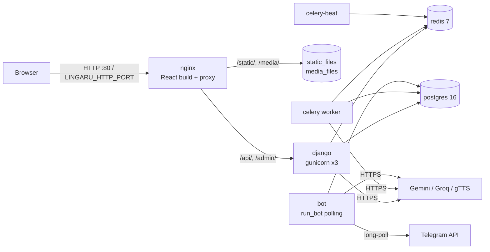

# Deployment and Operations

> How Lingaru runs in production on a single Hetzner server with Docker Compose, how code reaches it (GitHub Actions over SSH), and how to operate it day to day: env setup, migrations, backups and restore, logs, monitoring and incident runbooks. Audience: whoever deploys or is on call.

**Code:** `docker-compose.yml`, `docker-compose.dev.yml`, `backend/Dockerfile`, `nginx/`, `.github/workflows/deploy.yml`, `scripts/` · **Spec:** [specs/infrastructure.md](../specs/infrastructure.md)

## Overview

Everything runs on one host. nginx is the only container that publishes a port. It serves the built React app and reverse-proxies `/api/` and `/admin/` to gunicorn. Celery handles background work, Celery Beat schedules it, and the Telegram bot long-polls Telegram from its own container.



## Key concepts

| Term | Meaning |
|---|---|
| Deploy path | Directory on the server holding the git checkout (`HETZNER_DEPLOY_PATH` secret) |
| `.env` | Single env file at the repo root on the server, read by every backend container via `env_file: .env` |
| Smoke test | `GET /api/health/` must return `{"status": "ok"}` after a deploy |
| Rollback | `git reset --hard <previous SHA>` plus a rebuild. Code only (see [Migrations](#migrations)) |
| Approval | Web sign-ups are created inactive; an admin activates them in Django admin |

## Services

| Service | Image / build | Command | Ports | Volumes | Restart |
|---|---|---|---|---|---|
| `postgres` | `postgres:16-alpine` | default | none | `postgres_data:/var/lib/postgresql/data` | none |
| `redis` | `redis:7-alpine` | default | none | `redis_data:/data` | none |
| `django` | `backend/Dockerfile` | `migrate` then `collectstatic` then `gunicorn config.wsgi:application --bind 0.0.0.0:8000 --workers 3` | none (internal 8000) | `static_files`, `media_files` | none |
| `celery` | `backend/Dockerfile` | `celery -A config worker -l info` | none | none | none |
| `celery-beat` | `backend/Dockerfile` | `celery -A config beat -l info` | none | none | none |
| `bot` | `backend/Dockerfile` | `python manage.py run_bot` (long polling, `drop_pending_updates=True`) | none | none | `unless-stopped` |
| `nginx` | `nginx/Dockerfile` (multi-stage: `node:20-alpine` builds the frontend, then `nginx:alpine`) | default | `${LINGARU_HTTP_PORT:-80}:80` | `static_files:ro`, `media_files:ro` | none |

All backend containers set `DJANGO_SETTINGS_MODULE=config.settings.prod`. Postgres and Redis have compose healthchecks (`pg_isready`, `redis-cli ping`), and the app services wait on `service_healthy`.

The backend image is `python:3.12-slim` with `gcc` and `libpq-dev`, `pip install -r backend/requirements.txt`, the code at `/app` and `data/` at `/data`.

### Dev override

`docker-compose.dev.yml` switches every backend service to `config.settings.dev` and bind-mounts `./backend` to `/app`. It runs `runserver` on `:8000` and publishes Postgres on `5433` and Redis on `6379`. Use it locally only:

```bash
docker compose -f docker-compose.yml -f docker-compose.dev.yml up --build
```

## nginx

`nginx/nginx.conf` (one `server` on `:80`, `server_name _`, `client_max_body_size 10M`):

| Location | Behaviour |
|---|---|
| `/` | Serves `/usr/share/nginx/html` (Vite build) with SPA fallback `try_files $uri $uri/ /index.html` |
| `/api/` | `proxy_pass http://django` with `Host`, `X-Real-IP`, `X-Forwarded-For`, `X-Forwarded-Proto` |
| `/admin/` | Same proxy headers as `/api/` |
| `/static/` | `alias /app/staticfiles/` (Django `collectstatic` output, admin CSS/JS) |
| `/media/` | `alias /app/media/` (Django `MEDIA_ROOT`, e.g. generated TTS audio) |

TLS is not configured in this repo. Production is reached over HTTPS, so TLS is terminated in front of this nginx (outside the repo). `LINGARU_HTTP_PORT` exists so nginx can bind a non-80 host port when another proxy owns 80. Django trusts `X-Forwarded-Proto: https` (`SECURE_PROXY_SSL_HEADER`) and uses `X-Forwarded-Host` (`USE_X_FORWARDED_HOST`).

## Configuration

### First-time server setup (Hetzner)

1. Install Docker Engine and the compose plugin. Create a non-root deploy user that can run `docker compose`.
2. `git clone` the repo into the deploy path, then `cp .env.example .env` and `chmod 600 .env`.
3. Fill in `.env` using the table below. In production set `DEBUG=False`, a long random `DJANGO_SECRET_KEY` (`python -c "import secrets; print(secrets.token_urlsafe(64))"`) and a non-default `DB_PASSWORD`.
4. `docker compose up -d --build`, then `docker compose exec django python manage.py createsuperuser`.
5. Seed content as needed (see [Seeding](#seeding-content)).
6. Install the backup cron job (see [Backups](#backups)).
7. Add the GitHub Actions secrets listed under [Deploy workflow](#deploy-workflow).

### Environment variables

Defined in `.env` at the repo root. Settings live in `backend/config/settings/base.py` and `prod.py`.

| Variable | Used for | Notes |
|---|---|---|
| `DJANGO_SECRET_KEY` | Django signing (sessions, JWT) | Required. Long and random in production |
| `DEBUG` | Debug mode | `prod.py` forces `False` regardless |
| `ALLOWED_HOSTS` | Host header allowlist | Comma-separated exact hostnames |
| `CSRF_TRUSTED_ORIGINS` | Admin and form POST origin check | Must include the scheme, e.g. `https://app.example.com` |
| `SESSION_COOKIE_SECURE`, `CSRF_COOKIE_SECURE` | Secure cookie flags | Default `False`. Set `True` when served over HTTPS |
| `CORS_ALLOWED_ORIGINS` | CORS allowlist | Only needed if the SPA is served from another origin |
| `DB_NAME`, `DB_USER`, `DB_PASSWORD`, `DB_HOST`, `DB_PORT` | Postgres | `DB_HOST=postgres` in compose. Also feed `POSTGRES_*` for the postgres container |
| `REDIS_URL`, `CELERY_BROKER_URL`, `CELERY_RESULT_BACKEND` | Cache and Celery | `redis://redis:6379/0` in compose |
| `GEMINI_API_KEY`, `GEMINI_MODEL`, `GEMINI_EMBEDDING_MODEL` | Gemini LLM, vision, embeddings | |
| `GROQ_API_KEY`, `GROQ_MODEL` | Groq LLM and Whisper STT | |
| `TELEGRAM_BOT_TOKEN` | Bot | `bot` exits at startup if unset |
| `LINGARU_MEMORY_ENABLED` | Chat memory injection and extraction | Default `false` |
| `SENTRY_DSN`, `SENTRY_ENVIRONMENT`, `SENTRY_TRACES_SAMPLE_RATE`, `SENTRY_RELEASE` | Backend Sentry | Sentry is initialised only when `SENTRY_DSN` is set |
| `LINGARU_HTTP_PORT` | Host port for nginx | Default `80` |

Frontend build-time variables (`frontend/.env.example`): `VITE_API_URL` (default `/api`), `VITE_SENTRY_DSN`, `VITE_SENTRY_ENVIRONMENT`, `VITE_SENTRY_TRACES_SAMPLE_RATE`. Vite inlines them when the image is built.

## How it works

### Deploy workflow

`.github/workflows/deploy.yml`, "Deploy to Hetzner". It triggers when the `CI` workflow completes successfully on `main` (`workflow_run`), or manually (`workflow_dispatch`). `concurrency: deploy-prod` serialises deploys without cancelling a running one.

| # | Step | What it does |
|---|---|---|
| 1 | Configure SSH | Writes `HETZNER_SSH_KEY` to `~/.ssh/id_ed25519`, runs `ssh-keyscan` on `HETZNER_HOST` |
| 2 | Capture previous SHA | `git rev-parse HEAD` in the deploy path, saved as `steps.prev.outputs.sha` |
| 3 | Pull and rebuild | `git fetch origin main && git reset --hard origin/main && docker compose up -d --build && docker compose ps` |
| 4 | Wait | `sleep 15` |
| 5 | Run migrations | `docker compose exec -T django python manage.py migrate --noinput` |
| 6 | Smoke test | `curl` `HEALTH_URL` (default: the public app URL plus `/api/health/`) up to 5 times, 10s apart; passes when the body contains `"status": "ok"` |
| 7 | Rollback on failure | If any step after 2 fails: `git reset --hard $PREV_SHA && docker compose up -d --build`, then one health probe. The job still ends red |

Required repo secrets: `HETZNER_SSH_KEY`, `HETZNER_HOST`, `HETZNER_USER`, `HETZNER_DEPLOY_PATH`. `HEALTH_URL` is optional.

Manual deploy (same effect as step 3):

```bash
cd $DEPLOY_PATH
git fetch origin main && git reset --hard origin/main
docker compose up -d --build
docker compose ps
curl -fsS https://<host>/api/health/
```

### Migrations

- The `django` container command runs `python manage.py migrate` before gunicorn starts, so migrations apply as soon as the new container boots. Step 5 of the deploy runs `migrate` again; that run is normally a no-op.
- `celery`, `celery-beat` and `bot` start with the new code at the same time as `django`. They are not ordered after migrations.
- Rollback restores code only. Migrations already applied stay applied, so a rolled-back deploy runs old code against the new schema. Until this changes, keep migrations backward compatible (add nullable columns and new tables first; drop or rename in a later release).
- To reverse a reversible migration by hand: `docker compose exec django python manage.py migrate <app> <previous_migration>`, run before resetting the code.
- CI fails if models change without a migration (`makemigrations --check --dry-run`).

### Rollback by hand

```bash
cd $DEPLOY_PATH
git log --oneline -5                       # find the last good SHA
# optional: reverse migrations first (see above)
git reset --hard <good_sha>
docker compose up -d --build
curl -fsS https://<host>/api/health/
```

### Backups

`scripts/backup_db.sh` streams `pg_dump --no-owner --clean --if-exists` out of the running `postgres` container, gzips it to `$BACKUP_DIR/lingaru-<UTC timestamp>.sql.gz` (default `~/backups`) and deletes dumps older than `RETENTION_DAYS` (default 14).

Install once on the server, as the deploy user:

```bash
mkdir -p ~/backups
crontab -e
# 0 3 * * *  /home/lingaru/Lingaru/scripts/backup_db.sh >> ~/backups/backup.log 2>&1
```

Check that it ran: `ls -lh ~/backups | tail` and `tail ~/backups/backup.log`.

Scope today: Postgres only, kept on the same host. The `media_files` and `redis_data` volumes are not backed up. TTS audio can be regenerated; other files under media cannot.

### Restore

`scripts/restore_db.sh <dump.sql.gz>` pipes the dump into `psql` in the running `postgres` container after an interactive Enter confirmation. The dump contains `DROP ... IF EXISTS`, so current data is replaced.

```bash
docker compose stop django celery celery-beat bot     # stop writers
./scripts/restore_db.sh ~/backups/lingaru-YYYYMMDD-HHMMSS.sql.gz
docker compose start django celery celery-beat bot
curl -fsS https://<host>/api/health/
```

Both scripts use the database and role name `lingaru`. Edit them if `DB_NAME` or `DB_USER` differ.

### Background jobs

Celery Beat schedule (`CELERY_BEAT_SCHEDULE` in `base.py`):

| Entry | Task | Schedule |
|---|---|---|
| `generate-daily-discover-feed` | `discover.generate_daily_feed` | every 86400s |
| `fetch-real-news-morning` | `discover.fetch_real_news_pipeline` (`max_total=10`) | 07:00 UTC |
| `fetch-real-news-evening` | `discover.fetch_real_news_pipeline` (`max_total=10`) | 19:00 UTC |

On-demand tasks: `documents.process_document` (RAG ingestion after upload), `exam_prep.grade_response` (EE/EO grading; the frontend polls `/api/exam-prep/responses/<id>/grading/`), `content.process_video_lesson`. Beat keeps its schedule state in `celerybeat-schedule` inside the container's working directory.

### Seeding content

Management commands (run with `docker compose exec django python manage.py <cmd>`):

| App | Commands |
|---|---|
| content | `seed_topics_fr`, `seed_content`, `seed_content_en`, `seed_extended_content`, `seed_questions_en`, `seed_demo_data` |
| grammar | `seed_grammar`, `seed_grammar_booster_fr` |
| discover | `seed_discover_trivia_fr`, `seed_news`, `seed_news_en`, `fetch_news`, `generate_feed` |
| exam_prep | `seed_exam_exercises`, `seed_exam_all_levels` |
| dictionary | `seed_dictionary_fr` |
| agents | `seed_agents`, `seed_agents_en` |
| gamification | `seed_badges` |
| notes | `import_notes` |

JSON and CSV seed files live in `data/`, mounted at `/data` in the image.

## Observability

| Signal | Where |
|---|---|
| Health probe | `GET /api/health/`: no auth. Runs `SELECT 1`; returns 200 `{"status":"ok","db":"ok"}` or 503 `{"status":"error",...}` |
| Container logs | `docker compose logs -f --tail=200 <service>` (Docker `json-file` driver) |
| Backend errors | Sentry, when `SENTRY_DSN` is set. Django, Celery and logging integrations; `traces_sample_rate` from env (default 0.1); `send_default_pii=False` |
| Frontend errors | `@sentry/react` in `frontend/src/sentry.js`, active only if `VITE_SENTRY_DSN` is present at build time; replays off |
| Deploy status | GitHub Actions run of "Deploy to Hetzner" (red job = rollback attempted) |
| Backups | `~/backups/backup.log` |

## Runbook

| Symptom | Check | Fix |
|---|---|---|
| Site down / 502 from nginx | `docker compose ps`; `docker compose logs --tail=100 django` | If `django` exited (often a failing `migrate` at boot), fix and `docker compose up -d django`. After a host reboot, run `docker compose up -d` (most services have no restart policy) |
| Health probe 503 | `docker compose logs postgres`; `docker compose exec postgres pg_isready` | `docker compose up -d postgres`; check disk space (`df -h`) |
| Deploy red, site healthy | Actions log: did rollback run? | Fix forward on `main`; if a migration was applied, check schema compatibility of the rolled-back code |
| Requests time out under load | `docker compose logs django \| grep -i timeout` | gunicorn runs 3 sync workers with a 30s timeout and AI calls are synchronous. Restart `django`; consider more workers or threads |
| AI features return 503 "temporarily unavailable" | `docker compose logs django \| grep "LLM call failed"` | Provider outage or exhausted free-tier quota. Check the Gemini and Groq consoles; rotate or upgrade keys in `.env`, then `docker compose up -d` |
| Exam EE/EO grading stuck on "pending" | `docker compose logs celery`; `docker compose ps celery` | `docker compose restart celery` |
| News or Discover not refreshing | `docker compose logs celery-beat celery` | Restart both; run `python manage.py fetch_news` by hand |
| Bot silent | `docker compose logs bot` | Check `TELEGRAM_BOT_TOKEN`. Only one process may poll a token, so stop any local bot using the same token. `docker compose restart bot` |
| New user cannot log in | Django admin, Users list (inactive first) | Select the user, then "Approve selected accounts" |
| Disk filling up | `docker system df`; `du -sh` on the volumes; `~/backups` | Prune old images (`docker image prune`); TTS audio in `media/audio/` grows with use; container logs are not rotated by compose |
| Need to restore data | See [Restore](#restore) | Stop writers first |

## Working on it

- Change infra in `docker-compose.yml` or `nginx/nginx.conf`, merge to `main`, and the deploy rebuilds on the server.
- Static admin assets come from `collectstatic` into the shared `static_files` volume at container start.
- A new env var needs three things: add it to `.env.example`, read it in `settings/*.py` via `config(...)`, and set it in the server `.env`. Containers pick it up on the next `docker compose up -d`.
- Images are built on the server during deploy. The first build after a dependency bump takes several minutes.

## Known gaps

- Only `bot` has a restart policy; other services stay down after a crash or host reboot.
- Backups are Postgres-only and stored on the same host; there is no off-host copy, no media backup and no scheduled restore test.
- Rollback does not reverse database migrations, and no backup is taken automatically before a deploy.
- Migrations run both at `django` container start and in a separate deploy step; workers start with new code before migrations finish.
- Images are built on the production host; there is no registry and no tagged images to roll back to.
- Containers have no compose-level log rotation, resource limits or healthchecks (except Postgres and Redis).
- No `LOGGING` config in settings; app INFO logs are not emitted in production.
- `VITE_SENTRY_DSN` is not passed to the nginx image build (`.env*` files are excluded by `.dockerignore`), so frontend Sentry is inactive in production builds.
- `SENTRY_RELEASE` is not set by the deploy workflow.
- `frontend/Dockerfile` is unused (compose builds the frontend in `nginx/Dockerfile`).
- The frontend build stage uses Node 20, which is past end of life.
- No uptime monitoring or alerting is defined in the repo.
