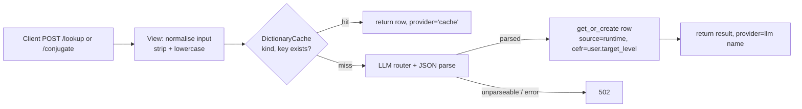

# Dictionary and Conjugator

> The dictionary lets a learner look up a word and see its part of speech, gender, definitions, examples, synonyms, antonyms, etymology and register. The conjugator returns a French verb in 8 tenses. Results are generated by an LLM once, cached in `DictionaryCache`, and served from the cache to everyone afterwards. The top 3000 French lemmas are pre-warmed at seed time.

**Code:** `backend/apps/dictionary/` · **Spec:** [specs/dictionary.md](../specs/dictionary.md)

## Overview



Pre-warm path: `seed_dictionary_fr` reads `data/dictionary_seed_fr.csv`, calls the LLM for each missing lemma, and writes rows with `source="seed"` and a CEFR level derived from the frequency rank.

## Key concepts

| Term | Meaning |
|---|---|
| kind | `lookup` (dictionary entry) or `conjugation` (verb table) |
| key | The normalised user input (stripped and lowercased word or infinitive) |
| source | `seed` (pre-warmed by the command) or `runtime` (written on a cache miss) |
| cefr_level | `A1`..`C2`. For seed rows it comes from frequency rank; for runtime rows it is the requesting user's `target_level`. |
| Cache-first | Check the cache before the LLM; a miss writes back, so the next user gets a hit |

## How it works

### Lookup (`DictionaryLookupView`)

1. `word = request.data["word"].strip().lower()`. An empty word returns 400 and a word longer than 100 characters returns 400.
2. The system prompt depends on `user.target_language`:
   - `en`: an English-dictionary prompt with `gender: null`.
   - otherwise: `LOOKUP_SYSTEM_PROMPT_FR`.
3. `cache.cached_or_call(kind=LOOKUP, key=word, llm_fn, default_cefr=user.target_level)`:
   - **Hit:** `{result, provider: "cache", cefr_level, source}`.
   - **Miss:** calls `llm_fn()`, parses with `parsing.parse_json_response` (handles plain JSON, fenced JSON, or the first `{...}` in prose), then `get_or_create`. If a concurrent request already wrote the row, that row is returned unchanged.
   - **`None` result:** raises `CacheMissResult`, which the view returns as 502. Nothing is cached.

### Conjugation (`VerbConjugatorView`)

- EN learners get 400 with `code: "feature_unavailable_for_language"`.
- `verb` is stripped and lowercased; an empty verb returns 400 and one longer than 60 characters returns 400.
- The same `cached_or_call` flow runs with `kind=CONJUGATION` and `CONJUGATE_SYSTEM_PROMPT`.
- Tenses returned: Présent, Imparfait, Passé composé, Futur simple, Conditionnel présent, Subjonctif présent, Impératif, Plus-que-parfait.
- The result also includes `auxiliary`, `past_participle` and `present_participle`.

### Pre-warm (`seed_dictionary_fr`)

- **Input:** CSV columns `rank,lemma,part_of_speech`, 3000 rows. It is built by `scripts/build_dictionary_seed_fr.py` from the Lonsdale & Le Bras frequency list.
- **Per row:** skip if `(lookup, lemma)` already exists. Otherwise call the LLM with `LOOKUP_SYSTEM_PROMPT_FR`, parse, and write `source="seed"` with `cefr_level=cefr_from_rank(rank)`.
- **Existing keys:** loaded into a set with one query up front.
- **Failures:** written to `data/dictionary_seed_failures.log`, which each run that has failures overwrites. `--retry-failed` re-runs only those lemmas.
- **Other flags:** `--path`, `--limit N`, `--dry-run`, and `--sleep S` (pause between LLM calls).

CEFR from rank (`cefr.py`):

| Rank | Level |
|---|---|
| 1-500 | A1 |
| 501-1000 | A2 |
| 1001-1700 | B1 |
| 1701-2400 | B2 |
| 2401-2800 | C1 |
| 2801+ | C2 |

`cefr_from_rank(rank)` raises `ValueError` for `rank < 1`.

## Data model

| Model | Purpose | Key fields |
|---|---|---|
| `DictionaryCache` | Global cache of LLM dictionary and conjugation output | `kind`, `key` (indexed), `result` JSON, `cefr_level` (indexed, null), `source` (indexed), timestamps; unique `(kind, key)` |

## Configuration

| Setting | Effect |
|---|---|
| `GEMINI_API_KEY`, `GEMINI_MODEL`, `GROQ_API_KEY`, `GROQ_MODEL` | LLM router used on a miss and at seed time |
| `data/dictionary_seed_fr.csv` | The lemma list for pre-warm |

## Working on it

```bash
cd backend
python manage.py seed_dictionary_fr --dry-run            # preview
python manage.py seed_dictionary_fr --limit 100          # staged rollout
python manage.py seed_dictionary_fr                      # full run (~3000 LLM calls, ~30 min)
python manage.py seed_dictionary_fr --retry-failed       # re-attempt failures
pytest apps/dictionary
```

- **Changing a prompt:** existing cache rows keep their old shape. To regenerate, delete the affected rows in admin or the shell and re-seed.
- **Correcting one entry:** edit or delete the `DictionaryCache` row. The next lookup refills it if you deleted it.
- **Parser:** always use `apps.dictionary.parsing.parse_json_response`. The seed command and the views share it.
- **Prompts:** `LOOKUP_SYSTEM_PROMPT_FR` and `CONJUGATE_SYSTEM_PROMPT` live in `views.py`, and the seed command imports them from there.

## Known gaps

- `DictionaryCache` has no `language` column. EN and FR lookups share keys, so an EN lookup of a word that is also French (for example `pain`, `chat`) returns the French entry, and the reverse also happens.
- Plan Phase 2 (pre-warming the top ~300 verbs into the conjugation cache) is not implemented. Conjugations are cache-first but only filled at runtime.
- The conjugator is FR-only.
- A cache miss calls the LLM synchronously inside the request.
- There is no admin action to purge or refresh stale rows. This is listed as a plan follow-up.
- Runtime rows take the user's `target_level` as `cefr_level`, which says more about the user than about the word.
- `views.py` keeps back-compat aliases (`LOOKUP_SYSTEM_PROMPT`, `_parse_json_response`). The prompts would be cleaner in a `prompts.py`.
- `admin.py` registers nothing for this app.

Related: [Content Data Pipeline](Content-Data-Pipeline.md).
