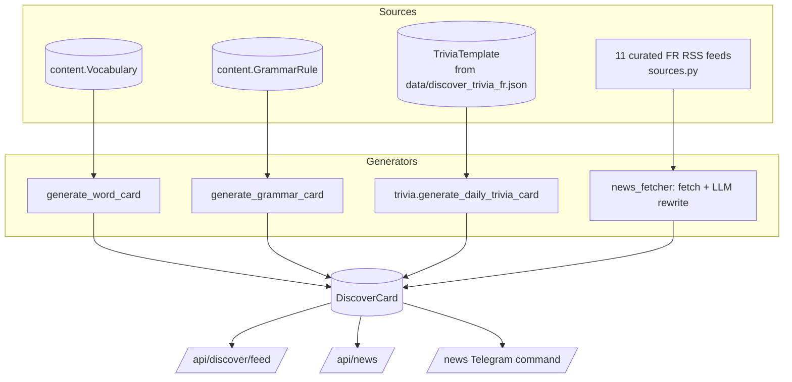
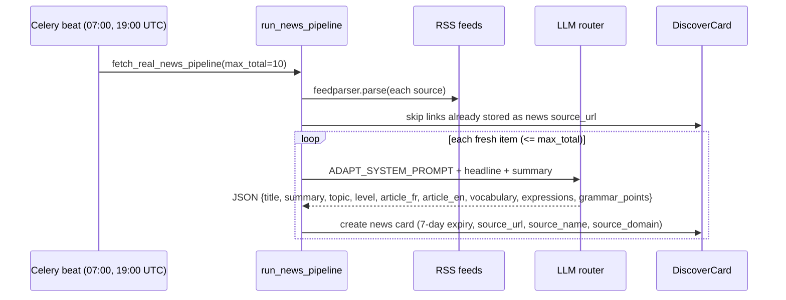

# Discover and News

> Discover is the "Explore" feed of bite-sized cards: Word of the Day, Grammar Tip and Trivia. News is a separate reading surface that takes real French headlines from curated RSS feeds and has an LLM rewrite them at B1-B2, with vocabulary, expressions and grammar points pulled out. Both are stored as `DiscoverCard` rows, shared by every learner of a given target language.

**Code:** `backend/apps/discover/` · **Spec:** [specs/discover-news.md](../specs/discover-news.md)

## Overview

| Surface | Card types | Endpoint prefix |
|---|---|---|
| Discover feed | `word`, `grammar`, `trivia` | `/api/discover/` |
| News | `news` | `/api/news/` |

## Key concepts

| Term | Meaning |
|---|---|
| `DiscoverCard` | One displayable card. Global (not per-user) and scoped by `language`. |
| Daily feed | One word, one grammar and one trivia card per active target language, made by Celery every 24 h |
| Trivia bank | Hand-authored `TriviaTemplate` rows loaded from JSON. A template is copied into a `DiscoverCard` when picked. |
| News pipeline | RSS fetch, then LLM rewrite, then save as a `news` card. Runs twice a day in Celery or on demand. |
| History | `UserDiscoverHistory(user, card)` records which cards a user has seen or interacted with. It drives "unseen first" ordering and the one-time XP award. |

## How it works

### Discover feed generation (`services.py`)

`generate_daily_cards()` collects the distinct `User.target_language` values, falling back to `["fr"]` if there are none. For each language it runs three generators:

| Generator | Source | Card content (`content_json`) | Expiry |
|---|---|---|---|
| `generate_word_card(lang)` | random `content.Vocabulary` in `lang` | `french, english, pronunciation, example, gender, part_of_speech`. The title is the target-language headword (English for `en`, French otherwise). | 24 h |
| `generate_grammar_card(lang)` | random legacy `content.GrammarRule` in `lang` | `explanation, formula, examples, exceptions`; summary is the first 200 characters of the explanation | 24 h |
| `generate_trivia_card(lang)` | `trivia.generate_daily_trivia_card`: random active `TriviaTemplate` in `lang` | `fact_fr, fact_en`; the card also copies the template's `title`, `summary` and `level` | 24 h |

- A failing generator is logged and skipped.
- If a language has no trivia bank (EN today), its trivia card is skipped.
- None of these generators call an LLM.

### Feed reading

- `GET /api/discover/feed/` returns every non-news card in the user's language. Expired cards are included on purpose, so the feed does not look empty.
- Each card is annotated with `seen` and `interacted` from `UserDiscoverHistory`.
- Ordering is unseen first, then `-generated_at`. Pages hold 20 cards.
- `POST /api/discover/generate-more/` runs `generate_daily_cards()` `rounds` times (default 3, clamped to 1..5) and returns the new cards.

### Interacting

`POST /api/discover/cards/<id>/interact/` (also mounted as `/api/news/<id>/interact/`):

1. Get-or-create the history row with `interacted=True`.
2. The first interaction awards 3 XP (`activity_type="discover_interact"`).
3. Later calls return `already_interacted: true` with 0 XP.

### Trivia bank (Phase 3 of the content plan)

- `data/discover_trivia_fr.json` holds 100 entries, loaded with `python manage.py seed_discover_trivia_fr`. See [Content Data Pipeline](Content-Data-Pipeline.md).
- `trivia.pick_trivia_template(user, lang)` prefers templates the user has not seen (`UserTriviaSeen`) and falls back to a random seen one.
- `generate_trivia_card_from_bank(user, lang)` copies the template into a card and records it as seen. This per-user path exists but is not wired into a view yet. The daily task and generate-more use the random, non-tracking `generate_daily_trivia_card`.

### News pipeline (`news_fetcher.py`)

- **Sources:** 11 feeds in `sources.py` (France Info, Le Monde sections, France 24, L'Equipe). Each has a default `topic` and `level`. A `preferred` source contributes up to 3 items per run; the others contribute 1.
- **Item cleanup:** HTML is stripped from titles and summaries with a regex. Titles are capped at 280 characters and summaries at 1200 before they go to the LLM.
- **Topic and level:** the topic from the LLM is used if it is in the valid set, otherwise the source default. Level comes from the LLM, else the source, else `B1`.

### On-demand news (`POST /api/news/generate/`)

`generate_news_card(topic, lang)` runs `count` times (default 3, clamped to 1..5). Each run tries three layers in order:

1. **RSS (FR only):** `fetch_one_fresh_card(topic)` fetches from the sources for that topic and rewrites the first fresh item.
2. **LLM synthetic:** the `news_generator` prompt asks the LLM to write a simplified article.
3. **Curated mock:** `_curated_news_mock(topic)` returns a hand-written article (9 topics) stored inline in `services.py`.

The endpoint returns 503 if no card was produced.

### News reading

- `GET /api/news/?topic=` lists non-expired news cards in the user's language, unseen first, 24 per page, together with topic counts.
- `GET /api/news/<id>/` returns the full article and marks it seen (no XP).

## Data model

| Model | Purpose | Key fields |
|---|---|---|
| `DiscoverCard` | Any displayable card | `type` (news, word, grammar, trivia), `title`, `summary`, `content_json`, `source_url`, `image_url`, `generated_at`, `expires_at`, `topic`, `level`, `language` |
| `TriviaTemplate` | Hand-authored trivia bank row | `slug`+`language` unique, `title`, `summary`, `fact_fr`, `fact_en`, `level`, `category`, `is_active` |
| `UserTriviaSeen` | Templates a user has seen | `user`+`template` unique, `seen_at` |
| `UserDiscoverHistory` | Seen and interacted state per card | `user`+`card` unique, `seen_at`, `interacted` |

## Configuration

| Setting | Effect |
|---|---|
| `CELERY_BEAT_SCHEDULE["generate-daily-discover-feed"]` | every 86400 s from when beat starts |
| `CELERY_BEAT_SCHEDULE["fetch-real-news-morning" / "-evening"]` | `crontab(7:00)` and `crontab(19:00)` UTC, `max_total=10` |
| `GEMINI_*`, `GROQ_*` | LLM router used for the news rewrite and the synthetic layer |
| `sources.RSS_SOURCES` | code constant: the feed list, topics and preferred flag |
| `CARD_EXPIRY_HOURS = 24`, `NEWS_CARD_LIFETIME_DAYS = 7` | module constants |

## Working on it

| Task | Command |
|---|---|
| Seed the trivia bank | `python manage.py seed_discover_trivia_fr [--dry-run] [--force]` |
| Make today's feed now | `python manage.py generate_feed` |
| Pull real news now | `python manage.py fetch_news [--max 10] [--clear]` |
| Seed one article per topic | `python manage.py seed_news [--clear]` (FR); `python manage.py seed_news_en` (EN, skips topics that already have an active article). Both go through `generate_news_card`, so they try RSS (FR) and the LLM before the curated mock. |
| Tests | `pytest apps/discover` |

- **Adding trivia:** append entries to `data/discover_trivia_fr.json` with a unique `slug`, then re-run the seed. Use `--force` to update existing slugs.
- **Adding an RSS feed:** add a dict to `RSS_SOURCES` with `id`, `name`, `topic`, `url`, `level` and an optional `preferred`.
- **New card type:** add it to `DiscoverCard.TYPE_CHOICES`, write a generator, add it to the tuple in `generate_daily_cards`, then update the frontend `DiscoverCard.jsx`.

## Known gaps

- `DiscoverCard` rows are never pruned, and the feed shows expired cards, so the table and the feed grow without limit.
- Generate-more creates cards for every active language, not only the requester's. Each round adds new shared cards.
- Trivia picks are random with no per-user dedupe, so the same template can appear several times in the feed. The per-user picker (`generate_trivia_card_from_bank`) is unused.
- There is no EN trivia bank. EN learners get no trivia cards.
- News still has the LLM-synthetic and curated-mock layers. The content plan says news should be RSS-only. The mock is about 790 lines of inline Python in `services.py`.
- The curated mock articles are French. EN learners fall back to them when the LLM is unavailable.
- News topic counts include expired cards, but the list does not.
- No composite index on `(language, type, generated_at)`. Duplicate detection loads every stored news `source_url`.
- `news_fetcher` (fetch, rewrite, save) has no direct unit tests.
- Generation (`generate-more`, `news/generate`) runs synchronously in the request rather than as a background job.
- The news topic list is defined in four places (`models.py`, `services.py`, `news_fetcher.py`, `sources.py`).
- The LLM `trivia_generator` prompts in `services/llm/prompts.py` are unused leftovers.
- `TriviaTemplate` is not registered in Django admin.

Related: [Telegram Bot](Telegram-Bot.md) (`/news`), [Content Data Pipeline](Content-Data-Pipeline.md).
