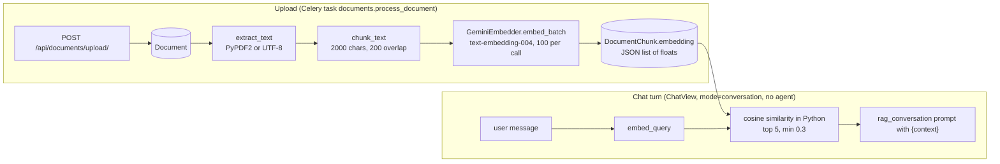

# Documents and RAG

> Learners upload their own study material (PDF or TXT) on `/documents`. Lingaru extracts the text, splits it into chunks, embeds each chunk with Gemini, and stores it. On later default-conversation turns the assistant retrieves the most similar excerpts and answers with them as reference (retrieval-augmented generation).

**Code:** `backend/apps/documents/`, `backend/services/rag/` · **Spec:** [specs/documents-rag.md](../specs/documents-rag.md)

## Overview

## Key concepts

| Term | Meaning |
|---|---|
| Document | One uploaded file owned by a user, with a `processed` flag and an optional `processing_error`. |
| Chunk | A fixed-size character window of the extracted text, plus its embedding vector. |
| Embedding | A Gemini `text-embedding-004` vector (768 floats). Documents use task type `RETRIEVAL_DOCUMENT` and queries use `RETRIEVAL_QUERY`. |
| Context | Up to `RAG_TOP_K` excerpts formatted as `[Excerpt i from "<title>"]:\n<content>`, joined by blank lines. |
| `rag_used` | Boolean in the chat response. True when context was injected for this turn. |

## How it works

### Upload and processing

1. `POST /api/documents/upload/` (multipart `file`, `title`). The serializer accepts `.pdf` and `.txt` and derives `file_type` from the extension.
2. A `Document` row is created (file stored under `documents/`).
3. `process_document_task.delay(document.id)` is queued (`apps/documents/tasks.py`). If queueing raises (for example the broker is unreachable), the view runs `process_document` synchronously and logs any failure.
4. The response is 201 with the serialized document. It usually shows `processed=false` and `chunk_count=0` because processing is asynchronous.

`services/rag/pipeline.py::process_document(document_id)` then runs these steps:

| Step | Detail |
|---|---|
| Extract | `services/rag/extractor.py`: TXT is read and decoded as UTF-8 (1 page). PDF uses `PyPDF2.PdfReader`, extracting text page by page and joining pages with blank lines. `page_count` is the number of PDF pages. |
| Empty text | Sets `processed=True` with `processing_error="No text could be extracted from the file."` |
| Chunk | `services/rag/chunker.py::chunk_text(text, 2000, 200)`. Fixed character windows with a step of 1800, so chunks are not aligned to sentences. |
| Embed | `GeminiEmbedder.embed_batch` in batches of 100 texts. |
| Store | `DocumentChunk.objects.bulk_create(...)` with `chunk_index`. `page_number` is left null. |
| Success | `processed=True`, `processing_error=None`. |
| Failure | `processed=False`, `processing_error=str(exc)`, and the exception is re-raised (the Celery task fails). |

### Retrieval in chat

`services/rag/context.py::retrieve_context_for_query(user_id, query)` is called by `ChatView` only when `mode == "conversation"` and **no agent** is selected:

1. If the user has no processed chunks with embeddings, return `None`. No API call is made.
2. Embed the query (`embed_query`). On failure, log an error and return `None`.
3. Load every chunk for the user (`id, content, embedding, document__title`) into memory.
4. `services/rag/retriever.py::rank_chunks`: pure-Python cosine similarity. Keep chunks with similarity ≥ `RAG_MIN_SIMILARITY`, sort descending, take the top `RAG_TOP_K`.
5. Format the excerpts and return them, or `None` if nothing qualifies.

`ChatView` then **replaces** the system prompt with `get_system_prompt(lang, "rag_conversation").format(context=...)` and sets `rag_used=True`. The memory block (if enabled) is prepended afterwards. Any exception in retrieval is caught and the standard prompt is used.

### Other endpoints

| Method + path | Behaviour |
|---|---|
| `GET /api/documents/` | The user's documents, paginated (20 per page), with `chunk_count`. |
| `DELETE /api/documents/<id>/` | Deletes the document and its chunks (cascade). Returns 204, or 404 if not owned. |
| `GET /api/documents/<id>/chunks/` | The chunks of one of the user's documents (`id, content, chunk_index, page_number`), paginated. Intended for debugging. |

## Data model

| Model | Table | Purpose | Key fields |
|---|---|---|---|
| `Document` | `documents_document` | Uploaded file | `user`, `title` (300), `file` (`documents/`), `file_type` (`pdf`/`txt`), `page_count`, `uploaded_at`, `processed`, `processing_error`. Ordering `-uploaded_at`. |
| `DocumentChunk` | `documents_chunk` | Text window + vector | `document` (CASCADE), `content`, `chunk_index`, `page_number` (nullable, unused), `embedding` (JSON list, default `[]`). Ordering `chunk_index`. |

Both are registered in admin.

## Configuration

| Setting | Default | Used by |
|---|---|---|
| `GEMINI_API_KEY` | | Embeddings (required for both ingest and retrieval) |
| `GEMINI_EMBEDDING_MODEL` | `models/text-embedding-004` | `pipeline.py`, `context.py` |
| `RAG_TOP_K` | 5 | retrieval |
| `RAG_MIN_SIMILARITY` | 0.3 | retrieval |
| `RAG_CHUNK_SIZE` / `RAG_CHUNK_OVERLAP` | 2000 / 200 | **not read**: the pipeline hard-codes 2000/200 |
| `CELERY_BROKER_URL` | `REDIS_URL` | async processing (`CELERY_TASK_ALWAYS_EAGER=True` in `local.py`) |

## Working on it

- **Tests:**
  - `apps/documents/tests/`: models and views (upload, list, delete, ownership).
  - `services/rag/tests/`: chunker, extractor, retriever, context, pipeline, embedder.
  - `apps/assistant/tests/test_chat_rag.py`
- Run the service tests explicitly: `python -m pytest services/rag`. They are outside `pytest.ini`'s `testpaths`.
- Upload tests run noticeably slower when no broker is reachable, because `.delay()` retries the connection before the view falls back to synchronous processing. Setting `CELERY_TASK_ALWAYS_EAGER=True` in test settings avoids this.
- **Reprocess a document:** delete its chunks first (`DocumentChunk.objects.filter(document=...).delete()`), then call `process_document(id)`. The pipeline does not clear old chunks.
- **Changing the embedding model:** all existing chunks must be re-embedded, because the model is not recorded per chunk.

## Known gaps

- `services/rag/tests/test_embedder.py` mocks the old `google.generativeai` module API, while the code uses `genai.Client`. Its 3 tests fail, and this goes unnoticed because `services/` is outside `testpaths`.
- Retrieval loads every chunk and its embedding into Python on each conversation turn and does brute-force cosine. There is no vector index (pgvector would fit since Postgres is the DB).
- Every conversation turn for users with documents makes a query-embedding API call, even for greetings.
- The similarity threshold (0.3) is permissive, so excerpts (up to about 10k chars) are injected on most turns.
- When context is found, the RAG prompt replaces the whole system prompt, dropping the agentic footer for that turn.
- Chunking ignores the `RAG_CHUNK_*` settings, splits mid-word or mid-sentence, does not record page numbers, and does not guard against `overlap >= chunk_size`.
- Re-running `process_document` duplicates chunks.
- TXT files that are not UTF-8 fail to process.
- `processing_error` stores the raw exception text instead of a user-friendly message.
- Deleting a document does not delete the stored file.
- PyPDF2 is deprecated in favour of `pypdf`.
- The default embedding model should be checked against Google's deprecation schedule. If embedding fails, retrieval silently returns no context.
- The document list uses `annotate(Count)`, which drops `Meta.ordering`, so its order is not guaranteed.
