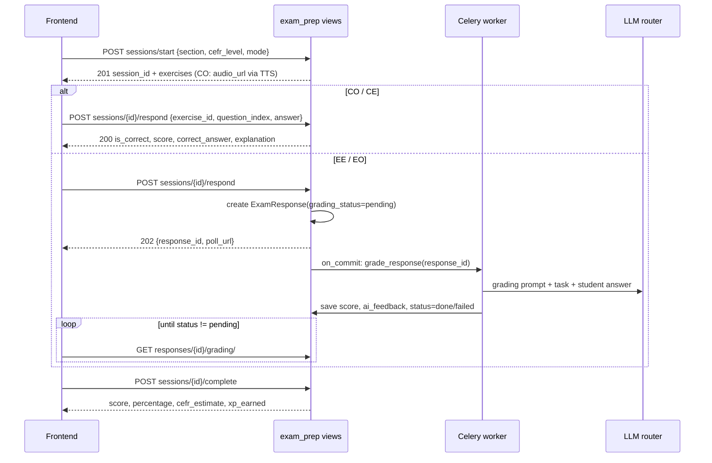

# Exam Prep

> Exam Prep is practice for the TCF and TEF French proficiency exams. It covers the four exam sections: listening (CO), reading (CE), writing (EE) and speaking (EO), at CEFR levels A1-C2. CO and CE are multiple choice and graded instantly. EE and EO answers are graded by an LLM in a Celery task while the frontend polls. Finished sessions award XP and update a per-section estimated CEFR level.

**Code:** `backend/apps/exam_prep/`, `backend/services/llm/prompts.py`, `backend/services/tts/` · **Spec:** [specs/exam-prep.md](../specs/exam-prep.md)

## Overview



## Key concepts

| Term | Meaning |
|---|---|
| Section | `CO` Compréhension orale (listening), `CE` Compréhension écrite (reading), `EE` Expression écrite (writing), `EO` Expression orale (speaking) |
| Mode | `practice`: no timer. `mock`: timed; the session time limit is the sum of the exercises' `time_limit_seconds`. |
| Exercise | One passage with MCQ questions (CO and CE), or one writing or speaking prompt (EE and EO) |
| Grading status | `not_required` (CO/CE), `pending`, `done`, `failed` (EE/EO) |
| Estimated CEFR | Derived from the user's best percentage per section |

## How it works

### Starting a session (`SessionStartView`)

1. Validate `section`, `cefr_level` and `mode` (default `practice`).
2. Load the active exercises for that section and level in the user's `target_language`, ordered by `order`. If there are none, return 404.
3. **CO:** for each exercise without `audio_url`, synthesise `passage_fr` with `get_or_create_audio` (cached in `media.AudioClip`) and attach the absolute URL to the response. A TTS failure is ignored.
4. **Max score:**
   - CO and CE: the total number of questions.
   - EE and EO: 20 per exercise.
5. **Time limit:** only in `mock` mode.
6. Create the `ExamSession` and return the exercises.

### Answering

**CO and CE (synchronous):**
- Compare `answer` with `question.correct_answer` (case-insensitive, trimmed).
- Store an `ExamResponse` with score 1 or 0 and max 1.
- Return the result together with `correct_answer` and `explanation`.

**EE and EO (asynchronous, added in PR #48):**
1. Store an `ExamResponse` with `grading_status="pending"`, `max_score=20` and a pre-generated `grading_task_id`.
2. Queue `exam_prep.grade_response` with `transaction.on_commit`, so the worker never sees an uncommitted row.
3. Return 202 with the `poll_url`.

**Grading task (`tasks.grade_response`):**
- Loads the response.
- If it is already `done`, returns the stored grading (idempotent).
- Builds `Task: <prompt_fr|prompt_en>\nRubric: ...\n\nStudent response: ...` and calls the LLM.
- Parses the JSON (fence-tolerant).
- On success it stores `score`, `max_score`, `ai_feedback` (the JSON string) and `done`.
- Errors trigger autoretry: up to 2 retries with exponential backoff capped at 60 s. The final retry marks the response `failed` and saves the error.

Expected grading JSON (from the prompt):

| Section | Keys |
|---|---|
| EE | `score`, `max_score` (20), `grammar_score`, `vocabulary_score`, `coherence_score`, `task_score`, `spelling_score`, `feedback_fr`, `feedback_en`, `errors[]`, `corrected_text` |
| EO (input is a transcription) | `score`, `max_score` (20), `fluency_score`, `vocabulary_score`, `grammar_score`, `task_score`, `coherence_score`, `feedback_fr`, `feedback_en`, `pronunciation_notes`, `grammar_notes` |

**Polling (`ResponseGradingView`):** returns `status`, `score` and `max_score`. When the status is `done` it also returns the parsed `grading`; when it is `failed`, a retry hint.

### Completing (`SessionCompleteView`)

1. `score = Σ response.score`, `max = Σ response.max_score` (at least 1).
2. `pct = score / max × 100`.
3. XP: `practice` 15, `mock` 30, plus 50 if `pct == 100`. Activity type is `exam_<section>_<mode>`. Also calls `check_streak`.
4. Update `ExamProgress(user, section)`: `sessions_completed += 1`, `best_score_pct = max(...)`, `estimated_cefr_level = score_to_cefr(best)`.

CEFR thresholds (`scoring.py`):

| ≥ % | Level |
|---|---|
| 95 | C2 |
| 85 | C1 |
| 75 | B2 |
| 65 | B1 |
| 50 | A2 |
| 30 | A1 |
| below 30 | "" |

### Hub

`GET hub/` returns, for each of the 4 sections: `code`, `label`, `exercise_count` (active, in the user's language), `sessions_completed`, `best_score_pct` and `estimated_cefr`.

## Data model

| Model | Purpose | Key fields |
|---|---|---|
| `ExamExercise` | Exercise content | `section`, `cefr_level`, `title`, `instructions_fr/en`, `content` JSON, `time_limit_seconds`, `order`, `is_active`, `language` |
| `ExamSession` | One attempt | `user`, `section`, `cefr_level`, `mode`, `score`, `max_score`, `time_limit_seconds`, `started_at`, `completed_at` |
| `ExamResponse` | One answer | `session`, `exercise`, `question_index`, `user_answer`, `is_correct`, `score`, `max_score`, `ai_feedback`, `grading_status`, `grading_task_id`, `grading_completed_at` |
| `ExamProgress` | Per-user, per-section aggregate | `user`+`section` unique, `best_score_pct`, `sessions_completed`, `estimated_cefr_level` |

`ExamExercise.content` shapes:

| Section | Shape |
|---|---|
| CE | `{text_fr, text_en?, questions: [{prompt, options[], correct_answer, explanation?}]}` |
| CO | `{passage_fr, questions: [...]}` (same question shape) |
| EE | `{prompt_fr, prompt_en, word_limit, rubric}` |
| EO | `{prompt_fr, prompt_en, duration_seconds, rubric}` |

## Configuration

| Setting | Effect |
|---|---|
| `CELERY_BROKER_URL` / `CELERY_RESULT_BACKEND` (default `REDIS_URL`) | Needed for EE/EO grading |
| `GEMINI_*`, `GROQ_*` | LLM grading |
| `GEMINI_API_KEY` | CO audio through Gemini TTS (gTTS fallback) |

## Working on it

```bash
cd backend
python manage.py seed_exam_exercises       # initial CE/CO/EE/EO set
python manage.py seed_exam_all_levels      # A1-C2 across all sections
pytest apps/exam_prep
celery -A config worker -l info            # required for EE/EO grading locally
```

- **Adding exercises:** today this means editing the Python lists in one of the two seed commands. Both use `get_or_create(section, cefr_level, title)`, so changing an existing exercise's content has no effect on re-run. Rename it or delete the row first. Plan Phase 4 moves this to `data/exam_prep_fr.json`.
- **Changing grading:** edit `exam_ee_grading` and `exam_eo_grading` in `services/llm/prompts.py` (per language). The API exposes the JSON shape as-is under `grading`.

## Known gaps

- **Grading prompt bug:** `tasks.py` looks up `SYSTEM_PROMPTS.get("exam_ee_grading")`, but `SYSTEM_PROMPTS` is keyed by language first. The grader therefore runs with an empty system prompt. It should use `get_system_prompt(exercise.language, key)`.
- The LLM `score` is saved without type or range checks. A non-numeric value fails after the retry handler and leaves the response `pending`.
- Completing a session while EE/EO grading is still pending counts those answers as 0.
- The completion percentage is computed over answered questions, not over the session's `max_score`. Repeated answers to one question are all counted.
- `ExamProgress` and `ExamSession` have no `language`, so FR and EN progress are merged.
- `ExamProgress.exercises_completed` is never updated.
- CO audio is synthesised synchronously at session start and always in French.
- There is no EN exam content (the seeds default to `language="fr"`).
- The two seed commands duplicate each other (identical `handle()`), and content is Python literals. Plan Phase 4 is not started.
- The hub makes 8 queries (a count and a progress lookup per section).
- Several parsers duplicate `dictionary.parsing.parse_json_response` (`tasks._parse_grading_json`).
- The README describes a hub with "countdown, readiness gauge, week plan, weak topics" and an exam filter, none of which exist. The async grading endpoint is not documented there.

Related: [Grammar Booster](Grammar-Booster.md), [Content Data Pipeline](Content-Data-Pipeline.md).
