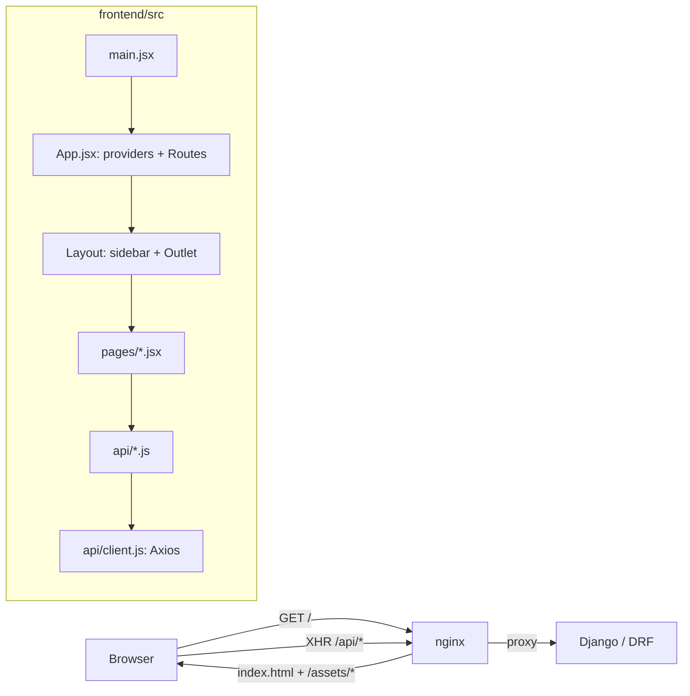
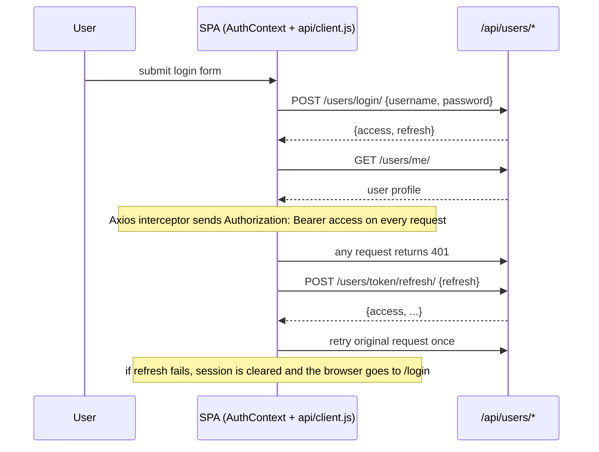

# Frontend Architecture

> The Lingaru web client is a React 18 single-page app served as static files by nginx. It talks only to the Django REST API under `/api/`. This page covers how the app boots, how routes map to pages and API calls, how the session works, where state lives, and how to add a page.

**Code:** `frontend/src/` · **Spec:** [specs/frontend.md](../specs/frontend.md) · **Related:** [Frontend Design System](Frontend-Design-System.md), [Internationalization](Internationalization.md), [Mini Games](Mini-Games.md)

## Overview



| Layer | Tech |
|---|---|
| UI | React 18.3, function components and hooks only |
| Routing | React Router 6 (`BrowserRouter`, nested `<Routes>`) |
| HTTP | Axios 1.x, one shared instance |
| Styling | Tailwind CSS 3.4 + `@tailwindcss/typography`, plus custom classes in `index.css` |
| i18n | i18next + react-i18next + browser language detector |
| Markdown | react-markdown 10 + remark-gfm |
| Errors | `@sentry/react`; a no-op when `VITE_SENTRY_DSN` is empty at build time |
| Build | Vite 5 |
| Lint / tests | ESLint 9 flat config; Playwright visual snapshots; Lighthouse CI |

## Key concepts

| Term | Meaning |
|---|---|
| **Mode** | `user.mode` is one of `general`, `exam` or `agentic`. It picks the landing route, the nav filter and the chrome colours. Mirrored to `<html data-mode>`. |
| **Target language** | `user.target_language` (`fr` or `en`): the language being learned. Content queries are scoped by it on the server. |
| **UI language** | `user.ui_language` (`en` or `fr`): the language of the app chrome. See [Internationalization](Internationalization.md). |
| **Blocks** | Structured payloads attached to assistant replies (`audio`, `vocab_card`, `quiz`, `feature_widget`, ...), rendered by `components/blocks/MessageBlocks.jsx`. |
| **Inline widget** | A one-round mini version of a feature, rendered inside chat by `FeatureWidgetBlock.jsx`. |
| **Feature availability** | `lib/featureAvailability.js`: a static table of which features exist per target language. Unavailable features are dimmed with `ComingSoonBadge`. |

## How it works

### Boot

1. `index.html` runs an inline script that applies the `dark` class from the saved theme (or `prefers-color-scheme`) before React loads, which avoids a theme flash. It also loads the Inter, Instrument Serif and JetBrains Mono fonts from Google Fonts.
2. `main.jsx` calls `initSentry()`, imports `index.css` and `i18n.js`, and renders `<StrictMode><BrowserRouter><App/></BrowserRouter></StrictMode>`.
3. `App.jsx` nests the providers in this order:

```
ThemeProvider → AuthProvider → LanguageProvider → ModeProvider → ToastProvider → <Routes>
```

4. `AuthProvider` loads the current user with `GET /api/users/me/` when a session exists. `ProtectedRoute` shows a loading state until that resolves.

### Routing map

Every authenticated route is nested under `/` → `<ProtectedRoute><Layout/></ProtectedRoute>`. All page modules are imported eagerly in `App.jsx`.

| Path | Page | API calls (module) |
|---|---|---|
| `/login` | `Login` | `POST /users/login/`, `GET /users/me/` (via `AuthContext`) |
| `/register` | `Register` | `POST /users/register/` (via `AuthContext`) |
| `/` (index) | `ModeLanding` | Renders `Dashboard` in general mode; redirects to `/exam-prep` (exam) or `/assistant` (agentic) |
| `/dashboard` | `Dashboard` | `getStats`, `getTrendReport` (gamification), `getSRSDueCards` (progress), `getRandomVocabulary` (content) |
| `/topics` | `Topics` | `getTopics` |
| `/topics/:id` | `TopicDetail` | `getTopic`, `getTopicProgress` |
| `/lesson/:id` | `LessonDetail` (+ `VideoSection`) | `getLesson`, `submitLessonVideo` |
| `/practice/quiz/random` | `RandomQuiz` | `GET /practice/quiz/random-lesson/`, then redirects to the quiz |
| `/practice/quiz/:lessonId` | `Quiz` | `startQuiz`, `submitAnswer`, `completeQuiz`, `completeLesson`, `generateTTS` |
| `/practice/dictation` | `Dictation` | `startDictation`, `checkDictation` |
| `/practice/pronunciation` | `Pronunciation` | `GET /content/vocabulary/random/`, `checkPronunciation`, `generateTTS` |
| `/practice/srs` | `SRSReview` | `getSRSDueCards`, `submitSRSReview` |
| `/practice/conjugation` | `ConjugationDrill` | `getConjugationVerbs`, `checkConjugation` |
| `/progress` | `Progress` | `getStats`, `getBadges`, `getLeaderboard`, `getXPHistory` |
| `/progress/mistakes` | `MistakeJournal` | `getMistakes`, `markMistakesReviewed` |
| `/assistant` | `Assistant` | `sendChatMessage`, `getConversations`, `getConversation`, `sendImageQuery`, `sendVoiceChat`, `memory.*` |
| `/agents` | `Agents` | `getAgents` |
| `/agents/:slug` | `AgentRun` | `getAgent`, `startAgentRun`, `getAgentRuns`, `sendChatMessage(..., agentSlug)` |
| `/documents` | `Documents` | `getDocuments`, `uploadDocument`, `deleteDocument` |
| `/discover` | `Discover` (+ `DiscoverCard`) | `getFeed`, `generateMore`, `interactWithCard` |
| `/news`, `/news/:id` | `News`, `NewsArticle` | `getNews`, `generateNews`, `getNewsArticle`, `interactWithNews` |
| `/dictionary` | `Dictionary` | `lookupWord`, `conjugateVerb` |
| `/our-notes`, `/our-notes/:id` | `OurNotes`, `OurNotesDetail` | `listNotes`, `getNote`, `askNote`, `addNoteToSrs`, `generateNoteQuiz` |
| `/our-notes/review`, `/our-notes/review/:id` | `OurNotesReview` | `listNotes`, `getNote`, `generateNoteQuiz` |
| `/my-notes` | `MyNotes` | `listMyNotes` |
| `/my-notes/new`, `/my-notes/:id` | `MyNotesEdit` | `getMyNote`, `createMyNote`, `updateMyNote`, `deleteMyNote`, `runMyNoteAIAction` |
| `/my-notes/public/:id` | `MyNotesPublic` | `getPublicMyNote` |
| `/mini-games` + 6 games | `MiniGames`, `WordScramble`, ... | See [Mini Games](Mini-Games.md) |
| `/exam-prep` | `ExamPrepHub` | `getExamHub` |
| `/exam-prep/:section` | `ExamSection` | `getExamExercises`, `startExamSession` |
| `/exam-prep/:section/:sessionId` | `ExamExercise` | `submitExamResponse`, `pollExamGrading`, `completeExamSession`, `generateTTS` |
| `/grammar` | `GrammarHub` | `getGrammarHub` |
| `/grammar/library` | `GrammarLibrary` | `getGrammarTopics` |
| `/grammar/topics/:slug` | `GrammarTopic` | `getGrammarTopic`, `startGrammarSession` |
| `/grammar/drill/:sessionId` | `GrammarDrill` | `submitGrammarAnswer`, `completeGrammarSession` |
| `/settings` | `Settings` | `PATCH /users/me/`, `PUT /users/change-password/`, `memory.*` |
| `*` | `NotFound` | none |

### Layout and navigation

- `components/Layout.jsx` renders a desktop sidebar (collapsible) and a mobile drawer.
- `NAV_SECTIONS` is a static array of `{ to, labelKey, icon }`. `filterNavForMode()` in `lib/modeConfig.js` filters it by mode and target language. In agentic mode, Dashboard and Assistant collapse into one "Home" item.
- The per-mode favicon is swapped at runtime (`/favicon-<mode>.png`).
- `/assistant` gets a full-bleed `<main>`; every other page is wrapped in a `max-w-7xl` container.
- `OnboardingModal` is shown while `user.mode` is `null`. On submit it PATCHes `mode`, `proficiency_level` and `target_language`, then calls `refreshUser()`.

### Session (auth) flow



- Registration creates an inactive account that waits for admin approval. The client shows the pending message and does not log in.
- Logout clears the client session and navigates to `/login`.
- Session credentials are handled only by `contexts/AuthContext.jsx` and `api/client.js`. Other modules should go through the shared client.

### State

| Kind | Where it lives |
|---|---|
| Current user, login/logout | `AuthContext` (`useAuth()`) |
| Theme (light/dark) | `ThemeContext` (`useTheme()`), saved as `theme` in localStorage |
| UI language | `LanguageContext` syncs `user.ui_language` into i18next and `<html lang>` |
| Mode | `ModeContext` mirrors `user.mode` to `<html data-mode>` |
| Toasts | `ToastContext` (`useToast().showToast(msg, type, duration)`) |
| Server data | Local `useState` + `useEffect` per page. There is no cache layer. |
| User preferences | `user.preferences` JSON, read through `useAuth().user.preferences` |
| Cross-page hand-off | `sessionStorage` (see the table below) |

Client-side storage keys, excluding session credentials:

| Key | Storage | Purpose |
|---|---|---|
| `theme` | local | `dark` / `light` |
| `lingaru-ui-language` | local | i18next detector cache |
| `lingaru.sidebar.collapsedSections.v1` | local | Collapsed nav sections |
| `myNotes:splitPct` | local | Editor/preview split (25-75) |
| `lingaru:last-activity` | session | Dashboard "Resume" banner (10 min expiry) |
| `exam_session_<id>` | session | Exam session payload, from `ExamSection` to `ExamExercise` |
| `grammar_session_<id>` | session | Grammar drill payload, from `GrammarTopic` to `GrammarDrill` |
| `celebrated-streak-<n>` | session | Show the streak confetti once per session |

### API layer

- `api/client.js` holds one Axios instance with `baseURL = import.meta.env.VITE_API_URL || "/api"`, a request interceptor (auth header) and a response interceptor (refresh and retry on 401).
- There is one module per backend app: `agents`, `assistant`, `content`, `dictionary`, `discover`, `documents`, `examPrep`, `gamification`, `grammar`, `media`, `memory`, `myNotes`, `news`, `notes`, `practice`, `progress`.
- Each function is a thin wrapper that returns the Axios promise. Pages read `res.data`.
- The helpers in `api/` are:
  - `normalizeVocabResponse()` (`content.js`): turns a bare object, an array or a paginated payload into an array.
  - `pollExamGrading()` (`examPrep.js`): polls async EE/EO grading with a backoff from 500 ms to 1500 ms, a 60 s timeout, and typed errors (`timeout`, `not_found`, `server`, `network`).
- `/users/*` calls are made directly with `client` from `AuthContext`, `Settings`, `OnboardingModal`, `RandomQuiz` and `Pronunciation`. There is no `api/users.js` yet.

### Agentic chat rendering

1. `Assistant.jsx` POSTs `/assistant/chat/` with `{message, mode, conversation_id}`.
   - `@agent` mentions such as `@vocab` or `@conjugate` are resolved client-side: the last mention overrides the mode for that turn and prepends a directive to the message.
2. Reply prose is split by `splitChatMessage()` (`components/QuizBlock.jsx`). Fenced quiz segments go to `QuizBlock`; the rest goes through `ReactMarkdown`.
3. `reply.blocks[]` goes to `MessageBlocks`, a registry keyed by `block.type`. Unknown types render nothing.
4. `feature_widget` blocks go to `FeatureWidgetBlock`, which picks a widget by `block.widget` and renders it from `components/blocks/inline/`.

## Data model

There are no client-side persistent models. The user object comes from `GET /users/me/`:

| Field | Used for |
|---|---|
| `username`, `email` | Header, Settings |
| `mode` | Landing route, nav filter, chrome theme, onboarding trigger (`null`) |
| `target_language` | Content language, feature availability, scenario and quote sets |
| `ui_language` | i18next language |
| `target_level`, `proficiency_level`, `daily_goal_minutes` | Settings, Topics default level |
| `preferences` | Game lengths and timers, other toggles (see [Mini Games](Mini-Games.md)) |
| `telegram_id` | Settings "linked" badge |

## Configuration

| Variable | Where | Effect |
|---|---|---|
| `VITE_API_URL` | build | API base; defaults to `/api` |
| `VITE_SENTRY_DSN` | build | Enables Sentry; empty means the init is compiled out |
| `VITE_SENTRY_ENVIRONMENT`, `VITE_SENTRY_RELEASE`, `VITE_SENTRY_TRACES_SAMPLE_RATE` | build | Sentry tagging and sampling |
| Vite dev proxy | `vite.config.js` | `/api` → `http://localhost:8000` on port 5173 |

`VITE_*` values are baked in at build time; they are not read at runtime. See `frontend/.env.example`.

## Working on it

```bash
cd frontend
npm ci
npm run dev        # http://localhost:5173, proxies /api to :8000
npm run lint       # eslint . (warnings do not fail)
npm run build      # dist/
npx playwright test   # visual snapshots of /login and /register (needs a build)
```

- **Production build:** `nginx/Dockerfile` runs `npm ci && npm run build` and copies `dist/` into nginx. `nginx/nginx.conf` falls back to `index.html` for client-side routes. `frontend/Dockerfile` is not used by compose.
- **CI:** `ci.yml` runs lint and build. `lighthouse.yml` and `visual-regression.yml` run on PRs to `main` and `dev`.

### Adding a page

1. Create `src/pages/MyPage.jsx` as a default-export function component.
2. Add API functions to the matching `src/api/<app>.js`. Do not call `client` from the page.
3. Register `<Route path="my-page" element={<MyPage/>} />` inside the protected `<Route path="/">` in `App.jsx`.
4. To show the page in the sidebar:
   - Add `{ to, labelKey, icon }` to `NAV_SECTIONS` in `Layout.jsx`.
   - Add the path to each mode's `visible` list in `lib/modeConfig.js`.
   - Add a `nav.*` label to both `locales/en.json` and `locales/fr.json`.
5. Start with `<PageHeader>`. Use `SkeletonCard` for loading and `EmptyState` for empty data.
6. Use `t()` for every user-visible string (see [Internationalization](Internationalization.md)).
7. If the feature is language-specific, add it to `lib/featureAvailability.js` and wrap entry points in `ComingSoonBadge`.

### Gotchas

- `Layout` re-renders on every navigation because it uses `useLocation`. Keep it light.
- React StrictMode double-invokes effects and state updaters in dev, so updaters must be pure.
- The exam and grammar drill pages depend on a `sessionStorage` payload written by the previous page. Opening them directly shows "session not found".

## Known gaps

- No route-level code splitting: the whole app ships as one JS chunk of about 1.1 MB (about 294 KB gzipped).
- No data-fetching or cache layer: each page re-implements its loading, error and data state, and few effects cancel stale requests.
- `Assistant.jsx` (about 1,700 lines) and `Settings.jsx` (about 1,400 lines) are monoliths that should be split into feature folders.
- `components/Layout.jsx` declares `SidebarInner` inside the render function, so the sidebar remounts and loses its scroll position on every navigation.
- The Dashboard skill compass, "today's plan", the exam countdown and the TCF sub-scores are hard-coded placeholder values, not user data.
- In `MyNotesEdit.jsx`, a save queued while another save is in flight can send a stale payload (an autosave race).
- `ExamExercise.jsx` posts oral-expression (EO) audio to `/api/media/voice-chat/`, which does not exist. The voice endpoint is `/api/assistant/voice-chat/`.
- `useVoiceRecorder` hard-codes `audio/webm;codecs=opus`, so recording fails on Safari/iOS.
- Several preferences in Settings (for example `quiz_difficulty`, `flashcard_order`, `autoplay_audio`, `dictation_rounds`) have no consumer.
- Assistant: the "Translate" composer button has no action, and the corrections ("Erreurs") drawer is always empty because the backend does not return `issues`.
- The production nginx build does not pass `VITE_SENTRY_DSN`, so frontend error reporting is off in production.
- No unit or component tests. Playwright covers only 2 public-page screenshots.
- Six relative-time helpers and several copies of `shuffle`, `stripAccents` and `resolveAudioUrl` are duplicated across pages.
