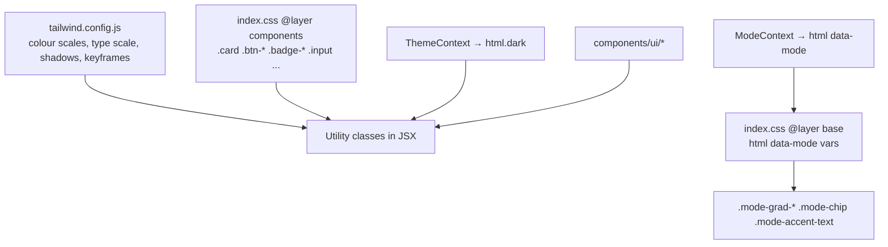

# Frontend Design System

> How Lingaru's look is built today: Tailwind tokens, the CSS component classes in `index.css`, per-mode palettes, light/dark theming, the small `components/ui/` kit and the animation library. It also lists where pages drift from the tokens, as input for the planned design overhaul.

**Code:** `frontend/tailwind.config.js`, `frontend/src/index.css`, `frontend/src/components/ui/`, `frontend/src/contexts/{ThemeContext,ModeContext}.jsx` · **Spec:** [specs/design-system.md](../specs/design-system.md) · **Related:** [Frontend Architecture](Frontend-Architecture.md)

## Overview

The system has three layers:

1. **Tailwind theme extension:** raw palettes and scales.
2. **Semantic CSS classes** in `index.css`: `.card`, `.btn-primary`, `.badge-success`, `.input` and similar.
3. **CSS custom properties per mode** that re-tint the chrome.

Pages are free to mix all three with arbitrary Tailwind values, and they do (see Inconsistencies).

## Key concepts

| Term | Meaning |
|---|---|
| **Theme** | Light or dark. Class-based (`darkMode: "class"`); `ThemeContext` toggles `html.dark` and saves it. An inline script in `index.html` applies it before first paint. |
| **Mode palette** | `html[data-mode=general\|exam\|agentic]` sets `--mode-grad-from`, `--mode-grad-to`, `--mode-accent`, `--mode-shell-tint`, `--mode-radius`. |
| **Surface** | The slate-based neutral scale used for backgrounds, borders and body text. |
| **Editorial** | Instrument Serif (`font-editorial`), used for display headlines and featured words. |

## How it works

### Colour scales (`tailwind.config.js`)

| Scale | Base hue | 500 value | Role |
|---|---|---|---|
| `primary` | Indigo/violet | `#6366f1` | Brand, links, active nav, primary buttons |
| `accent` | Coral/orange | `#f07d1e` | Highlights, achievements |
| `success` | Emerald | `#10b981` | Correct answers, success toasts |
| `danger` | Rose | `#f43f5e` | Errors, wrong answers, destructive actions |
| `warn` | Amber | `#f59e0b` | Warnings, favourites |
| `info` | Sky | `#0ea5e9` | Informational UI |
| `surface` | Slate (50-950) | `#64748b` | Neutrals |
| `paper` (50-600) | Warm off-white | n/a | Editorial panels |
| `ink` (700-900) | Near black | n/a | Dark hero panels |

### Mode palettes (`index.css`, `@layer base`)

| Mode | `--mode-grad-from` → `--mode-grad-to` | `--mode-accent` | `--mode-radius` |
|---|---|---|---|
| `general` (default) | `#6366f1` → `#7c3aed` | `#f07d1e` | `1rem` |
| `exam` | `#e11d48` → `#b91c1c` | `#dc2626` | `0.5rem` |
| `agentic` | `#d97706` → `#b45309` | `#ca8a04` | `1.25rem` |

They are consumed by `.mode-grad-bg`, `.mode-grad-band`, `.mode-grad-text`, `.mode-accent-text`, `.mode-shell` and `.mode-chip`. Those classes are used by the logo tile, the wordmark, the inline chat widget accent bars and the dashboard greeting. Settings shows a one-shot "mode celebration" animation on switch.

### Typography

| Token | Size / line-height | Weight |
|---|---|---|
| `text-display-xl` | 3.5rem / 1.05 | 800 |
| `text-display` | 2.75rem / 1.08 | 800 |
| `text-h1` | 2rem / 1.15 | 800 |
| `text-h2` | 1.5rem / 1.25 | 700 |
| `text-h3` | 1.25rem / 1.3 | 700 |
| `text-h4` | 1.0625rem / 1.35 | 600 |
| `text-body-lg` | 1rem / 1.6 | n/a |
| `text-body` | 0.9375rem / 1.55 | n/a |
| `text-caption` | 0.8125rem / 1.45 | n/a |
| `text-eyebrow` | 0.6875rem, tracking 0.08em | 600 |

Font families:

| Family | Font | Use |
|---|---|---|
| `font-sans`, `font-display` | Inter | UI and headings |
| `font-editorial` | Instrument Serif | Display moments |
| `font-mono` | JetBrains Mono | Eyebrows and metadata |

`html` enables Inter stylistic sets (`cv02 cv03 cv04 cv11 ss01`).

### Other tokens

| Token | Values |
|---|---|
| Radius | `rounded-2xl` = 1rem, `3xl` = 1.25rem, `4xl` = 2rem (extended) |
| Shadows | `card`, `card-hover`, `card-elevated`, `glow-{primary,success,danger,accent}`, `inner-highlight` |
| Gradients | `bg-gradient-{primary,accent,success,mesh}`, `bg-shimmer` |

### Component classes (`index.css`, `@layer components`)

| Class | Purpose |
|---|---|
| `.focus-ring` | Standard focus-visible ring (primary/60, offset 2) |
| `.card`, `.card-hover`, `.card-elevated` | Card surfaces (white / `surface-900`, `rounded-2xl`/`3xl`, `shadow-card`) |
| `.btn` + `.btn-{primary,accent,secondary,ghost,danger,success}` + `.btn-{sm,md,lg,xl}` | Buttons; filled variants are gradients |
| `.badge-{primary,success,danger,warn,info,accent,neutral}` | Pills |
| `.input`, `.input-error` | Text inputs and selects |
| `.section-label`, `.eyebrow-primary` | Uppercase eyebrow labels |
| `.stat-pill`, `.kbd`, `.divider-label` | Small helpers |

Utilities (`@layer utilities`) include `.glass`, `.glass-subtle`, `.text-gradient-{primary,accent,rainbow}`, `.skeleton`, `.bg-mesh`, `.bg-grid`, `.bg-grid-soft`, `.bg-noise`, `.font-editorial`, `.num` (tabular numerals), `.underline-wavy` and `.no-select`.

### `components/ui/` kit

| Component | API | Notes |
|---|---|---|
| `PageHeader` | `eyebrow, title, subtitle, backTo, backLabel, actions, icon, gradient` | Standard page top. `backLabel` defaults to the English "Back". |
| `EmptyState` | `icon, title, subtitle, action, tone (neutral\|success\|info\|warn)` | Zero-data and "all caught up" screens |
| `Skeleton`, `SkeletonText`, `SkeletonCard`, `SkeletonCircle`, `SkeletonGrid` | sizing props | Built on `.skeleton` shimmer |
| `Confetti` | `count, duration` | One-shot celebration |
| `TriumphHero` | `emoji, headline, subline, stats[], actions, celebrate, tone` | "Done" screen for Quiz, SRS, Grammar and Exam |
| `ComingSoonBadge` | `available, children` | Dims children and adds a "coming soon" pill |
| `LearningLanguageFlag` | `language` | Target-language flag next to the logo |

Outside `ui/`:

- `components/Toast.jsx` is used through `ToastContext`, with four types: `success`, `error`, `warn`, `info`.
- `components/AudioPlayButton.jsx` is the TTS play button.
- `components/blocks/InlineRoundWidget.jsx` is the shell for chat widgets.

Missing primitives: there is no shared Button, IconButton, Dialog/Modal, Drawer, Switch, Select, Tabs, Tooltip or Icon component. Settings defines private `Toggle`, `NumberStepper`, `SelectInput`, `FieldRow` and `SectionCard`. `Assistant.jsx` defines its own `Drawer`.

### Animation

There are 26 keyframes, each exposed as an `animate-*` utility.

| Group | Keyframes | Timing |
|---|---|---|
| Entrances | `fade-in`, `fade-in-up`, `slide-in-{left,right,down}`, `scale-in`, `pop-in`, `soft-zoom`, `bounce-in` | One-shot |
| Feedback | `shake`, `confetti-pop`, `confetti-fall` | One-shot |
| Loops | `pulse-glow`, `recording-pulse`, `shimmer`, `float`, `gradient-shift`, `spin-slow` (22 s), `flame`, `pulse-soft` | Infinite |
| Mode switch | `mode-pop`, `mode-ripple-1`, `mode-ripple-2`, `mode-wash` | One-shot |
| Misc | `count-up`, `progress-fill` | One-shot |

Helpers in `hooks/useAnimations.js`:

- `useCountUp(target, ms)`: an eased number tween.
- `staggerDelay(i, baseMs)`: an inline `animationDelay` for list staggering.

## Data model

Not applicable. Tokens are static config; theme and mode come from `user.mode` and the `theme` localStorage value.

## Configuration

| Setting | Where |
|---|---|
| Theme default | `prefers-color-scheme`, overridden by the saved `theme` |
| Mode | `user.mode`, applied by `ModeContext` |
| Fonts | Google Fonts `<link>` in `index.html` |
| Tailwind content globs | `./index.html`, `./src/**/*.{js,ts,jsx,tsx}` |

## Working on it

- **Prefer existing classes:** `.card`, `.btn-primary btn-md`, `.badge-*`, `.input`, `text-h*`/`text-caption`, and `surface-*` for neutrals.
- **Mode tinting:** use the `.mode-*` classes, not hard-coded indigo, when a surface should re-tint per mode.
- **Dark mode:** every colour utility needs a `dark:` counterpart. Check both themes.
- **New tokens:** add them to `tailwind.config.js` (scales) or `index.css` (semantic classes), never as hex in JSX.
- **Visual regression:** `npx playwright test --update-snapshots` after intentional changes to `/login` or `/register`.

### Measured inconsistencies (Phase-0 audit)

| Area | Observation |
|---|---|
| Font sizes | 406 arbitrary `text-[Npx]` usages across 23 distinct sizes (9px to 32px, including 10.5, 11.5, 12.5px), against 169 uses of the semantic type tokens. Assistant, Dashboard and Settings use mostly pixel sizes. |
| Off-token colours | About 180 uses of default Tailwind palettes outside the token set: `purple` 127, `pink` 27, `amber` 14, plus `violet`, `rose`, `red`, `emerald`. Purple acts as an unofficial second brand colour (user chat bubble, login panel, send button). |
| Hex in JSX | 18 hex literals: the Dashboard compass colours and the `Settings.jsx` `MODE_CARDS` palette, which duplicates the mode variables. |
| Mode reach | Only the chrome reads `--mode-*`. Primary buttons, active nav, focus rings and links stay indigo in exam and agentic modes. `--mode-radius` is defined but not consumed. |
| Buttons | 87 `.btn-*` uses alongside hand-rolled buttons (`bg-primary-600 text-white ...`, custom gradients), so there are at least 4 different "primary" looks. |
| Radii | Used without a rule: `rounded-xl` 188, `full` 169, `lg` 136, `2xl` 83, `md` 37, `3xl` 17. Cards appear as `xl`, `2xl` and `3xl`. |
| Icons | About 310 emoji used as icons, 152 inline SVGs and 3 local `Ic` icon maps. Stroke widths range from 1.6 to 2.5. |
| Overlays | 12 full-screen overlays, each hand-built. Focus trap and Escape handling exist only on the Settings mobile drawer. |
| Feedback | Toasts, inline banners, a custom undo snackbar in Settings (separate from `ToastContext`), spinners on some pages and skeletons on others. |
| Contrast | `text-surface-400`/`300` is used about 540 times for metadata, often at 9 to 10px, which falls below WCAG AA contrast on white. |
| Motion | 263 animation usages, including infinite loops on the dashboard. There is no `prefers-reduced-motion` handling. |

## Known gaps

- No shared primitives for buttons, dialogs, drawers, form fields or icons; each page re-implements them.
- The type scale and colour tokens are bypassed widely (see the table above).
- Mode theming re-tints only the chrome.
- No reduced-motion support.
- Low-contrast small metadata text in many places.
- `tailwind.config.js` mixes ESM `export default` with `require("@tailwindcss/typography")`.
- No component catalogue (Storybook or Ladle), and visual regression covers only `/login` and `/register`.
