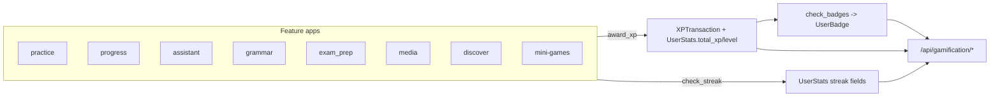

# Gamification

> XP, levels, daily streaks, badges, the leaderboard, XP history, the weekly coach trend report and mini-game scoring. Every learning feature in Lingaru reports activity here through two service functions.

**Code:** `backend/apps/gamification/` · **Spec:** [specs/gamification.md](../specs/gamification.md)

## Overview

`award_xp(user, activity_type, xp_amount, source_id=None)` and `check_streak(user)` in `apps/gamification/services.py` are the only write paths. Feature apps call them directly, usually `award_xp` first, then `check_streak`.

## Key concepts

| Term | Meaning |
|------|---------|
| XP | Points recorded as `XPTransaction` rows and summed into `UserStats.total_xp`. |
| Level | Index (0-5) into `LEVEL_THRESHOLDS`, recomputed on every award. The API also returns `level_name`. |
| Streak | Consecutive calendar days (server date) with at least one `check_streak` call. |
| Badge | Static achievement (`Badge`) with a `criteria_type` and threshold; earned once per user (`UserBadge`). |
| `activity_type` | Free-text label on each transaction, e.g. `quiz_correct`, `mini_game_word_scramble`. |
| `source_id` | Free-text reference to what earned the XP, e.g. `quiz_session_42`. Stored for display; not used for de-duplication. |

## How it works

### Levels (`constants.LEVEL_THRESHOLDS`)

| Index | Min XP | Name |
|-------|--------|------|
| 0 | 0 | Debutant |
| 1 | 100 | Explorateur |
| 2 | 500 | Apprenti |
| 3 | 1500 | Intermediaire |
| 4 | 5000 | Avance |
| 5 | 10000 | Expert |

### `award_xp`

Runs in one database transaction:
1. Insert an `XPTransaction`.
2. `get_or_create` the user's `UserStats`, add the amount to `total_xp`, recompute `level`, save.
3. `check_badges(user)`: evaluate every badge the user has not earned yet and create `UserBadge` rows for those now met.
4. Return `(stats, transaction, new_badges)`. Callers currently ignore the return value except the mini-game endpoint.

### `check_streak(user, today=None)`

`today` defaults to `date.today()`.

| Situation | Result |
|-----------|--------|
| No previous activity | `current_streak = 1`, `longest_streak = 1` |
| Already active today | No change |
| Last active yesterday | `current_streak += 1` |
| Gap of 2+ days | `current_streak = 1` |

`longest_streak` is kept as the max, and `last_active_date` is set to `today`. The streak is only recalculated when the user is active; there is no nightly job.

### Badges (`constants.DEFAULT_BADGES`, seeded by `seed_badges`)

| Badge | `criteria_type` | Value | Met when |
|-------|-----------------|-------|----------|
| First Quiz | `quizzes_completed` | 1 | Completed `QuizSession`s >= value |
| Quiz Master | `quizzes_completed` | 50 | same |
| Perfect Score | `perfect_quizzes` | 1 | Completed sessions with `score = total_questions` >= value |
| Week Warrior | `streak_days` | 7 | `current_streak` >= value |
| Month Master | `streak_days` | 30 | same |
| XP Collector | `total_xp` | 1000 | `total_xp` >= value |
| XP Legend | `total_xp` | 10000 | same |
| Conversationalist | `ai_conversations` | 10 | Assistant conversations with 5+ messages >= value |
| Apprenti | `level` | 500 | `total_xp` >= value |
| Expert | `level` | 10000 | same |

Unknown `criteria_type` values never match. Badges are only evaluated inside `award_xp`.

### Where XP comes from

| Activity type | XP | Awarded by | `source_id` |
|---------------|----|-----------|-------------|
| `quiz_correct` | 5 x correct answers | `practice` quiz complete | `quiz_session_<id>` |
| `quiz_perfect` | 25 | `practice` quiz complete, all correct | `quiz_session_<id>` |
| `lesson_complete` | 50 (first completion only) | `progress` lesson complete | `lesson_<id>` |
| `srs_review` | 10 per review | `progress` SRS review | `srs_card_<id>_<repetitions>` |
| `conjugation_drill` | 10 per correct check | `progress` conjugation check | `conjugation_<question_id>` |
| `mini_game_<game>` | 2 x score | `gamification` mini-game score | none |
| `ai_conversation` | 15 at the 5th user message | `assistant` chat | `conversation_<id>` |
| `pronunciation` | 5 | `media` pronunciation attempt | `pronunciation_<id>` |
| `dictation` | 15 | `media` dictation | `dictation_clip_<id>` |
| `discover_interact` | 3, once per card (deduplicated by `UserDiscoverHistory` in the view) | `discover` card interaction | `<card_id>` |
| `grammar_<mode>` | 3 x correct + 10 if perfect | `grammar` session complete | none |
| `exam_<section>_<mode>` | 15 practice / 30 mock, +50 if 100% | `exam_prep` session complete | none |

The amounts are hard-coded at each call site. `constants.XP_VALUES` exists but is not read.

### Read endpoints

| Endpoint | Returns |
|----------|---------|
| `GET /api/gamification/stats/` | Stats plus `level_name` and `rank` (1 + number of users with more XP). Creates the stats row on first call. |
| `GET /api/gamification/badges/` | `{earned: [{id, name, description, icon, earned_at}], available: [badge...]}` |
| `GET /api/gamification/leaderboard/?page=` | Paginated (50 per page) `{username, total_xp, level, current_streak}`, highest XP first. Users without a stats row are absent. |
| `GET /api/gamification/history/?page=` | The user's transactions, newest first, 20 per page, each with a human `description` from `ACTIVITY_LABELS` (falls back to the title-cased type). |
| `GET /api/gamification/trend/` | Seven-day coach report (below). |

### Trend report (`TrendReportView`)

Aggregates the last 7 days (UTC): total XP, XP by activity type, XP per day (7 entries, oldest first), lessons completed and average score percentage, mistakes (count, top 3 types, 3 most recent), SRS totals (`total`, `due`, `mastered` = interval >= 21 days), streak and level. It then builds `insights[]` of `{type: warn|ok|great|tip, text}`:

| Rule | Insight |
|------|---------|
| Weekly XP 0 / >= 200 / otherwise | warn "No activity" / great "Excellent week" / ok "Try to hit 200" |
| Streak >= 7 / >= 3 / == 0 | great / ok / warn |
| Mistakes > 0 / == 0 | tip naming the top mistake type / great "Zero mistakes" |
| SRS due > 5, else mastered > 0 | warn "cards due" / great "mastered" |
| Top activity is `conjugation_drill` with no lessons, else lessons >= 3 | tip "balance it" / great "solid pace" |

### Mini-games

See [Mini-Games](Mini-Games.md) for the client side.

`POST /api/gamification/mini-game/score/` `{game, score, total}` where `game` is one of `word_scramble`, `match_pairs`, `gender_snap`, `speed_round`, `missing_letter`. A score of 0 or less returns `{xp_earned: 0}`; otherwise awards `score x 2` XP and returns `{xp_earned, total_xp}`.

## Data model

| Model | Purpose | Key fields |
|-------|---------|------------|
| `UserStats` | Per-user totals (1:1 with user) | `total_xp`, `level`, `current_streak`, `longest_streak`, `streak_freeze_available`, `last_active_date` |
| `XPTransaction` | XP ledger | `user` FK, `activity_type`, `xp_amount`, `source_id`, `created_at`; newest first |
| `Badge` | Badge definition | `name` (unique), `description`, `icon` (icon key, e.g. `trophy`), `criteria_type`, `criteria_value` |
| `UserBadge` | Earned badge | `user` FK, `badge` FK, `earned_at`; unique `(user, badge)` |

## Configuration

None. Levels, badges and labels are constants in `apps/gamification/constants.py` and `serializers.py`.

## Working on it

- **Seed badges:** `python manage.py seed_badges` (idempotent by name; does not update existing badges).
- **Tests:** `pytest apps/gamification` (`test_services.py` covers levels, XP and streaks with injected dates; `test_api.py`, `test_integration.py`, `test_commands.py`).
- **Awarding XP from a new feature:** call `award_xp(request.user, activity_type="...", xp_amount=N, source_id="...")` then `check_streak(request.user)`, and add a label to `ACTIVITY_LABELS`.
- **New badge type:** add a branch in `_evaluate_badge`, add the definition to `DEFAULT_BADGES`, rerun `seed_badges`.

## Known gaps

- XP awards are not idempotent: `source_id` is not unique and `award_xp` does not check it, so repeated calls for the same source award XP again unless the caller guards it (discover, first-time lesson completion and the assistant's 5th-message trigger do; SRS review, conjugation and mini-games do not).
- Mini-game XP comes from the client-reported score, which is not checked against `total` or capped.
- `total_xp` is updated with read-modify-write, so concurrent awards can lose updates; `check_streak` saves the whole stats row.
- Streaks are only recomputed on activity, so stats, leaderboard and trend show a stale streak after missed days.
- `check_streak` uses the server date (`date.today()`), not `timezone.localdate()` or the learner's time zone.
- Streak badges are evaluated in `award_xp`, which callers run before `check_streak`, so they arrive one activity late.
- `check_badges` runs several count queries on every award (about 6-9 queries per call).
- The trend report runs about 13 queries, buckets daily XP in Python, and its SRS counts are not filtered by `target_language` (they can differ from `srs/due/`).
- XP amounts are hard-coded at each call site; `XP_VALUES`, `DAILY_STREAK_CAP` and `streak_freeze_available` are unused.
- `ACTIVITY_LABELS` lists types never emitted and misses ones that are (`mini_game_*`, `discover_interact`, `grammar_*`, `exam_*`).
- The `level` badge criteria duplicate `total_xp`.
- Activity endpoints return XP feedback inconsistently, and newly earned badges are never returned to the client.
- No indexes on `UserStats.total_xp` (leaderboard, rank) or `XPTransaction(user, created_at)` (history, trend).
- Non-numeric mini-game `score`/`total` causes a server error.
