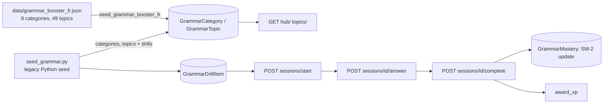

# Grammar Booster

> Grammar Booster is a dedicated grammar course. Topics are grouped into categories and tagged by CEFR level. Each topic has a markdown lesson (explanation, formula, examples, exceptions, common mistakes), short drill sessions, and per-user mastery tracked with an SM-2-flavoured spaced-repetition schedule. A diagnostic mode samples one drill from each of several topics.

**Code:** `backend/apps/grammar/` · **Spec:** [specs/grammar-booster.md](../specs/grammar-booster.md)

## Overview



`apps.grammar` is separate from the legacy `content.GrammarRule`, which only feeds Discover grammar-tip cards.

## Key concepts

| Term | Meaning |
|---|---|
| Category | Top-level grouping (for example Tenses, Pronouns), with icon and order |
| Topic | One grammar point with a markdown `explanation`, `formula`, `examples`, `exceptions`, `common_mistakes` and a `cefr_level` |
| Drill item | One exercise: `fill_blank`, `mcq`, `transform`, `error_detect` or `reorder` |
| Mastery | Per user and topic: score 0-100, attempts, SM-2 interval and ease, and `next_review_at` |
| Status | `not_started`, `learning` (<50), `practiced` (≥50), `mastered` (≥80 and ≥10 attempts) |
| Diagnostic | A mixed session of one random drill from each of up to 12 topics |

## How it works

### Browsing

| Endpoint | What it returns |
|---|---|
| `GET hub/` | Categories in the user's language that have active topics, each with `topic_count`, `mastered_count` and `avg_mastery`. Also the recommended topic: the earliest due review, else the weakest non-mastered topic, else the first topic not yet started. Also `total_topics`, `total_mastered` and `due_for_review`. |
| `GET categories/` | Categories in the user's language, with the active `topic_count` |
| `GET topics/?category=&level=` | Active topics in the user's language, with `drill_count` (annotated) and the user's `mastery`/`status` (prefetched) |
| `GET topics/<slug>/` | One topic with `explanation`, `examples`, `exceptions` and `common_mistakes` |

### Drill session lifecycle

1. **Start** (`POST sessions/start/`):
   - `mode=drill` needs a `topic_id` in the user's language. It loads all of the topic's drills, shuffles them, takes 10, gets or creates the user's `GrammarMastery`, and creates a `GrammarSession` with `mastery_before` set.
   - `mode=diagnostic` takes up to 12 active topics at the user's `target_level`. If fewer than 5 are found, it uses 12 random topics of any level instead. It picks one random drill from each and creates a session with no topic.
   - The response includes the drill items (`id, type, prompt, correct_answer, options, explanation, difficulty`).
2. **Answer** (`POST sessions/<id>/answer/`):
   - Grading happens on the client so feedback is instant.
   - The client posts `drill_item_id`, `user_answer` and `is_correct`.
   - The server stores a `GrammarAnswer` and increments `session.score` when the answer is correct.
3. **Complete** (`POST sessions/<id>/complete/`):
   - Sets `completed_at`.
   - In drill mode it runs `scoring.update_mastery(mastery, score, total)` and stores `mastery_after`.
   - Awards XP and calls `check_streak`.
   - Completing an already-completed session returns its summary again and awards no XP.

### Mastery update (`scoring.update_mastery`)

| Step | Rule |
|---|---|
| Score delta | `+5 × correct − 3 × wrong`, clamped to 0..100 |
| Attempts | `attempts += total`, `correct_count += correct` |
| Quality | `round(accuracy × 5)` on a 0-5 scale |
| Interval | quality < 3 → 1 day; first session → 2 days; current interval < 6 → 6 days; otherwise `interval × ease` |
| Ease | `max(1.3, ease + 0.1 − (5−q) × (0.08 + (5−q) × 0.02))` |
| Next review | `now + interval_days` |

### XP

- 3 XP per correct answer.
- +10 XP bonus when `score == total > 0`.
- Activity type `grammar_<mode>`.
- Nothing is awarded when the total is 0.

## Data model

| Model | Purpose | Key fields |
|---|---|---|
| `GrammarCategory` | Category | `name`, `slug` (unique), `description`, `icon`, `order`, `language` |
| `GrammarTopic` | Grammar point | `category` FK, `title`, `slug` (unique), `cefr_level`, `summary`, `explanation` (markdown), `formula`, `examples`/`exceptions`/`common_mistakes` JSON, `order`, `is_active`, `language` |
| `GrammarDrillItem` | Exercise | `topic` FK, `type`, `prompt`, `correct_answer`, `options` JSON, `explanation`, `difficulty` 1-5, `language` |
| `GrammarMastery` | Per-user SRS state | `user`+`topic` unique, `attempts`, `correct_count`, `mastery_score`, `last_drilled_at`, `next_review_at`, `interval_days`, `ease_factor` |
| `GrammarSession` | Drill or diagnostic run | `user`, `topic` (null for diagnostic), `mode`, `score`, `total`, `mastery_before/after`, `completed_at` |
| `GrammarAnswer` | One answer | `session`, `drill_item` (SET_NULL), `user_answer`, `is_correct` |

## Configuration

There are no settings or env vars. Everything is driven by data and the constants in `scoring.py` and `views.py` (`XP_PER_CORRECT_DRILL=3`, `XP_DRILL_PERFECT_BONUS=10`).

## Working on it

```bash
cd backend
python manage.py seed_grammar                          # legacy taxonomy WITH drills
python manage.py seed_grammar_booster_fr --dry-run     # preview JSON lessons
python manage.py seed_grammar_booster_fr [--force] [--reset] [--path FILE]
pytest apps/grammar
```

- **Lesson content:** edit `data/grammar_booster_fr.json`.
  - Each category needs `slug`, `name` and `topics`.
  - Each topic needs `title`, `slug`, `cefr_level` and `explanation` (markdown).
  - Optional: `summary`, `formula`, `examples`.
  - Re-run with `--force` to update existing slugs. `--reset` deletes the FR topics in those categories first, inside a transaction.
- **Drills:** today they come only from `seed_grammar.py`, a Python literal list. Running it deletes and recreates each of its topics' drills, which sets `GrammarAnswer.drill_item` to NULL in history.
- **The topic list is query-tested** (`tests/test_topics_view_perf.py`). Keep the `annotate` and `Prefetch` in `_topics_qs_with_prefetches` when you change it.
- **Markdown** is rendered on the frontend by `react-markdown` (`GrammarTopic.jsx`).

## Known gaps

- None of the 49 topics in `grammar_booster_fr.json` have drills, and the loader never creates `GrammarDrillItem`. Starting a drill on them returns "No drills available for this topic yet". The refactor plan said drills would live in the JSON.
- Two taxonomies coexist: the legacy `seed_grammar` (with drills) and the JSON booster (without), sharing only 1 topic slug.
- `GrammarCategory.slug` and `GrammarTopic.slug` are globally unique, not unique per language, so EN content cannot reuse FR slugs.
- In the hub, the mastery map and the due-for-review query are not filtered by language. A user who switches language can be recommended a topic from the other language.
- The hub runs one query per category (the prefetch is discarded by `.filter()`). `categories/` runs one count per category, and diagnostic mode one drills query per topic.
- XP awards and session scores are not idempotent: answers are not deduplicated per drill item, and `score` is not capped at `total`.
- Answers are not checked to belong to the session's topic or language.
- The mastery `status` logic is duplicated in `GrammarMastery.status` and `scoring.status_for`.
- There are no tests for the session start, answer and complete flow or for mastery scheduling.
- The README states "6 categories, 11 topics, 90 drill items", which does not match the current data.

Related: [Exam Prep](Exam-Prep.md), [Content Data Pipeline](Content-Data-Pipeline.md).
