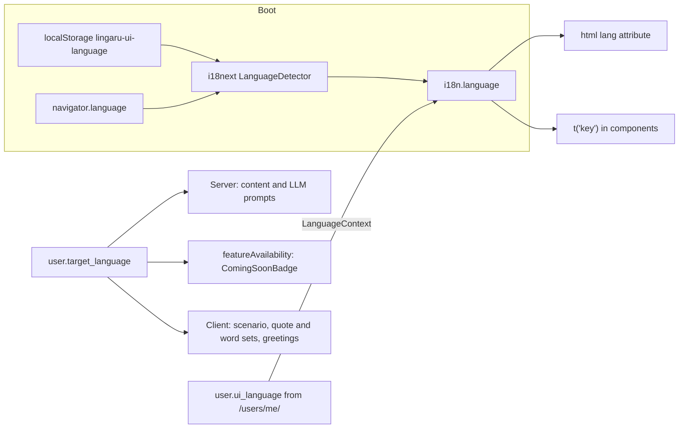

# Internationalization

> Lingaru separates two language settings. The **UI language** is the language the app chrome is shown in (buttons, nav, settings). The **target language** is the language the user is learning (French or English), and it drives content, prompts and feature availability. This page explains the i18next setup, how the two settings interact, current coverage, and how to add strings or a locale.

**Code:** `frontend/src/i18n.js`, `frontend/src/locales/{en,fr}.json`, `frontend/src/contexts/LanguageContext.jsx`, `frontend/src/lib/featureAvailability.js`; backend `backend/apps/users/models.py` (`ui_language`, `target_language`) · **Spec:** [specs/frontend.md](../specs/frontend.md) · **Related:** [Frontend Architecture](Frontend-Architecture.md)

## Overview



## Key concepts

| Concept | Field | Values | Controls |
|---|---|---|---|
| **UI language** | `user.ui_language` (nullable) | `en`, `fr` | Strings rendered through `t()`; `<html lang>` |
| **Target language** | `user.target_language` | `fr` (default), `en` | Which content rows the API returns (each content model has a `language` discriminator), which LLM prompt set is used, which features are available, plus some client-side content (roleplay scenarios, prompt starters, daily quotes, greetings) |
| **Native language** | `user.native_language` | default `en` | Stored, not used by the frontend |
| **Learning content** | n/a | n/a | Vocabulary, lessons, grammar explanations and so on are **never** translated by i18n. They are served in the target language by the API. |

Changing the target language in Settings PATCHes **both** `target_language` and `ui_language` to the new value, then reloads the page. Settings also has a separate interface-language picker that changes only `ui_language`.

## How it works

### Setup (`i18n.js`)

- Plugins: `i18next-browser-languagedetector` and `initReactI18next`.
- Resources are bundled statically: `en` and `fr` JSON files imported at build time, with no lazy loading.
- Detection order is `localStorage` (key `lingaru-ui-language`), then `navigator`. The result is cached back to localStorage.
- `fallbackLng: "en"`, `supportedLngs: ["en","fr"]`, `nonExplicitSupportedLngs: true` (so `fr-FR` maps to `fr`).
- `interpolation.escapeValue: false` (React escapes), `returnEmptyString: false`.
- Exports: `SUPPORTED_LANGUAGES`, `DEFAULT_LANGUAGE`, and the `i18n` instance.

### Runtime sync (`LanguageContext.jsx`)

- When `user.ui_language` is set and supported, the context calls `i18n.changeLanguage(user.ui_language)`, so the server value wins over browser detection after login.
- It sets `<html lang>` whenever `i18n.language` changes.
- Before login (Login and Register pages), the detected browser or localStorage language applies.

### Using strings

```jsx
const { t } = useTranslation();
t("settings.memory.title");
t("assistant.drawer.messagesCount", { count: n });   // {{count}} interpolation
<Trans i18nKey="dashboard.hero.description" components={{ 1: <em/>, 2: <span className="..."/> }} />
```

Keys are nested by feature namespace. The files have no plural suffix keys (`_one`/`_other`). Where singular and plural differ, code picks between two explicit keys, for example `assistant.bubble.correctionOne` / `correctionOther`.

### Locale files

Both files have **559 leaf keys** with exact key parity. `_meta` holds `{name, code}`.

| Namespace | Keys | Namespace | Keys |
|---|---|---|---|
| `dashboard` | 105 | `ourNotes` | 37 |
| `settings` | 91 | `news` | 32 |
| `assistant` | 85 | `dictionary` | 28 |
| `myNotes` | 61 | `nav` | 21 |
| `common` | 18 | `onboarding` | 18 |
| `auth` | 17 | `modes` | 15 |
| `practice` | 8 | `levels` | 7 |
| `agents`, `discover` | 4 each | `languages`, `layout`, `progress`, `_meta` | 2 each |

### Coverage today

| Status | Files |
|---|---|
| Fully or mostly translated | `Assistant` (chrome only, see below), `Dashboard`, `Settings` (memory, mode and language sections only), `MyNotes`, `MyNotesEdit`, `MyNotesPublic`, `OurNotes`, `OurNotesDetail`, `OurNotesReview`, `Dictionary`, `NewsArticle`, `OnboardingModal`, `Layout` nav, `components/notes/*`, `LearningLanguageFlag`, `ComingSoonBadge` |
| Page titles only | `Pronunciation`, `Dictation`, `ConjugationDrill` |
| **No `t()` at all (30 pages)** | `Login`, `Register`, `NotFound`, `Topics`, `TopicDetail`, `LessonDetail`, `Quiz`, `RandomQuiz`, `SRSReview`, `MistakeJournal`, `Progress`, `Discover`, `News`, `Documents`, `Agents`, `AgentRun`, `MiniGames` + all 6 games, `ExamPrepHub`, `ExamSection`, `ExamExercise`, `GrammarHub`, `GrammarLibrary`, `GrammarTopic`, `GrammarDrill` |
| **No `t()` in components** | `components/blocks/**` (chat blocks and inline widgets), `components/quiz/**`, `QuizBlock`, `VideoSection`, `DiscoverCard`, `AudioPlayButton`, `Toast`, `PageHeader`, `EmptyState`, `TriumphHero`, `ProtectedRoute` |

Hard-coded strings are a mix of languages:

| Language | Where |
|---|---|
| English | Settings profile, learning, games and security tabs; game pages; `Quiz`; `Login` |
| French | `AgentRun` errors, `InlineRoundWidget` defaults ("Encore", "Ouvrir session complète"), `News` relative times, `AudioPlayButton` title "Écouter", `ExamExercise` section names, `lib/modeConfig.js` `chipLabel` |

Some namespaces exist but are not wired. `auth.*`, `news.*`, `discover.*`, `progress.*`, `practice.*` and many `settings.*` keys (for example `settings.security.telegramNotLinked`) are already translated in both files, but the matching pages still render hard-coded text.

### Target-language-specific content in the client

These switch on `user.target_language`, not on the UI language:

| Where | What switches |
|---|---|
| `Assistant.jsx` | Roleplay scenarios (`ROLEPLAY_SCENARIOS_FR` / `_EN`), prompt starters |
| `Dashboard.jsx` | Daily quotes, greeting, date locale, fallback word of the day |
| `Dictionary.jsx` | Quick-word chips |
| `lib/featureAvailability.js` | `exam_prep`, `grammar_booster`, `gender_snap` and `conjugation` are available for `fr` only; they show `ComingSoonBadge` for `en` |
| `filterNavForMode()` | Nav items may declare a `languages` allow-list (today only "Our Notes", shown to `en` learners) |

## Data model

| Model.field | Type | Notes |
|---|---|---|
| `User.ui_language` | `CharField(4)`, nullable, choices `en`/`fr` | Null means "use browser detection" |
| `User.target_language` | `CharField(8)`, default `fr` | Learning language; scopes content queries server-side |
| `User.native_language` | `CharField(10)`, default `en` | Unused by the frontend |

## Configuration

| Setting | Location |
|---|---|
| Supported UI languages | `SUPPORTED_LANGUAGES` in `i18n.js` |
| Fallback language | `DEFAULT_LANGUAGE` / `fallbackLng` in `i18n.js` |
| Detector cache key | `lingaru-ui-language` |
| Per-language feature flags | `lib/featureAvailability.js` |

## Working on it

### Add a string

1. Pick or create a namespace that matches the feature (for example `games.wordScramble.title`).
2. Add the key to **both** `locales/en.json` and `locales/fr.json`. Keep parity; a missing key falls back to English.
3. Use `t("namespace.key")` in the component, with `{ var }` for `{{var}}` interpolation.
4. Do not translate learning content. It comes from the API in the target language.
5. Write `--` or `:` rather than em-dashes in user-facing strings (repo convention).

### Add a UI locale

1. Copy `locales/en.json` to `locales/<code>.json`, translate it, and set `_meta`.
2. Import it in `i18n.js`, add it to `resources`, and add the code to `SUPPORTED_LANGUAGES`.
3. Add the choice to `User.UI_LANGUAGE_CHOICES` (backend migration) and to `UI_LANGUAGE_OPTIONS` in `Settings.jsx`.

### Add a target language

This is a cross-stack change, not just i18n:

- Backend: content `language` choices, LLM prompt variants and seed data.
- Frontend: `LearningLanguageFlag` `FLAG_FOR`, the Settings target-language `<select>`, the `featureAvailability` rows, and the client content sets listed above.

### Check parity

```bash
cd frontend/src && python3 -c "
import json
def f(d,p=''):
  return {k2 for k,v in d.items() for k2 in (f(v,p+k+'.') if isinstance(v,dict) else {p+k})}
e,r=f(json.load(open('locales/en.json'))),f(json.load(open('locales/fr.json')))
print('missing in fr:',e-r,'missing in en:',r-e)"
```

## Known gaps

- 30 of 44 pages, and all chat block and quiz components, have no i18n.
- Existing locale keys (`auth.*`, `news.*`, `discover.*`, `progress.*`, much of `settings.*`) are not used by the pages they were written for.
- Hard-coded strings mix English and French regardless of the UI language.
- The Assistant's @-agent hints, tutor persona and the directives sent to the LLM are French-only, even for English-target learners.
- No plural keys (`_one`/`_other`); `{{count}}` strings do not pluralise correctly in all cases.
- The two language settings overlap: changing the target language overwrites `ui_language`, while a separate UI-language picker still exists.
- Relative-time formatting is implemented separately in six places, some hard-coded in English or French. It should use `Intl.RelativeTimeFormat(i18n.language)`.
- No lint rule (for example `i18next/no-literal-string`) prevents new hard-coded strings.
