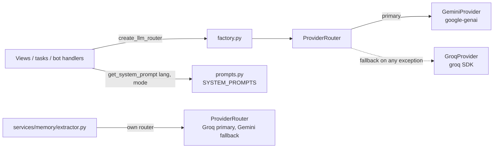

# LLM Providers and Prompts

> The shared LLM layer behind every AI feature in Lingaru (assistant chat, agents, image questions, dictionary, news, exam grading, memory extraction, Telegram bot). It wraps Google Gemini and Groq behind one interface, falls back from one to the other, and keeps the per-language system prompts in one file.

**Code:** `backend/services/llm/` · **Spec:** [specs/llm-layer.md](../specs/llm-layer.md)

## Overview

- **One interface:** every provider implements `generate(messages, system_prompt) -> LLMResponse`.
- **Gemini first for chat:** Gemini is the primary provider and Groq is the text fallback.
- **Gemini only for vision:** image input goes to Gemini, with no fallback.
- **Prompts are data:** system prompts sit in a two-level dict keyed by `target_language` and then by `mode`.

## Key concepts

| Term | Meaning |
|---|---|
| `LLMResponse` | Dataclass `(content: str, provider: "gemini" \| "groq", tokens_used: int)`. Every caller gets this back. |
| `BaseProvider` | Abstract class with `generate()`. Its `generate_with_image()` raises `NotImplementedError` unless a provider overrides it. |
| `ProviderRouter` | Holds a `primary` and an optional `fallback`. `generate()` tries the primary and calls the fallback once if the primary raises. `generate_with_image()` uses the primary only. |
| Mode | The key of a system prompt: `conversation`, `grammar_correction`, `roleplay_hotel`, and so on. |
| Target language | `User.target_language` (`fr` or `en`). It is the first-level key in `SYSTEM_PROMPTS`. |

## How it works

### Router construction (`services/llm/factory.py`)

`create_llm_router()` reads Django settings each time it is called:

| Keys present | Primary | Fallback |
|---|---|---|
| `GEMINI_API_KEY` and `GROQ_API_KEY` | Gemini (`GEMINI_MODEL`) | Groq (`GROQ_MODEL`) |
| Only `GEMINI_API_KEY` | Gemini | none |
| Only `GROQ_API_KEY` | Groq | none |
| Neither | raises `RuntimeError` | |

Callers build a new router (and new SDK clients) on every request.

The memory extractor builds its own router with the opposite order: Groq first and Gemini second (`services/memory/extractor.py`). See [Memory](Memory.md).

### Providers

| Provider | File | Request mapping | Notes |
|---|---|---|---|
| Gemini | `services/llm/gemini.py` | Role `user` stays `user` and every other role becomes `model`. `system_prompt` is sent as `system_instruction`. | Sends only `system_instruction`, no temperature or max-token settings. `tokens_used` comes from `usage_metadata.total_token_count`. `generate_with_image` sends one inline image blob plus the **last** message's text only. |
| Groq | `services/llm/groq_provider.py` | Adds `{"role": "system"}` as the first message, then `chat.completions.create`. | `tokens_used` comes from `usage.total_tokens`. No vision support. |

### Fallback

`ProviderRouter.generate()`:
1. Calls `primary.generate(...)`.
2. If that raises **any** exception and a fallback exists, it logs a WARNING (`Primary provider failed (<ExcType>), falling back`) and returns `fallback.generate(...)`.
3. If the fallback also raises, the exception reaches the caller. Views turn it into HTTP 503.

There is no retry, backoff or circuit breaker. A response that is empty or `None` without an exception is returned as-is.

### Prompt inventory (`services/llm/prompts.py`)

`get_system_prompt(language, mode)` returns `SYSTEM_PROMPTS[language][mode]`. An unknown language falls back to `fr`, and an unknown mode falls back to `conversation`. `services/llm/tests/test_prompts.py` checks that every language has the same set of modes.

| Mode | Purpose | Output | Used by |
|---|---|---|---|
| `conversation` | Default tutor (FR: patient B1-B2 tutor; EN: "Claire") | prose | `ChatView`, `VoiceChatView`, bot |
| `grammar_correction` | Correct a text and list errors | prose | `ChatView` |
| `grammar_explanation` | Explain a grammar point (under 200 words) | prose | `ChatView`, agents with that mode |
| `rag_conversation` | Conversation prompt plus a `{context}` slot for document excerpts | prose | `ChatView` when RAG finds context |
| `image_query` | Read text in an image, translate it, explain it | prose | `ImageQueryView`, bot |
| `roleplay_*` (10) | hotel, airport, bank, school, job_interview, restaurant, doctor, market, train, pharmacy | prose, in character | `ChatView` |
| `exam_ee_grading` | Writing exam grader, score /20 | strict JSON | `apps/exam_prep/tasks.py` |
| `exam_eo_grading` | Speaking exam grader (from a transcript), score /20 | strict JSON | `apps/exam_prep/tasks.py` |
| `news_generator` | Generate a B1-B2 news article plus vocab, expressions and grammar points | JSON | `apps/discover/services.py` |
| `trivia_generator` | Generate a trivia fact | JSON | no callers (Discover trivia now comes from a JSON bank) |

The EN JSON prompts reuse the FR key names "for compatibility" (`fact_fr`, `article_fr`, `example_fr`, `feedback_fr`), so downstream parsers stay the same.

Other prompt sources outside this file:

| Prompt | Location | Page |
|---|---|---|
| Agent personas | `Agent.system_prompt` / `system_prompt_en` (DB, seeded) | [Agents](Agents.md) |
| Structured-blocks instruction | `apps/agents/prompts.py` | [Agentic Blocks](Agentic-Blocks.md) |
| Agentic-mode footer | `apps/assistant/agentic_prompt.py` | [Agentic Blocks](Agentic-Blocks.md) |
| Learner context block | built by `services/memory/context.py` | [Memory](Memory.md) |
| Memory extractor | `services/memory/prompts.py` | [Memory](Memory.md) |
| Dictionary lookup and conjugation | `apps/dictionary/views.py` | Dictionary |

### Caching

- `services/llm` itself caches nothing.
- **Dictionary cache:** deterministic dictionary and conjugation lookups use `cached_or_call()` in `apps/dictionary/cache.py`, backed by the `DictionaryCache` table. It is cache-first and writes back on a miss. The design is in `docs/superpowers/specs/2026-06-27-llm-cache-layer-design.md`.
- **TTS cache:** text-to-speech has its own DB and disk cache. See [Audio TTS STT](Audio-TTS-STT.md).

### Parsing JSON output

There is no shared JSON helper. Each JSON-producing caller strips fences and parses the output itself:
- `apps/dictionary/parsing.py`
- `apps/content/tasks.py`
- `apps/exam_prep/tasks.py`
- `apps/notes/views.py`
- `apps/discover/news_fetcher.py`
- `services/memory/extractor.py`
- `apps/assistant/blocks.py`, for structured blocks

## Data model

The LLM layer has no models of its own. Per-message `provider` and `tokens_used` are stored on `assistant.Message` (see [AI Assistant](AI-Assistant.md)).

## Configuration

| Setting / env var | Default | Effect |
|---|---|---|
| `GEMINI_API_KEY` | `""` | Enables Gemini (chat, vision, embeddings, TTS). |
| `GEMINI_MODEL` | `gemini-2.0-flash` | Chat and vision model. |
| `GROQ_API_KEY` | `""` | Enables Groq (chat fallback, memory extractor primary, Whisper STT). |
| `GROQ_MODEL` | `llama-3.3-70b-versatile` | Groq chat model. |

All of these are read through `python-decouple` in `config/settings/base.py`, so values in the repo-root `.env` apply to every settings module, including tests.

## Working on it

- **Run the tests:** `cd backend && python -m pytest services/llm -q`. `pytest.ini` sets `testpaths = apps`, so a plain `pytest` does **not** collect `services/`. Pass the path explicitly.
- **Mock at the factory:** views import `create_llm_router` into their own module, so patch it there, for example `@patch("apps.assistant.views.create_llm_router")`.
- **Add a mode:** add the key under **every** language in `SYSTEM_PROMPTS` (the parity test fails otherwise). If it is a chat mode, also add it to `ChatRequestSerializer.MODE_CHOICES`.
- **Add a provider:** subclass `BaseProvider`, return an `LLMResponse`, and wire it in `factory.py`.
- **House style:** the FR prompts tell the model not to use the em-dash.

## Known gaps

- Provider calls use the SDK default timeouts. There is no retry with backoff for 429 or 5xx responses.
- An empty or `None` provider response does not trigger the fallback.
- Routers and SDK clients are rebuilt on every call, so connections are not reused.
- JSON output parsing is duplicated across about seven modules. Native JSON mode (Gemini `response_mime_type`, Groq `response_format`) is not used.
- `trivia_generator` is unused.
- The LLM cache helper lives in `apps/dictionary/cache.py`, not in `services/llm/cache.py` as the design spec described.
- Default models (`gemini-2.0-flash`, `text-embedding-004`, `gemini-2.5-flash-preview-tts`) should be checked against Google's current deprecation schedule.
