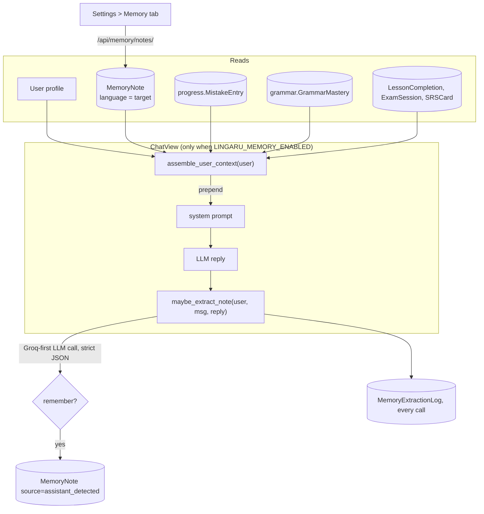

# Memory

> Gives the assistant continuity across conversations. Before each text-chat turn it prepends a compact **LEARNER CONTEXT** block: profile, goals, recent mistakes, weakest grammar topics, this week's activity, and the user's notes. After each turn it can detect "remember that..." requests and save them as notes. Users manage their notes in **Settings > Memory**.

**Code:** `backend/apps/memory/`, `backend/services/memory/` · **Spec:** [specs/memory.md](../specs/memory.md) · Design history: `docs/superpowers/specs/2026-05-17-assistant-memory-layer-design.md`

## Overview



The two service functions are the only chat-side entry points (`services/memory/__init__.py`):
- `assemble_user_context(user) -> str` is read-only and never raises.
- `maybe_extract_note(*, user, user_message, assistant_response, message=None) -> MemoryNote | None` writes and never raises.

## Key concepts

| Term | Meaning |
|---|---|
| Memory note | A short fact (≤ 500 chars) in one of five categories: `goal`, `preference`, `background`, `weakness`, `other`. |
| Source | `user` (Settings tab) or `assistant_detected` (extractor). The API never lets a client set the source. |
| Soft delete | DELETE sets `is_active=False`. Inactive notes are not injected. |
| Language scoping | Notes carry `language` (`fr`/`en`). Context assembly only reads notes matching `user.target_language`. |
| Extraction cap | At most **3** successful auto-extractions per user in a rolling 24 h window. |
| Kill switch | `LINGARU_MEMORY_ENABLED`. When off, chat does neither injection nor extraction, but the REST endpoints keep working. |

## How it works

### Context assembly (`services/memory/context.py`)

Sections are built in this order. Each runs in its own `try/except`, and a failing section is skipped with a WARNING:

| # | Section | Source | Rule |
|---|---|---|---|
| 1 | `**Profile:**` | `User` | `target_level`, `proficiency_level`, `mode`, `native_language`, `daily_goal_minutes` (only the fields that are set) |
| 2 | `**Goals:**` | `MemoryNote` | active, `category=goal`, matching language, oldest first |
| 3 | `**Recent mistakes (last 7 days):**` | `progress.MistakeEntry` | top 3 `mistake_type` values by count |
| 4 | `**Weakest grammar topics:**` | `grammar.GrammarMastery` | bottom 3 by `mastery_score`, `attempts > 0` |
| 5 | `**This week:**` | `LessonCompletion`, `ExamSession(mode=mock)`, `SRSCard` | counts over the last 7 days, omitted if all are zero |
| 6 | Preferences / Weaknesses (user-reported) / Background | `MemoryNote` | active, matching language, grouped by category |

Output: `"## LEARNER CONTEXT\n\n" + sections joined by blank lines`. If there are no sections it returns `""`, and the caller skips injection. `ChatView` prepends the block after the RAG step, so the block survives when RAG replaces the prompt.

Example:
```
## LEARNER CONTEXT

**Profile:** B2 target . B1 . mode=exam . native=en . 15 min/day goal

**Goals:**
- User is preparing for the TCF exam on June 15

**Recent mistakes (last 7 days):** gender (3x), agreement (2x)
```

### Note extraction (`services/memory/extractor.py`)

1. **Cap check.** If 3 or more `MemoryExtractionLog(extracted=True)` rows exist in the last 24 h, log `cap reached` and return `None` without calling the LLM.
2. **LLM call.** A dedicated router is used: Groq is primary when `GROQ_API_KEY` is set, with Gemini as fallback. The input is the system prompt `EXTRACTOR_SYSTEM_PROMPT` plus one user message containing the user text and the first 400 chars of the reply.
3. **Parse.** `_parse_json` tries a fenced block, then the whole string, then the span from the first `{` to the last `}`. A parse or LLM error writes a log row with the error and returns `None`.
4. **Decide.** If `remember` is false, or `content` is empty, write a log row and return `None`.
5. **Save.** The category is normalised (unknown values become `other`) and the content is truncated to 500 chars. The note is created as `MemoryNote(source="assistant_detected", language=user.target_language)` and a log row with `extracted=True` and the note link is written.
6. `ChatView` returns `memory_saved: {id, content, category}`. The frontend shows a "Saved to memory" chip with **Undo**, which calls DELETE on the note.

The prompt rules:
- Only explicit "remember / save / note / don't forget" requests qualify. Volunteered facts do not.
- The note is written in the third person, one fact per turn.
- When unsure, the model should return `remember=false`.

### REST API (`apps/memory/views.py`)

| Method + path | Behaviour |
|---|---|
| `GET /api/memory/notes/` | The user's active notes, or all with `?include_inactive=true` (also accepts `1`/`yes`). Unpaginated, ordered `-updated_at`. |
| `POST /api/memory/notes/` | Create `{content, category?}`. `source` is forced to `user`. Returns 201. |
| `PATCH /api/memory/notes/<id>/` | Partial update of `content`, `category`, `is_active`. |
| `DELETE /api/memory/notes/<id>/` | Soft delete. Returns 204, including when the note is already inactive. |

Notes owned by another user return 404.

## Data model

| Model | Table | Purpose | Key fields |
|---|---|---|---|
| `MemoryNote` | `memory_notes` | A fact to remember | `user`, `content` (Text, 500 at the API), `category`, `source`, `is_active`, `language` (fr/en, default fr, indexed), timestamps. Indexes `(user, is_active, -updated_at)`, `(user, language, is_active)`. |
| `MemoryExtractionLog` | `memory_extraction_log` | Audit of every extractor run, also used for the daily cap | `user`, `message` (FK to `assistant.Message`, SET_NULL), `note` (SET_NULL), `extracted`, `raw_output` (≤ 2000 chars stored), `created_at`. Index `(user, -created_at)`. |

Both are registered in Django admin.

## Configuration

| Setting | Default | Effect |
|---|---|---|
| `LINGARU_MEMORY_ENABLED` | `False` | Chat-side injection and extraction. Read on each call via `is_memory_enabled()`. |
| `GROQ_API_KEY` / `GEMINI_API_KEY` | | Extractor providers (Groq preferred) |
| `DAILY_EXTRACTION_CAP` (constant in `extractor.py`) | 3 | Successful extractions per rolling 24 h |
| `MAX_NOTE_CONTENT_LENGTH` (constant in `apps/memory/models.py`) | 500 | Note length cap |

## Working on it

- **Tests:**
  - `apps/memory/tests/`: models, REST views, language backfill migration.
  - `services/memory/tests/`: context, extractor, language scoping.
  - `apps/assistant/tests/test_chat_with_memory.py`: the "memory never breaks chat" invariant.
- `services/` tests are outside `pytest.ini`'s `testpaths`, so run them explicitly: `python -m pytest services/memory`.
- **Tests and `.env`:** if your repo-root `.env` sets `LINGARU_MEMORY_ENABLED=true` with real keys, chat tests that do not patch `maybe_extract_note` make real extractor calls. Export `LINGARU_MEMORY_ENABLED=false` when running tests.
- **Add a context section:** write a `_fetch_*` helper that returns markdown or `""`, and add it to the tuple in `assemble_user_context`. Keep each section to one or two lines.
- **Tune extraction:** edit `services/memory/prompts.py`. False positives can be reviewed in admin on `MemoryExtractionLog`.

## Known gaps

- Notes created through `POST /api/memory/notes/` keep the model default `language="fr"`, and the list endpoint is not language-scoped. EN learners' manually written notes are therefore not injected into the EN assistant.
- The 60 s per-user context cache and the Sentry spans (`memory.assemble`, `memory.extract`) from the design spec are not implemented. Each turn runs about 9 queries.
- The extractor makes a synchronous second LLM call on every text-chat turn, even when the message has no "remember" intent. A keyword pre-filter would skip most calls.
- `MemoryExtractionLog` gets one row per chat turn and has no retention policy.
- The "SRS reviews" figure in the "This week" section counts reviewed cards whose next review falls in or after the last 7 days. It overstates the reviews actually done this week.
- There is no cap on the number of notes injected.
- Memory is only wired into `ChatView`. Voice chat, image queries and the Telegram bot do not use it.
- The extractor has its own JSON parser, although the design called for reusing the blocks salvage helper.
