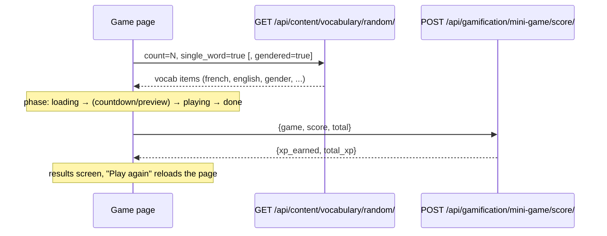

# Mini Games

> Six short vocabulary games (Word Scramble, Match Pairs, Gender Snap, Speed Round, Missing Letter, Listening Challenge) that turn the user's vocabulary bank into quick, scored rounds that award XP. Each game also has a one-round "inline" variant that the assistant can embed in chat in agentic mode.

**Code:** `frontend/src/pages/{MiniGames,WordScramble,MatchPairs,GenderSnap,SpeedRound,MissingLetter,ListeningChallenge}.jsx`, `frontend/src/components/blocks/inline/`, `frontend/src/components/blocks/FeatureWidgetBlock.jsx`; backend `backend/apps/gamification/views.py` (`MiniGameScoreView`), `backend/apps/content/views.py` (`RandomVocabularyView`) · **Spec:** [specs/frontend.md](../specs/frontend.md) · **Related:** [Frontend Architecture](Frontend-Architecture.md)

## Overview

The hub at `/mini-games` (`MiniGames.jsx`) lists the six games. Gender Snap is wrapped in `ComingSoonBadge` when `isAvailable("gender_snap", target_language)` is false; it is French-only today.

## Key concepts

| Term | Meaning |
|---|---|
| **Phase** | Each page's state machine: `loading` → optional `countdown`/`preview` → `playing` → `done`. |
| **Round** | One vocabulary item. Rounds are chained until the configured count is reached. |
| **Score** | Count of correct rounds. Match Pairs uses a moves-based formula instead. Sent to the backend on completion. |
| **Inline variant** | A one-round version rendered inside a chat reply via a `feature_widget` block. It awards no XP and links to the full page. |
| **Accent-insensitive** | Typed answers are compared after NFD normalisation and diacritic stripping, so `demenager` matches `déménager`. |

## How it works

### The six games

| Game (route) | Mechanic | Data request | Default length | Controls |
|---|---|---|---|---|
| **Word Scramble** (`/mini-games/word-scramble`) | Rebuild the word from shuffled letter tiles; the leading article is stripped and shown as a hint. Has a per-word countdown. | `count=rounds, single_word` | 8 words, 30 s each | Type letters, Backspace, Enter/Space for next, or click tiles |
| **Match Pairs** (`/mini-games/match-pairs`) | Memory grid of French and English cards. A preview shows all cards, then they flip face-down. Timed (elapsed clock). | `count=pairs, single_word` | 6 pairs, 3 s preview | Click cards; Esc goes back |
| **Gender Snap** (`/mini-games/gender-snap`) | Swipe or arrow-key a noun: right = masculine (le), left = feminine (la). Swipe threshold 60 px. | `count=rounds, single_word, gendered` | 10 words | Drag/swipe, ←/→ |
| **Speed Round** (`/mini-games/speed-round`) | True or false: is the shown translation correct? About 40% of questions show a wrong translation borrowed from another word. A 3-2-1 countdown, then one global timer. | `count=questions*2, single_word` (server caps at 20) | 12 questions, 45 s | ←/F = false, →/T = true |
| **Missing Letter** (`/mini-games/missing-letter`) | About 40% of letters blanked (the first letter stays visible); fill in the blanks. Three lives; a wrong answer costs one. | `count=rounds, single_word` | 8 words, 3 lives | Type into focused blank |
| **Listening Challenge** (`/mini-games/listening-challenge`) | Hear the word (TTS through `POST /media/tts/`) and type it. Progressive hints: first letter, then first and last letters with the length. | `count=rounds, single_word` | 8 words | Type + Enter, replay audio |

### Scoring and XP

- On `done`, each page calls `submitMiniGameScore(game, score, total)` → `POST /api/gamification/mini-game/score/`.
- The backend awards **2 XP per score point** (`XP_PER_CORRECT = 2`) and records an XP transaction of type `mini_game_<game>`. A score of 0 or less returns `{xp_earned: 0}`.
- The backend allows these `game` values: `word_scramble`, `match_pairs`, `gender_snap`, `speed_round`, `missing_letter`.
- Match Pairs score = `pairs + max(0, pairs + 4 - moves)`: a base score plus up to 4 bonus points for finishing in few moves.
- The results screen shows the per-round list, the animated score (`useCountUp`) and the XP earned.

### Settings that apply

These are stored in `user.preferences` and edited in Settings → Games:

| Preference | Game | Range |
|---|---|---|
| `word_scramble_rounds`, `word_scramble_timer` | Word Scramble | 3-20 words, 10-60 s |
| `match_pairs_count`, `match_pairs_preview` | Match Pairs | 4-10 pairs, 1-10 s |
| `gender_snap_rounds` | Gender Snap | 5-20 |
| `speed_round_questions`, `speed_round_timer` | Speed Round | 5-30 questions, 15-120 s |
| `missing_letter_rounds` | Missing Letter | 3-20 |
| `listening_challenge_rounds` | Listening Challenge | 3-20 |

### Inline chat variants

In agentic chat, the backend may return `{"type": "feature_widget", "widget": "<slug>", "config": {...}}`. The backend validates `widget` against `ALLOWED_FEATURE_WIDGETS` in `backend/apps/assistant/blocks.py`. `FeatureWidgetBlock.jsx` then maps the slug to a component, and every component renders inside the shared `InlineRoundWidget` shell (header, score chip, "Encore" button, "open full session" link).

| Widget slug | Component | Difference from the full page |
|---|---|---|
| `word_scramble` | `WordScrambleInline` | One word, no timer or streak |
| `match_pairs` | `MatchPairsInline` | 4 pairs in a 2×4 grid, no preview phase |
| `gender_snap` | `GenderSnapInline` | One noun, two buttons instead of swipe |
| `speed_round` | `SpeedRoundInline` | One question (fetches 4 words to build a distractor) |
| `missing_letter` | `MissingLetterInline` | One word, exactly one blank |
| `listening_challenge` | `ListeningChallengeInline` | One word, no hints or lives |
| `dictation`, `flashcard`, `conjugation`, `grammar_topic` | `*Inline` | Non-game widgets that use the same shell |
| `minigame` | `MiniGameWidget` | A preview card with a deep link |

Inline widgets do not submit scores or award XP.

### Shared vs duplicated logic

| Concern | Shared? | Where |
|---|---|---|
| Vocab fetch | Partly | All call `getRandomVocabulary`. Inline widgets use `normalizeVocabResponse`; full pages do their own `Array.isArray(res.data) ? ... : [res.data]` unwrap. |
| Phase machine, round advance, score, XP submit | **No** | Re-implemented in each of the 6 pages |
| Results screen, "Play again" | **No** | Per page. "Play again" calls `window.location.reload()`. |
| `shuffle()`, `stripAccents()` | **No** | Local copies in several pages, widgets and `utils/quizEnhancer.js` |
| TTS URL resolution | **No** | `resolveAudioUrl` / `API_BASE_URL.replace(...)` copied into about 8 files |
| Keyboard handling | **No** | Each page adds its own `window` `keydown` listener |
| Animated counters | Yes | `hooks/useAnimations.js` (`useCountUp`, `staggerDelay`) |
| Inline card chrome | Yes | `components/blocks/InlineRoundWidget.jsx` |
| Round logic between page and inline variant | **No** | Each game's rules exist twice: once in the page, once in the widget |

## Data model

No game tables. The games read `Vocabulary` through `GET /api/content/vocabulary/random/`:

| Param | Effect |
|---|---|
| `count` | Number of items, capped at 20 server-side |
| `single_word` | Only single-word entries |
| `gendered` | Only nouns with a gender |

When `count=1` the response is a bare object; otherwise it is an array. Completion writes an XP transaction through `award_xp()` in the gamification app.

## Configuration

- User preferences: see the table above. Defaults are constants at the top of each page (`DEFAULT_ROUNDS`, `DEFAULT_TIMER`, ...).
- Feature availability per target language: `frontend/src/lib/featureAvailability.js`.

## Working on it

- **Run:** start the backend with seeded vocabulary, then `npm run dev` and open `/mini-games`. A game shows "Not enough vocabulary" if the random endpoint returns fewer items than it needs.
- **Add a game:**
  1. Add the page and the route in `App.jsx`.
  2. Add a card to `GAMES` in `MiniGames.jsx`.
  3. Add the slug to `MiniGameScoreView.VALID_GAMES`.
  4. Add a preference to Settings → Games if the length should be configurable.
  5. Optionally add an `*Inline` widget, plus its slug in both `FeatureWidgetBlock` and `ALLOWED_FEATURE_WIDGETS`.
- **Refactor direction:**
  - Extract a `useMiniGame({ game, fetchItems, rounds })` hook (phase, round, score, submit, reset) and shared `<GameShell>`/`<GameResults>` components.
  - Move `shuffle` and `stripAccents` into one helper module.
  - Make each game's round component reusable by both the page and its inline variant.
- **Gotcha:** state updaters must be pure. StrictMode runs them twice in dev, so a side effect inside `setTimeLeft(t => ...)` fires twice.

## Known gaps

- `listening_challenge` is not in the backend `VALID_GAMES`, so Listening Challenge completions get a 400 and award no XP. The error is swallowed silently.
- Speed Round: when the global timer expires, the submit uses a stale `score` captured when play started, so timed-out games submit 0.
- Word Scramble and Speed Round run side effects (round-end handling, score submit) inside state updater functions.
- Speed Round requests `questions × 2` words, but the server caps at 20, so `speed_round_questions` above 20 always fails with "Not enough vocabulary".
- "Play again" reloads the whole app instead of resetting state.
- All game and widget strings are hard-coded: English on the pages, French in the inline widgets. They are not in the i18n files.
- XP submit failures are silently ignored (`.catch(() => {})`).
- Game logic is duplicated across 6 pages and 6 inline widgets (see the table above).
- Letter tiles are not keyboard-focusable (`tabIndex=-1`); keyboard play relies on global key handlers.
