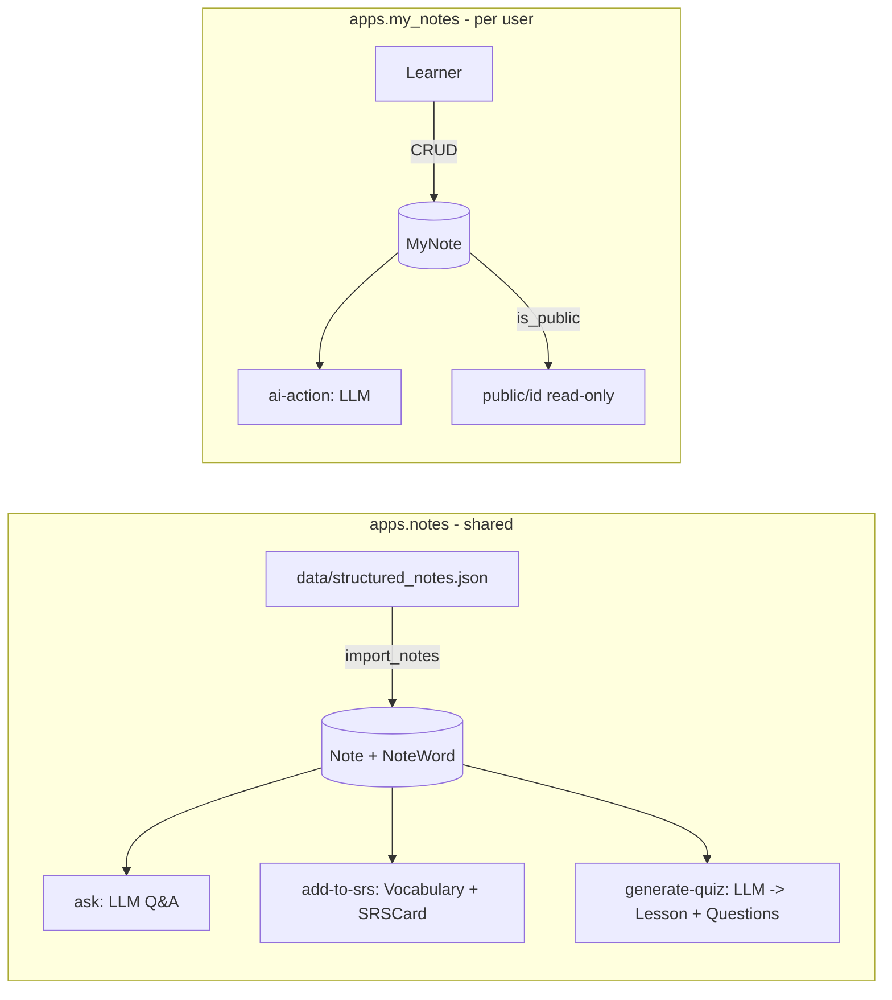

# Notes and My Notes

> Lingaru has **three** features with "notes" in the name. They are unrelated and do not share tables. This page covers the first two in detail and the third only enough to tell them apart:
> 1. **Our Notes** (`apps.notes`): a curated, read-only library of 80 dated English vocabulary study notes, shared by all learners, with AI Q&A, add-to-SRS and quiz generation.
> 2. **My Notes** (`apps.my_notes`): each learner's private markdown notebook, with optional public sharing and AI actions such as summarize or fix grammar.
> 3. **Memory notes** (`apps.memory`): short facts the AI assistant remembers about the learner across chats. It is documented with the assistant, not here.

**Code:** `backend/apps/notes/`, `backend/apps/my_notes/` · **Spec:** [specs/notes.md](../specs/notes.md)

## Overview: which "notes" is which?

| | Our Notes | My Notes | Memory notes |
|---|---|---|---|
| Django app | `apps.notes` | `apps.my_notes` | `apps.memory` |
| API prefix | `/api/notes/` | `/api/my-notes/` | `/api/memory/notes/` |
| Frontend route | `/our-notes`, `/our-notes/:id`, `/our-notes/review` | `/my-notes`, `/my-notes/new`, `/my-notes/:id`, `/my-notes/public/:id` | Settings → Memory tab |
| Who writes it | Admins, through the `import_notes` command | The learner (CRUD) | The learner, plus assistant-detected facts (`source="assistant_detected"`, behind `LINGARU_MEMORY_ENABLED`) |
| Ownership | Global; filtered by `target_language` | Per user (`user` FK) | Per user |
| Content | Note number + date + list of words (word, definition, example) | Title, kind, markdown body, tags | One-sentence fact + category (goal, preference, background, weakness, other) |
| AI | Ask a question about the note; generate a quiz | 7 one-click actions on the body | Fed into the assistant chat context (behind `LINGARU_MEMORY_ENABLED`) |
| Tables | `notes_note`, `notes_word` | `my_notes_mynote` | `memory_notes`, `memory_extraction_log` |



## Key concepts

| Term | App | Meaning |
|---|---|---|
| Note number | notes | Stable ordinal of a study note (1..80); unique per language |
| NoteWord | notes | A word or phrase in a note, with optional definition and example, ordered |
| "Our Notes" topic and lesson | notes | A shared `content.Topic` named "Our Notes" (EN) and lesson "Our Notes vocabulary" that hold the vocabulary created by add-to-srs |
| Kind | my_notes | `grammar`, `dialog`, `vocabulary`, `listening`, `writing`, `reading`, `freeform` (default) |
| Tags | my_notes | Lowercased, de-duplicated strings: at most 20 tags, each at most 40 characters |
| Public note | my_notes | `is_public=True`; any signed-in user can read it at `/api/my-notes/public/<id>/` |

## How it works

### Our Notes (`apps.notes`)

| Step | Behaviour |
|---|---|
| Import | `python manage.py import_notes [--path]` reads `data/structured_notes.json` (`{"notes": [{note_number, date, title, words: [{word, definition, example}]}]}`). Inside one transaction it upserts each `Note` on `(language="en", note_number)`, deletes its words and recreates them in file order. |
| List | `GET /api/notes/`: active notes in the user's `target_language`, newest number first, with `word_count`. Not paginated. |
| Detail | `GET /api/notes/<pk>/`: the note with its ordered `words`. |
| Ask | `POST /api/notes/<pk>/ask/ {question}`: builds a system prompt from the note's words ("answer using ONLY the words in this note"), calls the LLM and returns `{answer}`. Returns 503 if the LLM fails. |
| Add to SRS | `POST /api/notes/<pk>/add-to-srs/`: for each word, gets or creates an EN `Vocabulary` (both `english` and `french` set to the word) under the shared "Our Notes" lesson, then gets or creates the user's `SRSCard`. Returns `{created, existing}`. |
| Generate quiz | `POST /api/notes/<pk>/generate-quiz/`: the LLM returns a JSON array of 5-10 MCQs. A new EN `Lesson` "Quiz: Note N" is created under the "Our Notes" topic with one `Question` per item. Returns `{lesson_id, question_count}` (201). |

The prompts are English-vocabulary-specific because the imported notes are English.

### My Notes (`apps.my_notes`)

| Step | Behaviour |
|---|---|
| CRUD | `MyNoteViewSet` at `/api/my-notes/`. Every query is limited to `request.user`. The list uses a lean serializer with a 140-character `body_preview`; detail, create and update use the full one. On create, `language` defaults to the user's `target_language`. |
| Filters | `q` (case-insensitive match on title, body or tags), `kind`, `tag`, `favorite=1\|true`, `language` (`all` or empty means no filter). Not paginated. Ordered by `-updated_at`. |
| Public read | `GET /api/my-notes/public/<pk>/` returns any note with `is_public=True` (login required). |
| AI actions | `POST /api/my-notes/<pk>/ai-action/ {action}` on the user's own note. `_build_ai_prompt` builds the system and user prompts from the note's language, kind, title, tags and body. The response is `{result}`, or `{tags}` for `suggest_tags`. |

AI actions:

| Action | Output |
|---|---|
| `summarize` | exactly 3 markdown bullets |
| `enhance_format` | the reformatted full markdown (same content) |
| `fix_grammar` | the corrected full body |
| `more_examples` | 5 more example sentences as bullets |
| `ice_breakers` | 5 conversation-starter questions |
| `practice_questions` | 3 questions, each followed by `_Answer:_` |
| `suggest_tags` | 3-5 tags, parsed into a list of at most 5 (each at most 40 characters) |

Every action except `suggest_tags` returns 400 when the body is empty. AI output is returned only; the client decides whether to save it into the note.

## Data model

| Model | App | Purpose | Key fields |
|---|---|---|---|
| `Note` | notes | Curated study note | `note_number`, `date`, `title`, `language` (default `en`), `is_active`; unique `(language, note_number)`; index `(language, -note_number)` |
| `NoteWord` | notes | Word in a note | `note` FK, `word`, `definition`, `example`, `order`; index `(note, order)` |
| `MyNote` | my_notes | Private note | `user` FK, `title`, `kind`, `body_markdown`, `tags` JSON, `language` (default `fr`), `is_favorite`, `is_public`; indexes `(user, -updated_at)`, `(user, kind)`, `(is_public, -updated_at)` |

## Configuration

There are no app-specific settings. AI endpoints use the shared LLM router (`GEMINI_*`, `GROQ_*`).

## Working on it

```bash
cd backend
python manage.py import_notes                 # (re)load Our Notes, idempotent
pytest apps/notes apps/my_notes
```

- **Editing Our Notes:** change `data/structured_notes.json` and re-run `import_notes`. A note's words are replaced, not merged.
- **Adding a My Notes AI action:** add it to `ALLOWED_AI_ACTIONS`, add a branch in `_build_ai_prompt`, add a frontend button, and add a test.
- **Markdown:** `body_markdown` and AI results are rendered with `react-markdown` (no raw HTML).

## Known gaps

- The Our Notes list makes one `COUNT` query per note for `word_count` (`source="words.count"`) and is not paginated.
- `generate-quiz` creates a new shared Lesson and Questions on every call, so repeated clicks accumulate quiz lessons under "Our Notes".
- `_parse_quiz_json` does not catch a failed fallback parse or non-dict items. Those cases return 500 instead of the friendly error.
- The "Our Notes" topic get-or-create is duplicated between `_get_or_create_our_notes_lesson` and `NoteGenerateQuizView`.
- add-to-srs stores the English word in `Vocabulary.french` too, as a workaround for a FR-centric model.
- The Our Notes prompts and imports are hard-coded to English. `import_notes --force` is a documented no-op.
- `Note.language` and `MyNote.language` are `max_length=2`, while other content tables use 8.
- My Notes and Our Notes lists are both unpaginated.
- The LLM calls (ask, generate-quiz, ai-action) run synchronously in the request.
- Neither app is documented in the root README.

Related: [Content Data Pipeline](Content-Data-Pipeline.md).
