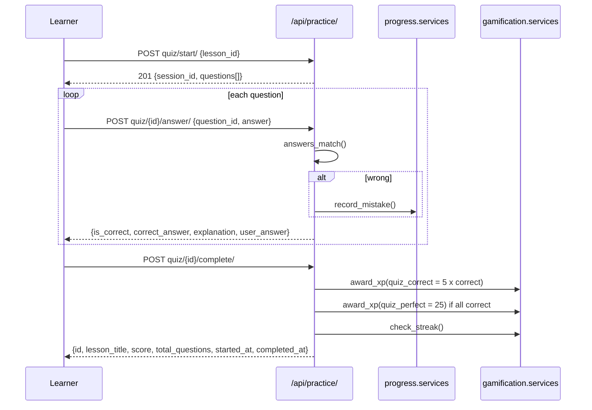

# Practice and Quizzes

> Lesson quizzes: start a session for a lesson, answer its questions one by one with forgiving answer matching, then complete the session to get a score and XP. Wrong answers feed the mistake journal.

**Code:** `backend/apps/practice/` · **Spec:** [specs/practice.md](../specs/practice.md)

## Overview

## Key concepts

| Term | Meaning |
|------|---------|
| Quiz session | One attempt at one lesson's questions (`QuizSession`). Open until `completed_at` is set. |
| Answer | One graded response to one question inside a session (`QuizAnswer`), at most one per question per session. |
| Score | Number of correct answers, computed at completion. |
| Perfect | `score == total_questions` (and total > 0). |
| Random quiz | `GET quiz/random-lesson/` picks a lesson with questions for the "Random Quiz" page. |

## How it works

### Start (`QuizStartView`)

1. Validates that `lesson_id` exists.
2. Loads **all** questions of the lesson. If there are none, returns `400`.
3. Creates a `QuizSession` with `total_questions` = question count.
4. Returns `201` with the session id and the serialized questions. For `mcq` questions with distractors, `options` holds the correct answer and `wrong_answers` shuffled together; other types get `options: []`.

### Answer (`QuizAnswerView`)

1. Loads the session for the current user (404 otherwise). Completed sessions return `400`.
2. Loads the question (404 if missing). A second answer to the same question returns `400`.
3. Grades with `answers_match(user_answer, correct_answer)` (in `apps/practice/views.py`):

| Rule | Example accepted |
|------|------------------|
| Trim and lowercase | `" Bonjour"` = `"bonjour"` |
| Strip one leading article `l'`, `le `, `la `, `les `, `un `, `une ` | `"la réunion"` = `"réunion"` |
| Accent-insensitive | `"reunion"` = `"réunion"` |
| Levenshtein distance at most 1 when the correct answer has 4+ chars (also tried accent-stripped) | `"bonjor"` = `"bonjour"` (a swap like `"bonjuor"` is 2 edits and fails) |

4. Saves the `QuizAnswer`. If wrong, calls `apps.progress.services.record_mistake()` (mistake type derived from the question type).
5. Returns the result with the correct answer and explanation.

### Complete (`QuizCompleteView`)

1. Loads the user's session (404) and rejects already-completed ones (400).
2. `score` = count of correct answers; sets `completed_at`.
3. Awards XP through `apps.gamification.services.award_xp` with `source_id = "quiz_session_<id>"`:
   - `quiz_correct`: 5 XP per correct answer (if any).
   - `quiz_perfect`: 25 XP bonus when every question was answered correctly.
4. Calls `check_streak()`.
5. Returns the session summary.

Completing a quiz does not create a `LessonCompletion`; the frontend calls `POST /api/progress/lessons/{id}/complete/` separately. See [Progress, SRS and Conjugation](Progress-SRS-and-Conjugation.md).

### History and random lesson

- `GET quiz/history/`: the user's sessions, newest first, DRF-paginated (`{count, next, previous, results}`, 20 per page).
- `GET quiz/random-lesson/`: a random lesson that has at least one question and no `conjugation` questions; `{lesson_id, title}` or `404`.

## Data model

| Model | Purpose | Key fields |
|-------|---------|------------|
| `QuizSession` | One quiz attempt | `user` FK, `lesson` FK, `started_at`, `completed_at` (null while open), `score` (null while open), `total_questions` |
| `QuizAnswer` | One graded answer | `session` FK, `question` FK, `user_answer`, `is_correct`, `answered_at`; unique `(session, question)` |

Both cascade-delete with the user, lesson or question.

## Configuration

None specific. XP amounts are hard-coded in `apps/practice/views.py` (see [Gamification](Gamification.md)).

## Working on it

- **Tests:** `pytest apps/practice` (models, serializers, views, `test_answer_matching.py` for the matcher).
- **Changing grading:** `answers_match` is pure; add cases to `apps/practice/tests/test_answer_matching.py` first.
- **Changing XP:** amounts live in `QuizCompleteView`; keep the `ACTIVITY_LABELS` in `apps/gamification/serializers.py` in sync.
- **Gotcha:** the serializer import in `views.py` sits below the matcher functions (ruff `E402` is ignored for `views.py`).

## Known gaps

- The answer endpoint does not check that the question belongs to the session's lesson, so a session's score can exceed `total_questions`.
- Quiz start and random-lesson are not filtered by `target_language`.
- Completing the same session twice concurrently can award XP twice (no lock or conditional update).
- Two concurrent answers to the same question can raise a database error instead of the `400` response.
- Accent-insensitive and one-typo matching also apply to conjugation and gender questions, where the accent or letter is the point.
- `answers_match` lives in `views.py`; conjugation drills in the progress app use a different, exact comparison.
- Quiz completion and lesson completion are separate concepts and separate calls; the lesson-completion score is reported by the client.
- `QuizStartView` runs three queries (`exists`, `count`, list) where one would do.
