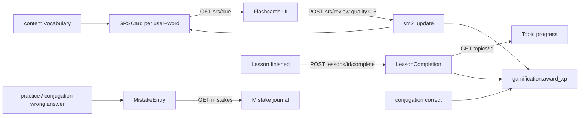

# Progress, SRS and Conjugation

> Learner progress tracking: SM-2 spaced-repetition flashcards, the mistake journal, conjugation drills, lesson completion and per-topic progress.

**Code:** `backend/apps/progress/` · **Spec:** [specs/progress-srs.md](../specs/progress-srs.md)

## Overview

## Key concepts

| Term | Meaning |
|------|---------|
| SRS card | One `SRSCard` per (user, vocabulary item) holding SM-2 state. |
| Quality | Self-rating 0-5 sent on review: 0 blackout ... 5 perfect. Below 3 is a lapse. |
| Ease factor (EF) | Multiplier for interval growth, starts at 2.5, never below 1.3. |
| Due | `next_review_at <= now`. |
| Mastered | Used by the trend report: `interval_days >= 21`. |
| Mistake | A wrong answer recorded with its type (`conjugation`, `other`, ...) and a `reviewed` flag. |
| Lesson completion | One row per (user, lesson), keeps the best score. |

## How it works

### SM-2 scheduling (`apps/progress/services.py`)

`sm2_update(quality, repetitions, ease_factor, interval_days)` is a pure function:

| Step | Rule |
|------|------|
| Validate | `quality` must be 0-5, else `ValueError`. |
| Ease factor | `EF' = EF + (0.1 - (5 - q) * (0.08 + (5 - q) * 0.02))`, floored at 1.3. Applied on every review, including lapses. |
| Lapse (`q < 3`) | `repetitions = 0`, `interval = 1` day. |
| Success, 1st | `repetitions = 1`, `interval = 1`. |
| Success, 2nd | `repetitions = 2`, `interval = 6`. |
| Success, later | `interval = round(previous_interval * EF')`. |

`review_card(card, quality)` applies it, sets `last_quality`, sets `next_review_at = now + interval days`, and saves.

| q | EF change |
|---|-----------|
| 5 | +0.10 |
| 4 | 0.00 |
| 3 | -0.14 |
| 2 | -0.32 |
| 1 | -0.54 |
| 0 | -0.80 |

### Flashcard review flow

1. `GET /api/progress/srs/due/?limit=N` (default 20, max 50) returns due cards, oldest due first, **only for vocabulary in the user's current `target_language`**. Cards in other languages are kept, so switching back restores progress. Response: `{cards: [...], count}`.
2. `POST /api/progress/srs/review/` `{card_id, quality}` runs `review_card`, awards 10 XP (`srs_review`), updates the streak, and returns the updated card.

### Where SRS cards come from

| Source | How |
|--------|-----|
| `python manage.py seed_flashcards [--username U]` | Creates a card for every vocabulary row for every user (or one user). |
| `apps/notes` "send to flashcards" | Creates EN `Vocabulary` rows from note words and a card for each. |

Lessons and quizzes do not create cards automatically.

### Mistake journal

- `record_mistake(user, question, user_answer, correct_answer, mistake_type=None)` is called by the practice answer endpoint and the conjugation check. If `mistake_type` is not given, `classify_mistake` maps question type `conjugation` -> `conjugation`, everything else -> `other`.
- `GET /api/progress/mistakes/?type=&reviewed=true|false` lists the user's mistakes, newest first, DRF-paginated.
- `POST /api/progress/mistakes/reviewed/` `{mistake_ids: [1..100 ids]}` marks the user's own mistakes as reviewed; returns `{updated}`.

### Conjugation drills

Conjugation data is stored as `content.Question` rows with `type="conjugation"` and a prompt of the form `Conjugate {verb} ({tense}, {subject})`, created by `seed_conjugations` (36 verbs, tenses `present`, `passe_compose`, `imparfait`, `futur_simple`, `conditionnel`, subjects `je`/`j'`, `tu`, `il/elle`, `nous`, `vous`, `ils/elles`).

| Endpoint | Behaviour |
|----------|-----------|
| `GET /api/progress/conjugation/verbs/` | Parses all conjugation prompts into sorted `{verbs, tenses}`. |
| `POST /api/progress/conjugation/check/` `{verb, tense, subject, answer}` | Finds the question whose prompt contains the verb, tense and subject (case-insensitive substring match, first by id), compares the trimmed, lowercased answer exactly. Correct: 10 XP (`conjugation_drill`) and streak update. Wrong: a `conjugation` mistake. Returns `{is_correct, correct_answer, explanation}`. |

### Lesson completion and topic progress

- `POST /api/progress/lessons/{lesson_id}/complete/` `{score, total_questions}`: creates the `LessonCompletion` on first call (50 XP `lesson_complete`, streak update), or raises the stored score if the new one is higher. Returns `{completed, first_time, xp_earned, next_lesson}` where `next_lesson` is the next lesson by `order` in the same topic, or `null`.
- `GET /api/progress/topics/{topic_id}/`: `{topic_id, total_lessons, completed_lessons, completed_lesson_ids}` for the current user.

## Data model

| Model | Purpose | Key fields |
|-------|---------|------------|
| `SRSCard` | SM-2 state per user and word | `user` FK, `vocabulary` FK, `ease_factor` (2.5), `interval_days` (0), `repetitions` (0), `next_review_at` (now), `last_quality` (0); unique `(user, vocabulary)`; ordered by `next_review_at` |
| `MistakeEntry` | Mistake journal row | `user` FK, `question` FK (nullable, `SET_NULL`), `user_answer`, `correct_answer`, `mistake_type`, `created_at`, `reviewed`; ordered newest first |
| `LessonCompletion` | Best result per lesson | `user` FK, `lesson` FK, `completed_at`, `score`, `total_questions`; unique `(user, lesson)` |

## Configuration

None. XP amounts are hard-coded in `apps/progress/views.py`.

## Working on it

- **Tests:** `pytest apps/progress` (`test_srs_service.py` for the pure algorithm, `test_srs_api.py`, `test_mistakes.py`, `test_conjugation.py`).
- **Seed:** `python manage.py seed_conjugations`, then `python manage.py seed_flashcards --username <you>`.
- **Changing SM-2:** change `sm2_update` only, and add a case to `test_srs_service.py`. The [Grammar Booster](Grammar-Booster.md) has its own scheduler in `apps/grammar/scoring.py`; keep them consistent if you change one.
- **Gotcha:** the SRS code is `apps/progress/services.py` (a module, not a package).

## Known gaps

- XP awards are not idempotent: every SRS review POST and every repeated correct conjugation check awards XP again, and cards do not need to be due to be reviewed.
- Conjugation lookup uses substring matching, so colliding inputs pick the wrong question (`voir` matches `avoir`, `pouvoir`, `devoir`, `savoir`, `recevoir`; `prendre` matches `comprendre`, `apprendre`; subject `tu` matches every `futur_simple` prompt).
- Conjugation endpoints, lesson completion, topic progress and the mistake list are not filtered by `target_language`.
- Lesson completion trusts the client-reported `score`/`total_questions` and does not validate their type or range.
- Conjugation checks use exact comparison while quizzes use the forgiving `answers_match`.
- `ConjugationListView` re-parses every conjugation prompt on each request.
- New users get no SRS cards unless `seed_flashcards` is run or they use the notes flow.
- `seed_flashcards` creates cards for all vocabulary in all languages, one `get_or_create` at a time.
- EF is lowered on lapses; classic SM-2 keeps EF unchanged on a lapse. Intent unclear.
- `get_or_create_card` and `LessonCompletionSerializer` are unused.
- Missing composite indexes: `SRSCard(user, next_review_at)`, `MistakeEntry(user, created_at)`.
- The Grammar Booster forks SM-2 (`apps/grammar/scoring.py`); the two should share one implementation.
- Invalid `limit` on `srs/due/` (non-numeric or negative) causes a server error.
