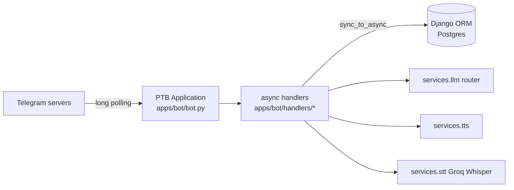
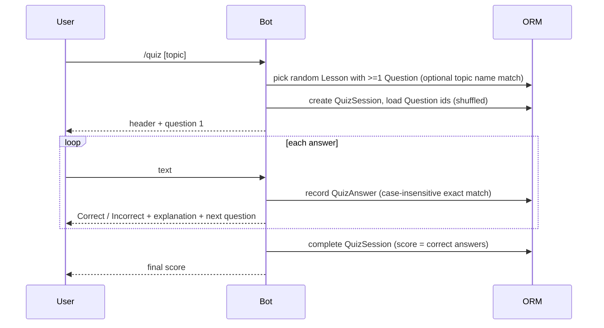

# Telegram Bot

> The Lingaru Telegram bot lets learners practise without opening the web app. It offers quick vocabulary, news and quiz commands, an AI tutor chat that accepts text, photos and voice, a dictation drill, and one-shot specialist "agents". It runs as its own long-polling process and shares the Django models and services with the web API.

**Code:** `backend/apps/bot/`, `backend/services/llm/`, `backend/services/tts/`, `backend/services/stt/` · **Spec:** [specs/telegram-bot.md](../specs/telegram-bot.md)

## Overview

- Built on **python-telegram-bot 21** (PTB) and started with `python manage.py run_bot` (`apps/bot/management/commands/run_bot.py`).
- In Docker it is the `bot` service in `docker-compose.yml`. It uses the same image as `django`, `celery` and `celery-beat`, with a different command.
- PTB handlers are `async`. Django ORM calls are synchronous, so each handler wraps its DB work in small sync helper functions called through `asgiref.sync.sync_to_async`.

## Key concepts

| Term | Meaning |
|---|---|
| Telegram user | `update.effective_user`; its numeric `id` is stored on `User.telegram_id` |
| Command handler | One-shot command (`/word`, `/news`, ...) registered with `CommandHandler` |
| Conversation | Multi-step flow (`/quiz`, `/chat`, `/dictation`, agents) built with PTB `ConversationHandler`; per-chat state lives in `context.user_data` (in memory, lost on restart) |
| Agent | A row in `apps.agents.Agent` (system prompt + metadata) that the bot can run once on a piece of text |

## How it works

### Startup

1. `run_bot` calls `create_bot_application()` in `apps/bot/bot.py`. On Python 3.14 or later it first installs an event loop.
2. The application reads `settings.TELEGRAM_BOT_TOKEN` and raises an error if it is empty.
3. It registers the command handlers and the four conversation handlers, plus an error handler that logs every handler exception with a stack trace.
4. `application.run_polling(drop_pending_updates=True)` starts polling. Updates sent while the bot was offline are discarded.

### User identity

- The bot finds the Lingaru user by `User.telegram_id == effective_user.id`.
- `get_or_create_telegram_user()` in `apps/bot/handlers/start.py` returns that user. If none exists, it creates one:
  - username `tg_<telegram id>`, with a random suffix if that name is taken
  - email `<username>@telegram.local`
  - `first_name` copied from Telegram
  - an unusable password
- `/start`, `/chat`, `/quiz` and `/stats` call this function.
- `/daily` only looks the user up. If no user is found, it asks the person to `/start` first.
- The web Settings page shows the linked `telegram_id` when one is set.

### Commands

| Command | Handler file | Flow |
|---|---|---|
| `/start` | `handlers/start.py` | Get or create the user. Reply "Bienvenue" (new) or "Welcome back". |
| `/help` | `handlers/help.py` | Static command list |
| `/word` | `handlers/word.py` | Random `content.Vocabulary`. Markdown card (word, pronunciation, POS, gender, example), then a TTS audio clip of the word. |
| `/news` | `handlers/news.py` | Newest `DiscoverCard(type="news")`; falls back to a random news or trivia card. Shows source attribution and a link to the original article. |
| `/daily` | `handlers/daily.py` | Up to 10 due SRS cards from `progress.services.get_due_cards` (scoped to the user's target language) |
| `/stats` | `handlers/stats.py` | Level, XP, streaks, badge count, completed quizzes and accuracy |
| `/upload` | `handlers/upload.py` | Static text pointing to the web Documents page |
| `/agents` | `handlers/agents.py` | Lists active agents with inline buttons (see below) |
| `/quiz [topic]` | `handlers/quiz.py` | Conversation (see below) |
| `/chat` | `handlers/chat.py` | Conversation (see below) |
| `/dictation` | `handlers/dictation.py` | Conversation (see below) |

### `/quiz` conversation

- `/cancel` closes the session early and keeps the score earned so far.
- MCQ questions show the correct answer and the distractors in shuffled order. The learner replies with the answer text, not the option number.

### `/chat` conversation (AI tutor)

| Input | What happens |
|---|---|
| `/chat` | Creates `assistant.Conversation(title="Telegram chat", context="telegram")`; stores `conversation_id` and `user_id` in `user_data` |
| Text | Saves a user `Message`. Sends the full conversation history plus `get_system_prompt(user.target_language, "conversation")` to the LLM router. Removes any fenced `blocks` payload with `assistant.blocks.extract_blocks`, saves the assistant `Message` and replies. |
| Photo | Downloads the largest size. Calls `router.generate_with_image` with the `image_query` prompt, saves an `ImageQuery` and two `Message` rows, then replies. |
| Voice | Downloads the OGG, transcribes it with `GroqWhisperProvider`, echoes "I heard: ...", runs the LLM, then replies with a TTS voice note and the text. |
| `/endchat` | Clears the state |

### `/dictation` conversation

1. Picks a random `Vocabulary` that has an `example_sentence`.
2. Generates TTS audio and sends it.
3. Waits for the learner's typed answer.
4. Scores it with `services.stt.scoring.calculate_accuracy`. The answer is correct when accuracy is at least 0.9.
5. Replies with the accuracy, the expected text, the learner's text and feedback.

`/cancel` aborts.

### Agents flow

1. `/agents` lists `Agent.objects.filter(is_active=True)` ordered by `order`, `name`. Each agent gets an inline button with `callback_data="agent:<slug>"`.
2. Tapping a button stores `pending_agent_slug` and asks for input text.
3. The next text message is sent to the LLM with `agent.system_prompt`. The call runs in `sync_to_async`, fenced blocks are removed, and the reply is sent in chunks of 3800 characters (Telegram's limit is 4096).
4. `/cancel` aborts.

## Data model

The bot owns no models. It reads and writes:

| Model | App | Used by |
|---|---|---|
| `User.telegram_id` (BigInteger, unique, nullable) | users | all handlers that need a user |
| `Vocabulary`, `Lesson`, `Question`, `Topic` | content | `/word`, `/dictation`, `/quiz` |
| `QuizSession`, `QuizAnswer` | practice | `/quiz`, `/stats` |
| `SRSCard` | progress | `/daily` |
| `UserStats`, `UserBadge` | gamification | `/stats` |
| `DiscoverCard` | discover | `/news` |
| `Conversation`, `Message`, `ImageQuery` | assistant | `/chat` |
| `Agent` | agents | `/agents` |
| `AudioClip` | media (via `services.tts`) | `/word`, `/dictation`, voice chat |

## Configuration

| Setting / env var | Effect |
|---|---|
| `TELEGRAM_BOT_TOKEN` | Required. If empty, `run_bot` raises `RuntimeError`. |
| `GEMINI_API_KEY`, `GEMINI_MODEL`, `GROQ_API_KEY`, `GROQ_MODEL` | LLM router providers (chat, photo, agents) |
| `GROQ_API_KEY` | Whisper speech-to-text for voice messages |
| `GEMINI_API_KEY` | Gemini TTS (falls back to gTTS) |

## Working on it

- **Run locally:**
  1. Set `TELEGRAM_BOT_TOKEN` in `.env`.
  2. Run `cd backend && python manage.py run_bot`.
  3. Only one poller may run per token, so stop the Docker `bot` service first.
- **Tests:** `pytest apps/bot`. Handlers are tested with `MagicMock`/`AsyncMock` Telegram objects and `pytest-asyncio`. The LLM, STT and TTS are patched.
- **Adding a command:**
  1. Write an `async def x_command(update, context)` in `apps/bot/handlers/x.py`.
  2. Put ORM access in plain sync helpers and call them with `await sync_to_async(helper)(...)`.
  3. Register the command in `create_bot_application()` and add it to `HELP_TEXT`.
- **Gotchas:**
  - Never touch a lazy FK or evaluate a queryset directly inside a coroutine. Django raises `SynchronousOnlyOperation`. Use `select_related` inside the sync helper, or build the reply text there.
  - Blocking SDK calls (LLM, STT) must also go through `sync_to_async` or `asyncio.to_thread`. Otherwise they stall every chat.
  - `parse_mode="Markdown"` (v1) fails with `BadRequest` if the text contains unbalanced `_`, `*` or `[`. Escape dynamic text.
  - `context.user_data` is in memory only, so a bot restart drops any in-flight quiz or chat.

## Known gaps

- `/quiz` reads `lesson.topic` inside the coroutine, so the header line can raise `SynchronousOnlyOperation`. The async quiz handlers have no tests.
- In `/chat`, LLM and STT calls run directly on the event loop, so one slow reply delays all other users.
- `/word`, `/dictation`, `/quiz` and `/news` do not filter by `target_language`. TTS and STT are hard-coded to French.
- Dynamic text is sent with Markdown v1 without escaping. `**bold**` is not valid v1 syntax.
- Chat replies longer than 4096 characters are not chunked (agents replies are).
- The whole chat history is sent to the LLM on every turn, so token use grows with conversation length.
- `/news` always returns the same newest card rather than a random or unseen one, and ignores expiry.
- `/start` always creates a separate Telegram-only account. There is no in-bot flow to attach Telegram to an existing web account.
- The README bot section lists only `/start /quiz /word /daily /stats`.

Related: [Discover and News](Discover-and-News.md), [Content Data Pipeline](Content-Data-Pipeline.md).
