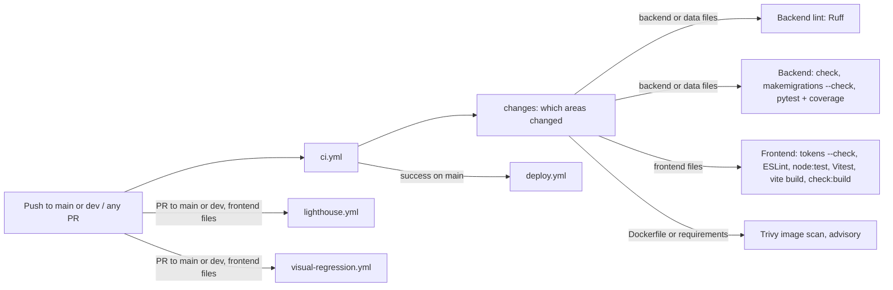

# Testing and CI

> How Lingaru is tested locally and in GitHub Actions: backend pytest suite and lint, frontend token check, lint, unit and component tests and build, the screenshot sweep, Lighthouse, Playwright visual regression, Trivy image scan and Dependabot. Audience: anyone opening a PR.

**Code:** `backend/pytest.ini`, `backend/conftest.py`, `backend/config/settings/test.py`, `backend/pyproject.toml`, `frontend/playwright.config.js`, `frontend/vitest.config.js`, `frontend/scripts/{tokens,sweep,checks}/`, `frontend/lighthouserc.json`, `.github/workflows/`, `.github/dependabot.yml` · **Spec:** [specs/infrastructure.md](../specs/infrastructure.md)

## Overview



## Key concepts

| Term | Meaning |
|---|---|
| `config.settings.test` | Test settings: in-memory SQLite, MD5 password hasher, locmem cache, `DEBUG=True` |
| `testpaths = apps` | Default pytest collection root (see [Gotchas](#gotchas)) |
| Baselines | Committed Playwright screenshots in `frontend/e2e/__screenshots__/` |
| Sweep | A local-only Playwright script (`npm run sweep`) that screenshots the whole app and measures contrast, overflow and computed styles; not part of CI |
| Generated tokens | `src/design/tokens.css` and `design/paper.tokens.json`, generated from `src/design/tokens.json` and committed |
| Advisory job | Runs and reports but never fails the pipeline (Trivy, Lighthouse) |

## How it works

### Backend tests

`backend/pytest.ini`:

| Setting | Value |
|---|---|
| `DJANGO_SETTINGS_MODULE` | `config.settings.test` |
| `python_files` | `tests.py test_*.py *_tests.py` |
| `testpaths` | `apps` |
| `addopts` | `-v --tb=short -p no:locust -p no:relaxed` |

Layout: each app has `apps/<app>/tests/` (or `tests.py` for `dictionary`). Service-layer tests live in `services/{llm,memory,rag,stt,tts}/tests/`.

Shared fixtures in `backend/conftest.py`:

| Fixture | Returns |
|---|---|
| `user_data` | dict with username, email, password |
| `create_user` | a saved `User` |
| `api_client` | `rest_framework.test.APIClient` |
| `authenticated_client` | `api_client` with `force_authenticate(create_user)` |

Plugins in `requirements.txt`: `pytest-django`, `pytest-cov`, `pytest-asyncio` (bot handlers), `factory-boy`.

### Run locally

```bash
cd backend
python -m venv .venv && source .venv/bin/activate
pip install -r requirements.txt

pytest                                # apps/ only (testpaths)
pytest services                       # service-layer tests (explicit path)
pytest apps services --cov=apps --cov=services --cov-report=term
pytest apps/assistant -k blocks       # one area

ruff check . && ruff format --check .  # same as CI lint
python manage.py makemigrations --check --dry-run
```

Frontend:

```bash
cd frontend
npm ci
npm run tokens -- --check             # generated design tokens are up to date
npm run lint
npm run test:unit                     # node:test: lib, token and contrast, sweep tests
npm test                              # Vitest + Testing Library component tests
npm run build
npm run check:build                   # after build: the dev gallery is not in dist/
npm run test:visual                   # needs a build first; boots vite preview on :4173
npm run test:visual:update            # accept new baselines after an intentional UI change
```

### Frontend tests

| Suite | Command | What it runs |
|---|---|---|
| Component tests | `npm test` (`vitest run`) | Vitest with Testing Library in `jsdom` (`frontend/vitest.config.js`): every `src/**/*.test.jsx`, set up by `src/test/setup.js` (jest-dom matchers, cleanup after each test). Today these cover the `components/ui/` library, the toast context, the app shell (`Layout`) and the Settings mode card. |
| Node unit tests | `npm run test:unit` | `node --test` over `src/lib/*.test.js`, `scripts/tokens/*.test.mjs` and `scripts/sweep/*.test.mjs`: the save queue, the token generator, the contrast ratios of every pair listed in `tokens.json` (fails if a pair drops below 4.5:1, or 3:1 for borders), and the sweep's argument parsing and probe comparison. |
| Token freshness | `npm run tokens -- --check` | Regenerates `tokens.css` and `paper.tokens.json` in memory from `tokens.json` and fails if the committed files differ. Fix with `npm run tokens`. |
| Build guard | `npm run check:build` | After `npm run build`: fails if the marker `data-ui-gallery` is in any `dist/assets/*.js`, i.e. the dev-only `/dev/ui` gallery leaked into production. Exits with an error if `dist/assets` does not exist. |
| Visual regression | `npm run test:visual` | See [Visual regression](#visual-regression). |

### Screenshot sweep

`npm run sweep` (`frontend/scripts/sweep/`, full notes in its `README.md`) is a manual before/after check for UI work. It is not run in CI because it needs a running backend and a seeded account.

What it records for each route (dashboard, topics, practice/srs, assistant, agents, discover, news, dictionary, grammar, exam-prep, mini-games, our-notes, my-notes, progress, settings, plus `login` logged out), in light and dark at desktop (1440x900) and mobile (390x844):

- a screenshot (`<route>-<theme>-<viewport>.png`);
- the number of axe `color-contrast` violations;
- whether the page overflows horizontally;
- the font of the first `h1`;
- how many elements still animate under `prefers-reduced-motion: reduce` (one extra mobile pass per route);
- computed-style probes (colours, radii, shadow, size, padding, hover and focus states) of small snippets built from the app's real class strings, written to `probes.json`.

Setup: Node 22.12 or newer, a seeded backend (see [Getting Started](Getting-Started.md) and [Content Data Pipeline](Content-Data-Pipeline.md)) on `http://127.0.0.1:8000`, a demo user whose `mode` is already set, the frontend dev server (`npx vite --port 5173`, which proxies `/api`), and `npx playwright install chromium` once.

Credentials are read from the environment, never from files:

| Variable | Meaning |
|---|---|
| `SWEEP_BASE_URL` | Frontend URL, default `http://localhost:5173` |
| `SWEEP_USER` | Seeded demo username (required) |
| `SWEEP_PASSWORD` | Its password (required; set it in your shell, do not commit it) |

```bash
cd frontend
# baseline
SWEEP_USER=<demo user> SWEEP_PASSWORD=<its password> npm run sweep -- --out sweep-out/baseline
# after a change, compared with the baseline
SWEEP_USER=<demo user> SWEEP_PASSWORD=<its password> \
  npm run sweep -- --out sweep-out/after --compare sweep-out/baseline
```

| Option | Effect |
|---|---|
| `--out <dir>` | Output directory (required). With `--compare` it must differ from the compared one. |
| `--compare <dir>` | Adds a `diffRatio` per screenshot (pixelmatch) and compares `probes.json` with the one in `<dir>`; any probe mismatch makes the run exit non-zero. Contrast and overflow are not failures: compare `report.json` with the baseline's by hand. |
| `--probes-only` | Run only the probes pass and write only `<out>/probes.json`; lets you add probes to an older baseline. |
| `--record-probes` | With `--compare`, for a change that alters the look on purpose: record the probes without comparing them. Not valid with `--probes-only` or without `--compare`. |

Output goes to `frontend/sweep-out/` (git-ignored; keep your baseline directory). The sweep freezes the clock, seeds `Math.random` and stubs the "word of the day" so that an unchanged build compares at a `diffRatio` under 0.005.

### External APIs in tests

Tests must not call live Gemini, Groq, gTTS or Telegram. Mock at the provider boundary: `services.llm.factory.create_llm_router`, `services.stt.groq_whisper.GroqWhisperProvider`, `services.tts.service.get_or_create_audio`. Settings read keys with python-decouple, which looks for a `.env` file in parent directories. A developer's repo-root `.env` with real keys is therefore visible to a local test run, while CI has none. A test that passes locally but needs network will fail in CI, and a missing mock can spend real quota locally.

Celery: `config.settings.test` does not enable eager mode. Code paths that call `.delay()` / `apply_async()` should be patched, or the test should call the task function directly.

### CI workflows

| Workflow | Trigger | Jobs | Blocking |
|---|---|---|---|
| `ci.yml` (CI) | push to `main`, `dev`; every PR (any base branch, so stacked PRs are checked); manual; `concurrency` cancels superseded runs | `changes`: lists the changed files through the GitHub API and decides which jobs below run (see "Skipping unaffected jobs") | yes |
| | | `backend-lint`: Ruff check and format check (Python 3.12) | yes |
| | | `backend`: `pip install -r requirements.txt`, `manage.py check`, `makemigrations --check --dry-run`, `pytest --cov=apps --cov=services`, PR coverage comment (`MishaKav/pytest-coverage-comment`) | yes |
| | | `frontend`: one job, one `npm ci`: `npm run tokens -- --check`, `npm run lint`, `npm run test:unit`, `npm test`, `npm run build`, `npm run check:build` (Node version from `frontend/.nvmrc`) | yes |
| | | `security-scan`: build backend image, Trivy scan for CRITICAL/HIGH with known fixes, table output; runs only when the image's inputs change | no (`exit-code: 0`) |
| `lighthouse.yml` | PR to `main`, `dev` that touches `frontend/`; manual; superseded runs are cancelled | build, `lhci autorun` on `/login`, `/register` (desktop preset); scores written to the step summary | no (`\|\| true`) |
| `visual-regression.yml` | PR to `main`, `dev` that touches `frontend/`; manual; superseded runs are cancelled | install Chromium, build, `npm run test:visual`; uploads `playwright-report/` on failure (14 days) | yes, for the PR check |
| `deploy.yml` | `CI` completed on `main`; manual | SSH deploy, see [Deployment and Operations](Deployment-and-Operations.md) | n/a |

Every job has a `timeout-minutes` limit, and the workflows run with a read-only token unless a job asks for more (only the backend job, for its PR coverage comment).

#### Skipping unaffected jobs

The `changes` job classifies the changed files, and each other job runs only when its area changed. A skipped job counts as passed, so the deploy workflow still runs after a docs-only change on `main`.

| Changed path | Jobs that run |
|---|---|
| `backend/**`, `data/**` | `backend-lint`, `backend` |
| `backend/Dockerfile`, `backend/requirements*.txt`, `.dockerignore` | `backend-lint`, `backend`, `security-scan` |
| `frontend/**` | `frontend` |
| `.github/workflows/ci.yml` | all |
| `docs/**`, `nginx/**`, `scripts/**`, other `.github/**` files, `*.md`, `LICENSE`, `.gitignore` | none |
| anything else (for example `docker-compose.yml`) | `backend-lint`, `backend`, `frontend` |

If the file list cannot be read (API error, a first push with no previous commit, 300 or more files in one push) or the run is manual, every job runs.

The Node version for CI lives in `frontend/.nvmrc` (22). The two Dockerfiles that build the frontend name `node:22-alpine` themselves; change all three together.

CI env for the backend job: `DJANGO_SETTINGS_MODULE=config.settings.test`, a dummy `DJANGO_SECRET_KEY`, `DEBUG=True`.

### Lighthouse

`frontend/lighthouserc.json` serves `./dist` statically and audits `http://localhost/login` and `/register` once each.

| Category | Threshold | Level |
|---|---|---|
| Performance | 0.70 | warn |
| Accessibility | 0.85 | error |
| Best practices | 0.80 | warn |
| SEO | 0.80 | warn |

Reports upload to Lighthouse `temporary-public-storage`.

### Visual regression

`frontend/playwright.config.js`: Chromium only, 1280x800, `en-US`, UTC, light scheme, 1 worker, no retries, `maxDiffPixelRatio: 0.02`. `webServer` runs `npm run preview -- --port 4173`. `frontend/e2e/visual.spec.js` covers the unauthenticated `login` and `register` pages. Authenticated pages and the dev gallery are not covered by it: the manual [screenshot sweep](#screenshot-sweep) is how they are checked.

Screenshots are platform-sensitive. If you regenerate baselines on macOS they may differ from CI (Ubuntu); regenerate in CI or in a Linux container when diffs are only font rendering.

### Trivy

The `security-scan` job builds `backend/Dockerfile` as `lingaru-backend:scan` and scans the image (OS packages and Python deps), filtered to `CRITICAL,HIGH` with `ignore-unfixed: true`. Findings appear in the job log only; the SARIF upload is disabled. The job runs when `backend/Dockerfile`, `backend/requirements*.txt`, `.dockerignore` or `ci.yml` changes, or on a manual run of the workflow, because those are the only inputs that change the result of a build. Since the image has no compiler, this build is also the check that every dependency still installs from a wheel.

### Dependabot

`.github/dependabot.yml`:

| Ecosystem | Directory | Schedule | Groups |
|---|---|---|---|
| pip | `/backend` | weekly, Monday, max 5 PRs | `django` (Django, django-*, djangorestframework*), `llm` (google-genai, groq, sentry-sdk*), `backend-minor-and-patch` (every other minor or patch update, in one PR) |
| npm | `/frontend` | weekly, Monday, max 5 PRs | `react`, `sentry` (`@sentry/*`), `eslint`, `tailwind`, `frontend-minor-and-patch` (every other minor or patch update, in one PR) |
| github-actions | `/` | monthly | `actions` (all action updates in one PR) |
| docker | `/backend` | monthly | none |

### Lint config

- Ruff (`backend/pyproject.toml`): target py312, line length 100, rules `E F I B W`, ignores `E501 B008 B904`, per-file ignores for tests, settings, management commands and views. Migrations are excluded.
- ESLint 9 flat config (`frontend/eslint.config.js`) with react, react-hooks and react-refresh plugins. There are no lint rules yet for arbitrary font sizes or off-token palette classes (see [Frontend Design System](Frontend-Design-System.md)).

## Working on it

- New app: put tests in `apps/<app>/tests/test_*.py`. Use the `authenticated_client` fixture for API tests.
- New service module: put tests under `services/<svc>/tests/`, and run them with `pytest services` (see Gotchas).
- Changed a model: commit the migration, or the `makemigrations --check` step fails.
- Intentional UI change on `/login` or `/register`: update the baselines in the same PR.
- Changed a design token: edit `frontend/src/design/tokens.json`, run `npm run tokens` and commit the generated files, or the `tokens --check` step fails.
- Wider visual change: run `npm run sweep` before and after and compare the reports and screenshots (see [Screenshot sweep](#screenshot-sweep)).
- New `components/ui/` component: add a `*.test.jsx` next to it and a section in the dev gallery (`src/pages/dev/`).
- PR from a branch: coverage is posted as a PR comment by the `backend` job.

## Gotchas

- `testpaths = apps` means a bare `pytest` (which is how CI invokes it) collects `apps/` only. The `services/*/tests` suites are not run in CI even though `--cov=services` is passed. Run `pytest apps services` to include them.
- Tests use SQLite while production uses PostgreSQL 16. Postgres-specific behaviour (JSON lookups, constraints, ordering) is not exercised in CI.
- CI installs frontend dependencies with plain `npm ci`; the nginx image build uses `npm ci --no-audit --no-fund`.
- `npm run test:unit` and `npm test` are separate runners with separate file patterns: `node:test` files end in `.test.js` or `.test.mjs`, Vitest files in `.test.jsx`. A test in the wrong place is silently not run.
- The sweep needs `SWEEP_USER` and `SWEEP_PASSWORD` and a running seeded backend; it fails immediately without them.

## Known gaps

- Service-layer tests (`services/`) are outside `testpaths` and therefore not executed by CI.
- No Postgres service in CI; tests run on SQLite.
- Trivy and Lighthouse are advisory and never fail a build.
- No dependency audit step (`pip-audit` / `npm audit`) in CI.
- Visual regression covers only two public pages; the sweep covers the rest but runs by hand, not in CI.
- Vitest covers the `components/ui/` library, the toast context, the shell and one Settings test; most pages have no component tests.
- No end-to-end tests against a running backend.
- Dependabot's docker ecosystem watches `/backend` only; `nginx/Dockerfile` and compose images get no update PRs.
- GitHub Actions are pinned by tag rather than commit SHA, except the Trivy action, which is pinned to a release commit.
- The README describes CI steps (filesystem Trivy scan, Playwright e2e in CI) that differ from the workflows above.
