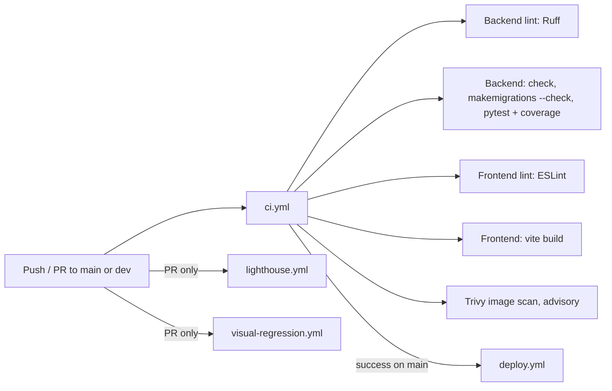

# Testing and CI

> How Lingaru is tested locally and in GitHub Actions: backend pytest suite and lint, frontend lint and build, Lighthouse, Playwright visual regression, Trivy image scan and Dependabot. Audience: anyone opening a PR.

**Code:** `backend/pytest.ini`, `backend/conftest.py`, `backend/config/settings/test.py`, `backend/pyproject.toml`, `frontend/playwright.config.js`, `frontend/lighthouserc.json`, `.github/workflows/`, `.github/dependabot.yml` · **Spec:** [specs/infrastructure.md](../specs/infrastructure.md)

## Overview



## Key concepts

| Term | Meaning |
|---|---|
| `config.settings.test` | Test settings: in-memory SQLite, MD5 password hasher, locmem cache, `DEBUG=True` |
| `testpaths = apps` | Default pytest collection root (see [Gotchas](#gotchas)) |
| Baselines | Committed Playwright screenshots in `frontend/e2e/__screenshots__/` |
| Advisory job | Runs and reports but never fails the pipeline (Trivy, Lighthouse) |

## How it works

### Backend tests

`backend/pytest.ini`:

| Setting | Value |
|---|---|
| `DJANGO_SETTINGS_MODULE` | `config.settings.test` |
| `python_files` | `tests.py test_*.py *_tests.py` |
| `testpaths` | `apps` |
| `addopts` | `-v --tb=short -p no:locust -p no:relaxed` |

Layout: each app has `apps/<app>/tests/` (or `tests.py` for `dictionary`). Service-layer tests live in `services/{llm,memory,rag,stt,tts}/tests/`.

Shared fixtures in `backend/conftest.py`:

| Fixture | Returns |
|---|---|
| `user_data` | dict with username, email, password |
| `create_user` | a saved `User` |
| `api_client` | `rest_framework.test.APIClient` |
| `authenticated_client` | `api_client` with `force_authenticate(create_user)` |

Plugins in `requirements.txt`: `pytest-django`, `pytest-cov`, `pytest-asyncio` (bot handlers), `factory-boy`.

### Run locally

```bash
cd backend
python -m venv .venv && source .venv/bin/activate
pip install -r requirements.txt

pytest                                # apps/ only (testpaths)
pytest services                       # service-layer tests (explicit path)
pytest apps services --cov=apps --cov=services --cov-report=term
pytest apps/assistant -k blocks       # one area

ruff check . && ruff format --check .  # same as CI lint
python manage.py makemigrations --check --dry-run
```

Frontend:

```bash
cd frontend
npm ci --legacy-peer-deps
npm run lint
npm run build
npm run test:visual                   # needs a build first; boots vite preview on :4173
npm run test:visual:update            # accept new baselines after an intentional UI change
```

### External APIs in tests

Tests must not call live Gemini, Groq, gTTS or Telegram. Mock at the provider boundary: `services.llm.factory.create_llm_router`, `services.stt.groq_whisper.GroqWhisperProvider`, `services.tts.service.get_or_create_audio`. Settings read keys with python-decouple, which looks for a `.env` file in parent directories. A developer's repo-root `.env` with real keys is therefore visible to a local test run, while CI has none. A test that passes locally but needs network will fail in CI, and a missing mock can spend real quota locally.

Celery: `config.settings.test` does not enable eager mode. Code paths that call `.delay()` / `apply_async()` should be patched, or the test should call the task function directly.

### CI workflows

| Workflow | Trigger | Jobs | Blocking |
|---|---|---|---|
| `ci.yml` (CI) | push and PR to `main`, `dev`; `concurrency` cancels superseded runs | `backend-lint`: Ruff check and format check (Python 3.12) | yes |
| | | `backend`: `pip install -r requirements.txt`, `manage.py check`, `makemigrations --check --dry-run`, `pytest --cov=apps --cov=services`, PR coverage comment (`MishaKav/pytest-coverage-comment`) | yes |
| | | `frontend-lint`: `npm ci --legacy-peer-deps`, `npm run lint` (Node 20) | yes |
| | | `frontend`: `npm ci`, `npm run build` | yes |
| | | `security-scan`: build backend image, Trivy scan for CRITICAL/HIGH with known fixes, table output | no (`exit-code: 0`) |
| `lighthouse.yml` | PR to `main`, `dev`; manual | build, `lhci autorun` on `/login`, `/register` (desktop preset); scores written to the step summary | no (`\|\| true`) |
| `visual-regression.yml` | PR to `main`, `dev`; manual | install Chromium, build, `npm run test:visual`; uploads `playwright-report/` on failure (14 days) | yes, for the PR check |
| `deploy.yml` | `CI` completed on `main`; manual | SSH deploy, see [Deployment and Operations](Deployment-and-Operations.md) | n/a |

CI env for the backend job: `DJANGO_SETTINGS_MODULE=config.settings.test`, a dummy `DJANGO_SECRET_KEY`, `DEBUG=True`.

### Lighthouse

`frontend/lighthouserc.json` serves `./dist` statically and audits `http://localhost/login` and `/register` once each.

| Category | Threshold | Level |
|---|---|---|
| Performance | 0.70 | warn |
| Accessibility | 0.85 | error |
| Best practices | 0.80 | warn |
| SEO | 0.80 | warn |

Reports upload to Lighthouse `temporary-public-storage`.

### Visual regression

`frontend/playwright.config.js`: Chromium only, 1280x800, `en-US`, UTC, light scheme, 1 worker, no retries, `maxDiffPixelRatio: 0.02`. `webServer` runs `npm run preview -- --port 4173`. `frontend/e2e/visual.spec.js` covers the unauthenticated `login` and `register` pages. Authenticated pages are not covered, because they would need a mocked or running backend.

Screenshots are platform-sensitive. If you regenerate baselines on macOS they may differ from CI (Ubuntu); regenerate in CI or in a Linux container when diffs are only font rendering.

### Trivy

The `security-scan` job builds `backend/Dockerfile` as `lingaru-backend:scan` and scans the image (OS packages and Python deps), filtered to `CRITICAL,HIGH` with `ignore-unfixed: true`. Findings appear in the job log only; the SARIF upload is disabled.

### Dependabot

`.github/dependabot.yml`:

| Ecosystem | Directory | Schedule | Groups |
|---|---|---|---|
| pip | `/backend` | weekly, Monday, max 5 PRs | `django` (Django, django-*, djangorestframework*), `llm` (google-genai, groq, sentry-sdk*) |
| npm | `/frontend` | weekly, Monday, max 5 PRs | `react`, `sentry` (`@sentry/*`), `eslint` |
| github-actions | `/` | monthly | none |
| docker | `/backend` | monthly | none |

### Lint config

- Ruff (`backend/pyproject.toml`): target py312, line length 100, rules `E F I B W`, ignores `E501 B008 B904`, per-file ignores for tests, settings, management commands and views. Migrations are excluded.
- ESLint 9 flat config (`frontend/eslint.config.js`) with react, react-hooks and react-refresh plugins.

## Working on it

- New app: put tests in `apps/<app>/tests/test_*.py`. Use the `authenticated_client` fixture for API tests.
- New service module: put tests under `services/<svc>/tests/`, and run them with `pytest services` (see Gotchas).
- Changed a model: commit the migration, or the `makemigrations --check` step fails.
- Intentional UI change on `/login` or `/register`: update the baselines in the same PR.
- PR from a branch: coverage is posted as a PR comment by the `backend` job.

## Gotchas

- `testpaths = apps` means a bare `pytest` (which is how CI invokes it) collects `apps/` only. The `services/*/tests` suites are not run in CI even though `--cov=services` is passed. Run `pytest apps services` to include them.
- Tests use SQLite while production uses PostgreSQL 16. Postgres-specific behaviour (JSON lookups, constraints, ordering) is not exercised in CI.
- `npm ci --legacy-peer-deps` is required in CI; the nginx image build uses `npm ci --no-audit --no-fund`.

## Known gaps

- Service-layer tests (`services/`) are outside `testpaths` and therefore not executed by CI.
- No Postgres service in CI; tests run on SQLite.
- Trivy and Lighthouse are advisory and never fail a build.
- No dependency audit step (`pip-audit` / `npm audit`) in CI.
- Visual regression covers only two public pages.
- No end-to-end tests against a running backend.
- Dependabot's docker ecosystem watches `/backend` only; `nginx/Dockerfile` and compose images get no update PRs.
- GitHub Actions are pinned by tag rather than commit SHA, and the Trivy action tracks a branch.
- The README describes CI steps (filesystem Trivy scan, Playwright e2e in CI) that differ from the workflows above.
