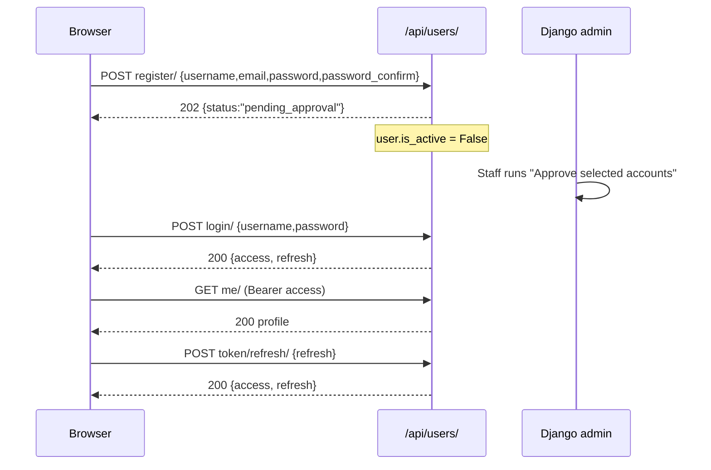

# Users and Auth

> The custom `User` model, registration with admin approval, JWT login, and the profile settings (target language, mode, levels, UI language) that the rest of Lingaru reads on every request.

**Code:** `backend/apps/users/` · **Spec:** [specs/users-auth.md](../specs/users-auth.md)

## Overview

New accounts are created inactive. A staff member approves them in Django admin, and only then can they log in. Superusers created with `createsuperuser` are active immediately.

## Key concepts

| Term | Meaning |
|------|---------|
| `target_language` | The language being learned (`fr` or `en`). Every content query filters on it. |
| `native_language` | Free-text code of the language the learner thinks in (default `en`). |
| `ui_language` | Language of the app chrome (`en`/`fr`). `null` means "detect from the browser". |
| `mode` | Audience persona: `general`, `exam` (TCF/TEF), `agentic` (assistant first). `null` means not onboarded yet; the frontend shows a picker. |
| `target_level` | CEFR level the learner wants to reach (A1-C2, default B2). |
| `proficiency_level` | Self-reported current CEFR level, or `unsure`. |
| Pending approval | `is_active=False` after sign-up until a staff member activates the account. |

## How it works

### Registration (`RegisterView`, `RegisterSerializer`)

1. `POST /api/users/register/` validates `username`, `email` (unique), `password` (min 8 chars) and `password_confirm` (must match).
2. `create_user()` stores the hashed password, then sets `is_active=False`.
3. Responds `202 Accepted` with `{status: "pending_approval", detail, username, email}`. No tokens are issued.

### Login (`ApprovalAwareTokenObtainPairView`)

A thin subclass of SimpleJWT's `TokenObtainPairView`. Before delegating to SimpleJWT, it looks the user up; if the account exists, is inactive, and the password is correct, it returns `401` with a friendly "awaiting admin approval" `detail` (DRF error code `pending_approval`). Every other case falls through to the standard SimpleJWT behaviour (`200 {access, refresh}` or `401`).

### Token refresh

`POST /api/users/token/refresh/` is SimpleJWT's `TokenRefreshView`. With `ROTATE_REFRESH_TOKENS=True` the response carries a new `refresh` as well as a new `access`. The frontend Axios client refreshes on `401`.

### Profile (`MeView`)

`GET /api/users/me/` returns the current user via `UserSerializer`. `PATCH` updates profile fields; the frontend uses it for onboarding (mode, levels), settings, and switching `target_language`. Changing `target_language` instantly changes what every content endpoint returns; per-user progress rows (SRS cards, completions, mistakes) are kept.

### Change password (`ChangePasswordView`)

`PUT` or `PATCH /api/users/change-password/` with `{old_password, new_password}`. Checks the old password, requires the new one to be at least 8 characters, saves, returns `{detail}`.

### Admin (`apps/users/admin.py`)

`UserAdmin` extends Django's `UserAdmin`:
- Lists inactive (pending) accounts first, then newest.
- Bulk actions **Approve selected accounts** (`is_active=True`) and **Suspend selected accounts** (`is_active=False`, never the acting admin).
- Filters on `is_active`, `is_staff`, `target_language`, `target_level`.

### Telegram linkage

`telegram_id` holds the learner's Telegram user id. The bot (`apps/bot/handlers/start.py`) looks users up by this field on `/start`. See [Telegram Bot](Telegram-Bot.md).

## Data model

| Model | Purpose | Key fields |
|-------|---------|------------|
| `User` (`users` table, extends `AbstractUser`) | Account + learner profile | `username`, `email` (unique), `is_active`, `telegram_id` (unique, nullable), `native_language`, `target_language`, `target_level`, `proficiency_level`, `daily_goal_minutes`, `mode`, `ui_language`, `preferences` (JSON) |

`LANGUAGE_CHOICES` (`fr`, `en`) live in `apps/users/constants.py`, not in `models.py`, so other apps and their migrations can import them without a model import cycle. Every content model's `language` field uses them.

## Configuration

| Setting | Effect |
|---------|--------|
| `AUTH_USER_MODEL = "users.User"` | Custom user model (`config/settings/base.py`). |
| `SIMPLE_JWT` | Access 60 min, refresh 7 days, rotation on. `local.py` uses 7 d / 30 d. |
| `DEFAULT_PERMISSION_CLASSES` | `IsAuthenticated`; register, login and refresh are public. |

See [Configuration and Settings](Configuration-and-Settings.md).

## Working on it

- **Create a usable account locally:** `python manage.py createsuperuser` (active immediately), or register through the UI and approve it in `/admin/users/user/`.
- **Tests:** `pytest apps/users` (models, serializers, views, target-language behaviour, the `0005` backfill migration).
- **Adding a profile field:** add it to `User`, `makemigrations`, add it to `UserSerializer.fields` (and to `read_only_fields` if the client should not set it), and to the `UserAdmin` fieldsets.
- **Adding a target language:** extend `LANGUAGE_CHOICES` in `apps/users/constants.py`; every content model picks it up. Content, prompts and seeds then need the new language.
- **Gotcha:** the register endpoint returns `202`, not `201`, and no tokens. The frontend shows a "pending approval" screen.

## Known gaps

- `UserAdmin` fieldsets do not expose `target_language`, `mode`, `proficiency_level`, `ui_language` or `preferences`.
- `LEVEL_CHOICES` and `PROFICIENCY_CHOICES` duplicate the A1-C2 list.
- The `ui_language` help text still says the learned language is "always French", which predates `target_language`.
- The README lists change-password as `POST`; the view accepts `PUT`/`PATCH` only.
- `ChangePasswordView` returns its error as a bare string (`{"old_password": "Wrong password."}`) rather than DRF's list form.
